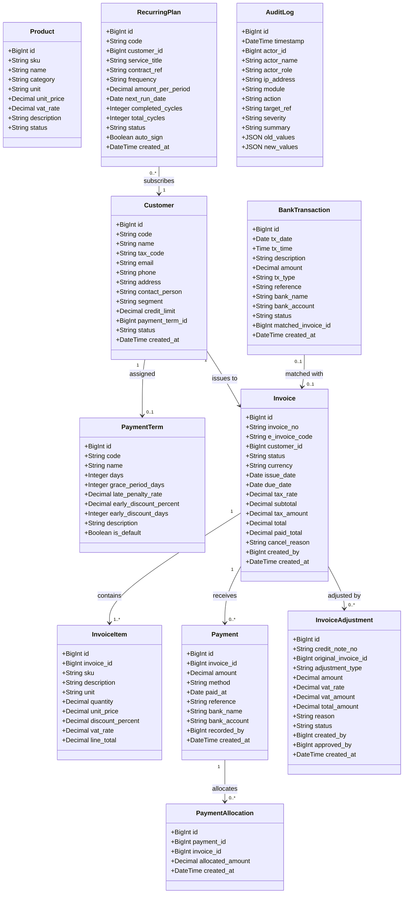

# BILLING_ONE EXTENDED — MÔ HÌNH MIỀN NGHIỆP VỤ (DOMAIN MODEL)

> **Tài liệu chuẩn hóa thực thể, quy tắc bất biến và vòng đời tài chính**  
> **Nguyên tắc:** Tính toàn vẹn số liệu là tối thượng. Nghiệp vụ phản ánh chuẩn kế toán và quy định pháp luật Việt Nam (Nghị định 123/2020/NĐ-CP, Thông tư 78/2021/TT-BTC, Thông tư 48/2019/TT-BTC).

---

## 1. DANH MỤC THỰC THỂ CỐT LÕI (CORE ENTITIES & VALUE OBJECTS)



---

## 2. VÒNG ĐỜI VÀ MÁY TRẠNG THÁI (STATE MACHINES & LIFECYCLES)

### 2.1. Vòng đời Hóa đơn (Invoice State Transition)

```text
       ┌───────────┐
       │   DRAFT   │ ◄─── Có thể chỉnh sửa dòng hàng, khách hàng, hạn thanh toán
       └─────┬─────┘
             │
      [Hành động: Phát hành (Issue)] ──> Kiểm tra có item, tổng tiền > 0, due_date >= issue_date
             │                           Cấp số hóa đơn chính thức (INV-YYYY-XXXXXX)
             ▼
       ┌───────────┐
       │  ISSUED   │ ◄─── BẤT BIẾN: Không thể sửa dòng hàng hay giá tiền trực tiếp
       └─────┬─────┘
             │
   ┌─────────┴───────────────────────┬────────────────────────┐
   │                                 │                        │
[Thanh toán một phần]         [Thanh toán toàn bộ]       [Hủy hóa đơn]
   │                                 │                        │
   ▼                                 ▼                        │ (Chỉ khi chưa có thanh toán)
┌─────────────────┐           ┌─────────────┐                 ▼
│ PARTIALLY_PAID  │           │    PAID     │          ┌─────────────┐
└────────┬────────┘           └─────────────┘          │  CANCELLED  │
         │                           ▲                 └─────────────┘
         └─[Thanh toán nốt phần dư]──┘
```

**Các quy tắc bất biến của Hóa đơn (Invariants):**
- $total = subtotal + tax\_amount$
- $paid\_total \le total$ (Ngoại trừ trường hợp điều chỉnh giảm công nợ đã được phê duyệt)
- $outstanding = total - paid\_total$
- Khi $paid\_total = total$, trạng thái tự động chuyển sang `PAID`.
- Khi $0 < paid\_total < total$, trạng thái là `PARTIALLY_PAID`.
- Hóa đơn chỉ được `CANCELLED` khi $paid\_total = 0$ và có bắt buộc phải nhập `cancel_reason`.
- Khi đã có thanh toán ghi nhận ($paid\_total > 0$), việc giảm trừ công nợ bắt buộc phải đi qua **Biên bản Điều chỉnh (Credit Note / Adjustment)**.

---

### 2.2. Vòng đời Biên bản Điều chỉnh & Giảm trừ (Credit Note Lifecycle)

```text
       ┌───────────┐
       │   DRAFT   │ ◄─── Dự thảo biên bản giảm trừ / hoàn tiền
       └─────┬─────┘
             │
     [Hành động: Phê duyệt (Approve)] ──> Yêu cầu quyền quản lý (Admin / Billing Manager)
             │
             ▼
       ┌───────────┐
       │ APPROVED  │ ◄─── Đã phê duyệt nội bộ, sẵn sàng áp dụng
       └─────┬─────┘
             │
     [Hành động: Áp dụng vào Sổ cái (Process)]
             │
             ▼
       ┌───────────┐
       │ PROCESSED │ ◄─── Đã cấn trừ vào công nợ hóa đơn gốc hoặc thực hiện hoàn tiền
       └───────────┘
```

---

### 2.3. Vòng đời Kế hoạch Định kỳ (Recurring Plan Lifecycle)

```text
   ┌───────────┐      Tạm hoãn       ┌───────────┐
   │  ACTIVE   │ ─────────────────> │  PAUSED   │
   └─────┬─────┘ <───────────────── └───────────┘
         │            Kích hoạt lại
   [Scheduler / API Run]
         │
         ├──> Thành công: Sinh hóa đơn DRAFT/ISSUED -> completed_cycles++ -> tính next_run_date
         │    Nếu completed_cycles >= total_cycles ──> Chuyển trạng thái [ COMPLETED ]
         │
         └──> Thất bại (Lỗi dữ liệu / hạn mức) ───────> Chuyển trạng thái [ FAILED ]
```

---

## 3. ĐỊNH NGHĨA CÔNG THỨC & CÁC CHỈ SỐ TÀI CHÍNH (FINANCIAL METRICS & FORMULAS)

Mọi chỉ số tài chính trên giao diện và báo cáo đều tuân thủ định nghĩa chuẩn mực toán học sau:

### 3.1. Phân nhóm Tuổi nợ (Aging Buckets)
Xét tại thời điểm báo cáo $T_{now}$ đối với mọi hóa đơn $i$ thỏa mãn:
$$status_i \in \{\text{'ISSUED'}, \text{'PARTIALLY\_PAID'}\} \quad \text{và} \quad remaining_i = (total_i - paid\_total_i) > 0$$

Số ngày quá hạn (Days Overdue):
$$D_{diff} = T_{now} - due\_date_i$$

Phân loại vào 5 nhóm tuổi nợ:
1. **Hiện tại (Current - Chưa quá hạn):** $D_{diff} \le 0$
2. **Quá hạn 1 – 30 ngày:** $1 \le D_{diff} \le 30$
3. **Quá hạn 31 – 60 ngày:** $31 \le D_{diff} \le 60$
4. **Quá hạn 61 – 90 ngày:** $61 \le D_{diff} \le 90$
5. **Quá hạn trên 90 ngày (Nợ khó đòi / High Risk):** $D_{diff} > 90$

---

### 3.2. Số ngày Thu hồi Tiền Bình quân (Days Sales Outstanding - DSO)
Đo lường thời gian trung bình doanh nghiệp thu hồi được tiền bán hàng sau khi phát hành hóa đơn trong một chu kỳ quan sát (ví dụ $N = 90$ ngày hoặc $N = 365$ ngày):

$$DSO = \left( \frac{\text{Tổng công nợ phải thu cuối kỳ (Receivables)}}{\text{Tổng doanh thu bán hàng trong kỳ (Total Credit Sales)}} \right) \times N$$

- *Chuẩn đánh giá:* DSO $\le 45$ ngày là lành mạnh đối với doanh nghiệp B2B công nghệ / viễn thông.

---

### 3.3. Tỷ lệ Hiệu quả Thu hồi Công nợ (Collection Effectiveness Index - CEI)
Đo lường năng lực của bộ phận tài chính trong việc thu hồi các khoản nợ có thể thu được trong kỳ:

$$CEI = \left( \frac{\text{Số tiền thực thu trong kỳ}}{\text{Nợ đầu kỳ} + \text{Doanh thu mới phát sinh trong kỳ} - \text{Nợ chưa đến hạn cuối kỳ}} \right) \times 100\%$$

---

### 3.4. Doanh thu Định kỳ Hàng tháng & Hàng năm (MRR / ARR)
Dựa trên các hợp đồng thuê bao định kỳ đang hoạt động (`status = 'ACTIVE'`):
- Với hợp đồng tính theo tháng: $MRR_k = amount_k$
- Với hợp đồng tính theo quý: $MRR_k = \frac{amount_k}{3}$
- Với hợp đồng tính theo năm: $MRR_k = \frac{amount_k}{12}$

$$MRR_{total} = \sum_{k \in ACTIVE} MRR_k$$
$$ARR_{total} = MRR_{total} \times 12$$

---

### 3.5. Xử lý Thuế GTGT theo Mẫu 01-1/GTGT
Doanh thu thuần chưa thuế ($Net$) và Tiền thuế ($VAT$) được tổng hợp theo 5 nhóm thuế suất:
1. **Thuế suất 10%:** Áp dụng cho hạ tầng số, viễn thông, bản quyền thông thường.
2. **Thuế suất 8%:** Áp dụng cho các dịch vụ theo chính sách giảm thuế Nghị định 72/2024/NĐ-CP.
3. **Thuế suất 5%:** Áp dụng cho thiết bị, dịch vụ đặc thù.
4. **Thuế suất 0%:** Áp dụng cho dịch vụ xuất khẩu / cung cấp ngoài lãnh thổ.
5. **Không chịu thuế (KCT):** Chuyển giao công nghệ, phần mềm thuộc diện ưu đãi.

$$Total\_Net = \sum Net_{10\%} + \sum Net_{8\%} + \sum Net_{5\%} + \sum Net_{0\%} + \sum Net_{KCT}$$
$$Total\_VAT = \sum VAT_{10\%} + \sum VAT_{8\%} + \sum VAT_{5\%}$$

---

## 4. MA TRẬN PHÂN QUYỀN RBAC & QUY TẮC AN TOÀN TRUY CẬP

| Role Code | Tên Vai trò | Mô tả phạm vi quyền hạn | Quyền cốt lõi (Core Permissions) |
|---|---|---|---|
| `ROLE_SYS_ADMIN` | Quản trị Hệ thống | Toàn quyền cấu hình máy chủ, phân quyền, người dùng, xem toàn bộ dữ liệu | `*` (All permissions) |
| `ROLE_BILLING_MANAGER` | Quản lý Hóa đơn & Thu phí | Quản lý vòng đời hóa đơn, duyệt hủy, duyệt điều chỉnh Credit Note, xem KPI | `invoice.*`, `customer.*`, `payment.*`, `adjustment.approve`, `report.view`, `recurring.*`, `reconciliation.*` |
| `ROLE_ACCOUNTANT` | Kế toán viên | Ghi nhận thanh toán, đối soát ngân hàng, lập báo cáo công nợ & tuổi nợ | `invoice.read`, `invoice.create`, `payment.*`, `reconciliation.*`, `report.view`, `adjustment.create` |
| `ROLE_BILLING_STAFF` | Nhân viên Billing | Tạo dự thảo hóa đơn nháp, tra cứu khách hàng, gửi email thông báo | `customer.read`, `customer.create`, `invoice.read`, `invoice.create`, `invoice.edit_draft` |
| `ROLE_AUDITOR` | Kiểm toán viên | Chỉ xem (Read-only) toàn bộ hóa đơn, đối chiếu số dư, xem nhật ký kiểm toán | `*.read`, `audit.view`, `report.view` |

Mọi thao tác sửa đổi hoặc phát sinh tài chính đều được ghi vết tự động vào `audit_logs` với đầy đủ định danh người thực hiện, địa chỉ IP và mã băm kiểm tra tính toàn vẹn dữ liệu.
