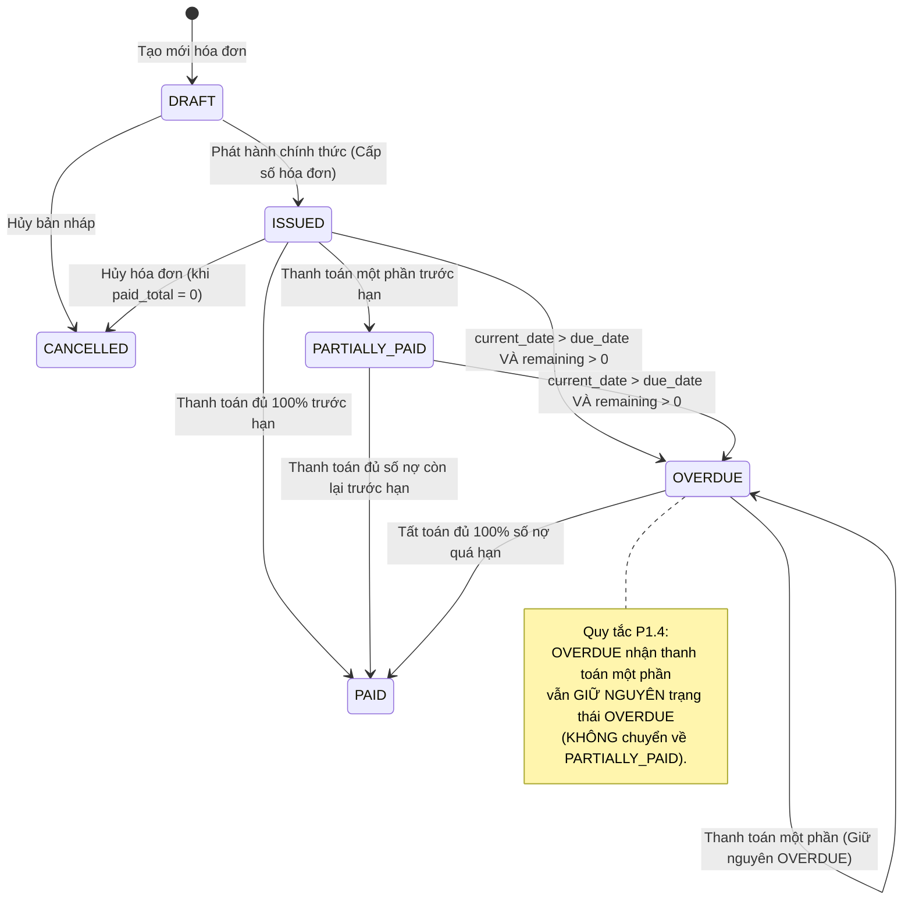

# BILLING_ONE — P1.4 OFFICIAL SPECIFICATION
## AUTOMATED OVERDUE INVOICE LIFECYCLE ENGINE
## PRODUCT OWNER APPROVED & SCOPE FROZEN SPECIFICATION

**Document Version:** 1.0.2 (FINAL FROZEN — FINAL CONSISTENCY RECONCILIATION)  
**Approval Authority:** Product Owner & Senior Technical Architecture Lead  
**Approved Date:** October 07, 2026  
**Target Milestone:** P1.4 Implementation  
**Baseline Git State:** Commit `d794de0461e992122a4c8eddadb1ead2082ae8ac` + P1.3 Working Baseline (`P1.3 OFFICIALLY CLOSED — VERIFIED`)  
**Operational Status:** SCOPE FROZEN — SPECIFICATION SIGNED OFF (FINAL CONSISTENCY VERIFIED) — READY FOR IMPLEMENTATION  
**Operational Mode:** SPECIFICATION ONLY — Zero Code Modifications, Zero Migrations, Zero Schema Changes, Zero Test Execution  

---

## TABLE OF CONTENTS
- [1. Document Control](#1-document-control)
- [2. Product Owner Decision](#2-product-owner-decision)
- [3. Scope Statement](#3-scope-statement)
- [4. Business Objective](#4-business-objective)
- [5. In Scope](#5-in-scope)
- [6. Deferred Scope](#6-deferred-scope)
- [7. Out of Scope](#7-out-of-scope)
- [8. Current Baseline](#8-current-baseline)
- [9. Official Overdue Definition](#9-official-overdue-definition)
- [10. Invoice State Machine](#10-invoice-state-machine)
- [11. Payment Interaction Rules](#11-payment-interaction-rules)
- [12. Database Requirements](#12-database-requirements)
- [13. Service / Domain Requirements](#13-service--domain-requirements)
- [14. Scheduler Requirements](#14-scheduler-requirements)
- [15. Audit Requirements](#15-audit-requirements)
- [16. API Requirements](#16-api-requirements)
- [17. Reporting Requirements](#17-reporting-requirements)
- [18. Customer Impact](#18-customer-impact)
- [19. Frontend Requirements](#19-frontend-requirements)
- [20. RBAC / Security](#20-rbac--security)
- [21. Concurrency / Idempotency](#21-concurrency--idempotency)
- [22. Financial Invariants](#22-financial-invariants)
- [23. Testing Strategy](#23-testing-strategy)
- [24. Acceptance Criteria](#24-acceptance-criteria)
- [25. Non-Goals](#25-non-goals)
- [26. Risks](#26-risks)
- [27. Future Extension Boundaries](#27-future-extension-boundaries)
- [28. Traceability to P1.4 Discovery](#28-traceability-to-p14-discovery)
- [29. Final Scope Freeze Statement](#29-final-scope-freeze-statement)

---

## 1. DOCUMENT CONTROL

| Thông tin Kiểm soát | Giá trị Chính thức |
|---|---|
| **Dự án** | Billing_One Financial Engine |
| **Mốc phát triển** | Milestone P1.4 |
| **Tên tài liệu** | `BILLING_ONE_P1_4_OFFICIAL_SPEC.md` |
| **Phiên bản tài liệu** | `1.0.2 (FINAL FROZEN — FINAL CONSISTENCY RECONCILIATION)` |
| **Thẩm quyền phê duyệt** | Product Owner (PO) |
| **Trưởng nhóm kỹ thuật** | Senior Product Architect + Financial Systems Analyst + Technical Lead |
| **Ngày phê duyệt Consistency** | 07/10/2026 |
| **Tình trạng Mốc tiền nhiệm** | `P1.3 OFFICIALLY CLOSED — VERIFIED` (Hợp nhất theo Migration 06) |
| **Tài liệu căn cứ (Source of Truth)** | [BILLING_ONE_P1_4_PRE_IMPLEMENTATION_DISCOVERY.md](file:///c:/Users/phamt/OneDrive/Desktop/Billing_One/docs/BILLING_ONE_P1_4_PRE_IMPLEMENTATION_DISCOVERY.md)<br>[BILLING_ONE_P1_4_IMPLEMENTATION_PREFLIGHT.md](file:///c:/Users/phamt/OneDrive/Desktop/Billing_One/docs/BILLING_ONE_P1_4_IMPLEMENTATION_PREFLIGHT.md)<br>[BILLING_ONE_P1_3_FINAL_CLOSURE.md](file:///c:/Users/phamt/OneDrive/Desktop/Billing_One/docs/BILLING_ONE_P1_3_FINAL_CLOSURE.md)<br>[BILLING_ONE_P1_3_1_RE_AUDIT.md](file:///c:/Users/phamt/OneDrive/Desktop/Billing_One/docs/BILLING_ONE_P1_3_1_RE_AUDIT.md)<br>[BILLING_ONE_FEATURE_ROADMAP.md](file:///c:/Users/phamt/OneDrive/Desktop/Billing_One/docs/BILLING_ONE_FEATURE_ROADMAP.md)<br>[FUTURE_SYSTEM_EVOLUTION_PROPOSAL.md](file:///c:/Users/phamt/OneDrive/Desktop/Billing_One/docs/FUTURE_SYSTEM_EVOLUTION_PROPOSAL.md) |
| **Ghi chú Phiên bản 1.0.2** | Đối soát nhất quán kỹ thuật lần cuối trước khi triển khai: Chuẩn hóa 9 chỉ số forensic invariant theo đúng chứng cứ kiểm toán P1.3.1; thống nhất chỉ mục quét nợ (due_date); phân định rõ ngữ nghĩa SQL báo cáo Doanh thu (Không đổi) và Thuế GTGT (Phải cập nhật). Phạm vi nghiệp vụ giữ nguyên 100% ĐÓNG BĂNG (Chỉ Candidate A). Các quyết định của Product Owner không thay đổi. Tuyệt đối không thay đổi mã nguồn. |

---

## 2. PRODUCT OWNER DECISION

Product Owner đã chính thức đánh giá Báo cáo Khảo sát Tiền Triển khai [BILLING_ONE_P1_4_PRE_IMPLEMENTATION_DISCOVERY.md](file:///c:/Users/phamt/OneDrive/Desktop/Billing_One/docs/BILLING_ONE_P1_4_PRE_IMPLEMENTATION_DISCOVERY.md) và đưa ra quyết định đóng băng phạm vi (Scope Freeze Decision) như sau:

> **QUYẾT ĐỊNH CỦA PRODUCT OWNER:**  
> 1. **Chính thức lựa chọn duy nhất: CANDIDATE A — AUTOMATED OVERDUE INVOICE LIFECYCLE.**  
> 2. Mục tiêu tối thượng của Giai đoạn P1.4 là thiết lập một **Vòng đời Hóa đơn Quá hạn (OVERDUE Invoice Lifecycle) chính thức, bền vững trong cơ sở dữ liệu, và có khả năng kiểm toán đầy đủ** cho hệ thống Billing_One.  
> 3. Đây là **PHẠM VI TRIỂN KHAI DUY NHẤT** của Milestone P1.4.  
> 4. Tất cả các ý niệm mở rộng khác (Nhắc nợ tự động, Khóa khách hàng tự động, Xóa nợ xấu, Hạ tầng thông báo) được phân loại rõ ràng thành **HOÃN LẠI (DEFERRED)** hoặc **NGOÀI PHẠM VI (OUT OF SCOPE)**.

---

## 3. SCOPE STATEMENT

Milestone P1.4 triển khai cơ chế tự động hóa vòng đời hóa đơn quá hạn trong Billing_One:
- Mở rộng ràng buộc kiểm tra trạng thái hóa đơn trong cơ sở dữ liệu để chính thức công nhận `'OVERDUE'`.
- Xây dựng tác vụ định kỳ nền `runOverdueScan()` trong scheduler hiện hành nhằm tự động quét và chuyển trạng thái các hóa đơn thỏa mãn điều kiện sang `OVERDUE`.
- Ghi nhận nhật ký kiểm toán bất biến chuỗi băm SHA-256 (`INVOICE_OVERDUE_FLAGGED`) cho mỗi chuyển dịch trạng thái quá hạn.
- Đảm bảo tính tương thích tuyệt đối của cỗ máy thanh toán: Hóa đơn `OVERDUE` vẫn phải được phép nhận thanh toán/phân bổ; khi tất toán đủ chuyển sang `PAID`, khi thanh toán một phần giữ nguyên trạng thái `OVERDUE`.
- Cập nhật toàn diện các câu lệnh tính toán công nợ và báo cáo trên toàn hệ thống để không bỏ sót các hóa đơn `OVERDUE`.
- Phản ánh chính xác trạng thái `OVERDUE` trên giao diện người dùng (danh sách, chi tiết, bộ lọc).

---

## 4. BUSINESS OBJECTIVE

1. **Chuẩn hóa Mô hình Trạng thái FSM (State Machine Determinism):**  
   Xóa bỏ tình trạng "trạng thái ảo" khi hóa đơn quá hạn thanh toán nhưng vẫn mang nhãn `ISSUED` hoặc `PARTIALLY_PAID` trong database. Thiết lập trạng thái `OVERDUE` bền vững giúp các hệ thống nghiệp vụ xác định chính xác danh mục rủi ro tức thời.
2. **Minh bạch hóa Kiểm toán Quản trị Nợ (Auditability & Traceability):**  
   Mọi hóa đơn bị quá hạn đều được hệ thống gắn nhãn tự động kèm sự kiện kiểm toán bất biến, ghi nhận rõ thời điểm bị quá hạn, số ngày trễ hạn, và dư nợ quá hạn mà không phụ thuộc vào thao tác thủ công của kế toán viên.
3. **Tối ưu Hóa Lọc Dữ liệu Vận hành (Operational Querying & Filtering):**  
   Lưu trữ bền vững trạng thái `OVERDUE` trong cơ sở dữ liệu giúp tối ưu hóa mạnh mẽ các thao tác truy vấn và bộ lọc vận hành (`WHERE status = 'OVERDUE'`) mà không cần quét toàn bảng hay lặp lại các điều kiện so sánh ngày phức tạp trong các truy vấn thường nhật. Lưu ý: Báo cáo Tuổi nợ (Aging Report) vẫn tiếp tục tính toán động số ngày trễ hạn (`CURRENT_DATE - due_date`) để phân loại hóa đơn vào các nhóm tuổi nợ cụ thể.
4. **Bảo toàn Dòng tiền Thu hồi (Continuous Debt Settling):**  
   Đảm bảo việc hóa đơn bị gắn mác `OVERDUE` không cản trở khách hàng trả tiền; dòng tiền phân bổ từ thanh toán trực tiếp hoặc tiền ký quỹ chưa phân bổ (Unapplied Cash - P1.3) tiếp tục chảy vào để tất toán hóa đơn quá hạn một cách thông suốt.

---

## 5. IN SCOPE

Toàn bộ các hạng mục bắt buộc triển khai trong P1.4 bao gồm:

1. **Database Schema:** Cập nhật check constraint của bảng `public.invoices` để bổ sung giá trị `'OVERDUE'`. Cập nhật ràng buộc `invoices_issued_have_number`. Thêm partial indices (`idx_invoices_overdue_scan` trên `due_date` và `idx_invoices_customer_overdue` trên `customer_id`) phục vụ quét nợ quá hạn và truy vấn theo khách hàng với hiệu năng cao.
2. **Invoice State Transitions:** 
   - `ISSUED` $\rightarrow$ `OVERDUE` (khi $current\_date > due\_date$ và $outstanding > 0$).
   - `PARTIALLY_PAID` $\rightarrow$ `OVERDUE` (khi $current\_date > due\_date$ và $outstanding > 0$).
   - `OVERDUE` $\rightarrow$ `PAID` (khi nhận thanh toán và dư nợ trở về đúng $0$).
   - `OVERDUE` $\rightarrow$ `OVERDUE` (khi nhận thanh toán một phần nhưng dư nợ vẫn $> 0$).
3. **Scheduler Job:** Triển khai hàm `runOverdueScan(pool)` trong `app/src/scheduler.js`, sử dụng PostgreSQL Advisory Lock độc lập (`OVERDUE_SCAN_LOCK_ID = 88812346`).
4. **Audit Logging:** Ghi sự kiện kiểm toán `INVOICE_OVERDUE_FLAGGED` vào `public.audit_logs` có đầy đủ SHA-256 hash chaining khi hóa đơn chuyển sang OVERDUE.
5. **Payment Engine Whitelist:** Cập nhật `PaymentService.js` (cả luồng `allocatePayment` và `autoSettleInvoiceFromUnapplied`) để chấp nhận hóa đơn có `status = 'OVERDUE'`.
6. **Repository-wide Query Update:** Rà soát và cập nhật toàn bộ các câu lệnh SQL công nợ và báo cáo (`customers.js`, `reports.js`, `invoices.js`) để bổ sung `'OVERDUE'` vào tập hợp trạng thái công nợ phải thu.
7. **API Filtering:** Cập nhật `GET /api/invoices` cho phép lọc theo `status=OVERDUE`.
8. **Frontend Representation:** Hiển thị nhãn/badge `OVERDUE` (màu đỏ) trực quan, bộ lọc danh sách hóa đơn theo trạng thái quá hạn, và thông tin công nợ quá hạn.
9. **Zero-Regression Assurance:** Bảo toàn 100% kết quả kiểm thử và bất biến tài chính từ P0 đến P1.3.

---

## 6. DEFERRED SCOPE

Các tính năng sau đây được Product Owner xác định là **HOÃN LẠI (DEFERRED)**, tuyệt đối **KHÔNG** triển khai trong P1.4, và chỉ được xem xét ở các mốc tiếp theo:

1. **Candidate B — Dunning Policy & Scheduled Internal Dunning Events:**
   - Bảng `dunning_policies` và cấu hình mốc nhắc nợ (3, 7, 15, 30 ngày).
   - Bảng `dunning_events` và lịch sử đôn đốc nợ nội bộ.
   - Tiến trình scheduler tự động quét dunning `runDunningCycle()`.
   - Các API `GET/POST /api/dunning/*`.
2. **Candidate C — Customer Risk Status Auto-Management:**
   - Tự động chuyển `customers.status` sang `WARNING` hoặc `LOCKED` dựa trên nợ quá hạn.
   - Tự động mở khóa khách hàng khi hoàn tất thanh toán.
   - Điểm chặn tự động từ chối phát hành hóa đơn khi khách hàng bị `LOCKED`.
   - Cơ chế Admin Override mở khóa khách hàng (`POST /api/customers/:id/override-status`).

---

## 7. OUT OF SCOPE

Các hạng mục sau đây bị loại trừ **TUYỆT ĐỐI (ABSOLUTE OUT OF SCOPE)** khỏi P1.4:

- **Hạ tầng Thông báo (Notification Infrastructure):**
  - Không tích hợp máy chủ SMTP hoặc thư viện gửi email (`nodemailer`...).
  - Không tích hợp SMS Gateway hoặc nhà cung cấp SMS bên thứ ba.
  - Không xây dựng dịch vụ phát Webhook ra bên ngoài.
  - Không tạo hàng đợi gửi tin (BullMQ, RabbitMQ...) hay mẫu thông báo (templates).
  - Không tạo mock/fake gửi tin thông báo dưới bất kỳ hình thức nào.
- **Xóa Nợ Xấu & Kế toán Nợ Khó Đòi (Debt Write-Off):**
  - Không bổ sung trạng thái `WRITTEN_OFF`.
  - Không tạo bảng xóa nợ hay sổ cái hạch toán chi phí nợ xấu.
  - Không xây dựng quy trình phê duyệt xóa nợ (Approval Workflow / Maker-Checker).
- **Thu hồi Nợ Chuyên sâu & Pháp lý (Debt Recovery):**
  - Không có hồ sơ vụ việc thu nợ (Collection Case Management).
  - Không giao việc cho nhân viên thu nợ hay đơn vị đòi nợ ngoài.
  - Không theo dõi cam kết thanh toán (Promise-to-Pay) hay tranh chấp (Dispute).
- **Cổng Thanh toán Khách hàng (Payment Portal):**
  - Không có cổng tự tra cứu và thanh toán nợ trực tuyến cho khách hàng.
  - Không tính lãi phạt trễ hạn tự động (Late payment interest).

---

## 8. CURRENT BASELINE

Hệ thống Billing_One tại điểm bắt đầu của P1.4 có các đặc tính kỹ thuật đã kiểm chứng:

```
+-----------------------------------------------------------------------------------+
|                           CURRENT VERIFIED BASELINE                               |
+-----------------------------------------------------------------------------------+
| Baseline Commit       | d794de0461e992122a4c8eddadb1ead2082ae8ac                  |
| Milestone Predecessor | P1.3 OFFICIALLY CLOSED — VERIFIED (Migration 06 Applied)  |
| Invariant Integrity   | 9/9 Invariants PASS (0 vi phạm)                           |
| Audit Hash Chain      | 100% toàn vẹn SHA-256 (2.603/2.603 bản ghi hợp lệ)        |
| Test Suites           | 12/12 suites PASS                                         |
| Invoices Statuses     | DRAFT, ISSUED, PARTIALLY_PAID, PAID, CANCELLED            |
| Customers Statuses    | ACTIVE, WARNING, LOCKED (Manual updates only)             |
| Scheduler Engine      | Running (advisory lock 88812345 for Recurring Billing)    |
| Payment Engine        | Payment Allocation V2 + FIFO Auto-Settlement Engine       |
+-----------------------------------------------------------------------------------+
```

---

## 9. OFFICIAL OVERDUE DEFINITION

Một hóa đơn tài chính chính thức trở thành **OVERDUE** khi và chỉ khi **TOÀN BỘ 3 ĐIỀU KIỆN SAU ĐÂY ĐỒNG THỜI THỎA MÃN**:

$$\text{is\_overdue} \iff \begin{cases} 
\text{status} \in \{\text{'ISSUED'}, \text{'PARTIALLY\_PAID'}\} \\
\text{outstanding\_amount} > 0 \quad (\text{với } \text{outstanding} = \text{total} - \text{paid\_total} - \text{adjusted\_total}) \\
\text{current\_date} > \text{due\_date} \quad (\text{nghiêm ngặt: } \text{due\_date} < \text{CURRENT\_DATE})
\end{cases}$$

### Quy định Chi tiết:
1. **Toán tử so sánh thời gian & Ngữ nghĩa Ngày tháng (PostgreSQL Date Semantics):**  
   - Cột `due_date` có kiểu dữ liệu là PostgreSQL `DATE` (không chứa thành phần giờ hoặc múi giờ).  
   - Cơ chế phát hiện nợ quá hạn sử dụng trực tiếp hàm `CURRENT_DATE` của PostgreSQL (`due_date < CURRENT_DATE`).  
   - Billing_One hiện tại phụ thuộc hoàn toàn vào ngữ nghĩa ngày tháng của PostgreSQL (PostgreSQL date semantics), không đưa vào bất kỳ phép tính toán ngày độc lập nào bằng Node.js trong P1.4.  
   - Sử dụng toán tử so sánh ngày nghiêm ngặt $\text{current\_date} > \text{due\_date}$. Nếu hôm nay đúng bằng ngày đến hạn ($\text{current\_date} = \text{due\_date}$), hóa đơn **CHƯA** bị quá hạn.  
   - *Lưu ý Kỹ thuật Triển khai:* Dự án hiện không có cấu hình múi giờ nghiệp vụ riêng (business timezone configuration); đây được ghi nhận là một lưu ý kỹ thuật khi triển khai, không phải là một tính năng mới của P1.4. Tuyệt đối không thêm cấu hình múi giờ mới trong P1.4.
2. **Thời gian ân hạn (Grace Period):**
   - **Grace period = 0 ngày (Chính thức theo quyết định của PO).**
   - Không áp dụng số ngày hoãn; không xây dựng cấu hình grace period động trong P1.4.
3. **Các trạng thái KHÔNG BAO GIỜ trở thành OVERDUE:**
   - Hóa đơn ở trạng thái `DRAFT` **tuyệt đối không bao giờ** chuyển sang `OVERDUE`.
   - Hóa đơn ở trạng thái `PAID` **tuyệt đối không bao giờ** chuyển sang `OVERDUE`.
   - Hóa đơn ở trạng thái `CANCELLED` **tuyệt đối không bao giờ** chuyển sang `OVERDUE`.
   - Hóa đơn có dư nợ bằng $0$ ($\text{outstanding} = 0$) **tuyệt đối không bao giờ** chuyển sang `OVERDUE`.

---

## 10. INVOICE STATE MACHINE

Bảng trạng thái FSM đầy đủ của hóa đơn sau khi hoàn thành Milestone P1.4:



### Bảng Ma trận Chuyển dịch Trạng thái Hợp lệ (Valid Transition Matrix):

| Trạng thái Hiện tại (From) | Trạng thái Đích (To) | Điều kiện Kích hoạt (Trigger Condition) | Hành vi / Quy tắc |
|---|---|---|---|
| `DRAFT` | `ISSUED` | Người dùng gọi `POST /api/invoices/:id/issue` | Gán `invoice_no`, lưu `issue_date` |
| `DRAFT` | `CANCELLED` | Người dùng gọi `POST /api/invoices/:id/cancel` | Ghi nhận `cancel_reason` |
| `ISSUED` | `PARTIALLY_PAID` | Nhận phân bổ thanh toán với $0 < \text{paid\_total} < \text{total}$ (trước hạn) | Cập nhật `paid_total` |
| `ISSUED` | `PAID` | Nhận phân bổ thanh toán với $\text{paid\_total} + \text{adjusted\_total} = \text{total}$ | Tất toán toàn bộ |
| `ISSUED` | `CANCELLED` | Hủy hóa đơn khi $\text{paid\_total} = 0$ | Ghi nhận `cancel_reason` |
| **`ISSUED`** | **`OVERDUE`** | **Scheduler `runOverdueScan()` quét thấy $current\_date > due\_date$ & $outstanding > 0$** | **Ghi audit `INVOICE_OVERDUE_FLAGGED`** |
| **`PARTIALLY_PAID`** | **`OVERDUE`** | **Scheduler `runOverdueScan()` quét thấy $current\_date > due\_date$ & $outstanding > 0$** | **Ghi audit `INVOICE_OVERDUE_FLAGGED`** |
| **`OVERDUE`** | **`PAID`** | **Nhận phân bổ thanh toán với $outstanding$ trở về đúng $0$** | **Tất toán nợ quá hạn** |
| **`OVERDUE`** | **`OVERDUE`** | **Nhận phân bổ thanh toán một phần ($outstanding$ vẫn $> 0$)** | **Giữ nguyên trạng thái OVERDUE** |

---

## 11. PAYMENT INTERACTION RULES

Quy tắc xử lý thanh toán đối với hóa đơn `OVERDUE` là quyết định bắt buộc từ Product Owner và phải được thực hiện nhất quán:

```
                                    ┌────────────────────────┐
                                    │     INVOICE OVERDUE    │
                                    │ (outstanding_amount > 0)│
                                    └───────────┬────────────┘
                                                │
                                    ┌───────────┴────────────┐
                                    │ Nhận Phân bổ Thanh toán│
                                    │   (allocatePayment /   │
                                    │  autoSettleUnapplied)  │
                                    └───────────┬────────────┘
                                                │
                       ┌────────────────────────┴────────────────────────┐
                       ▼                                                 ▼
        [Dư nợ còn lại == 0]                              [Dư nợ còn lại > 0]
 (paid_total + adjusted_total == total)            (paid_total + adjusted_total < total)
                       │                                                 │
                       ▼                                                 ▼
             ┌───────────────────┐                             ┌───────────────────┐
             │   Chuyển sang     │                             │    GIỮ NGUYÊN     │
             │      PAID         │                             │     OVERDUE       │
             └───────────────────┘                             └───────────────────┘
```

### Chi tiết Thực hiện:
1. **Khi tất toán đủ (Full Settlement):**
   Nếu khoản thanh toán mới làm cho $\text{paid\_total} + \text{adjusted\_total} \ge \text{total}$, hóa đơn chuyển từ `OVERDUE` $\rightarrow$ `PAID`.
2. **Khi thanh toán một phần (Partial Settlement):**
   Nếu sau khi nhận tiền mà số dư nợ còn lại vẫn $> 0$, hóa đơn **GIỮ NGUYÊN TRẠNG THÁI `OVERDUE`**.
   - **TUYỆT ĐỐI KHÔNG CHUYỂN:** `OVERDUE` $\rightarrow$ `PARTIALLY_PAID`.
   - **Lý do nghiệp vụ:** Khi hóa đơn đã quá ngày đến hạn thanh toán, bất kỳ số nợ nào còn sót lại đều mang bản chất là nợ quá hạn. Việc chuyển về `PARTIALLY_PAID` sẽ làm sai lệch bản chất rủi ro và làm ẩn hóa đơn khỏi các báo cáo nợ xấu.

---

## 12. DATABASE REQUIREMENTS

Tài liệu này xác định các yêu cầu cơ sở dữ liệu chi tiết cho việc lập Migration 07 trong giai đoạn triển khai:

### 1. Thay đổi Check Constraint Trạng thái trên bảng `public.invoices`:
Thay thế ràng buộc trạng thái cũ:
```sql
-- Hiện tại: CHECK (status IN ('DRAFT', 'ISSUED', 'PARTIALLY_PAID', 'PAID', 'CANCELLED'))
-- Mục tiêu P1.4:
ALTER TABLE public.invoices DROP CONSTRAINT IF EXISTS invoices_status_check;
ALTER TABLE public.invoices ADD CONSTRAINT invoices_status_check 
    CHECK (status IN ('DRAFT', 'ISSUED', 'PARTIALLY_PAID', 'OVERDUE', 'PAID', 'CANCELLED'));
```

### 2. Cập nhật Ràng buộc Tính toàn vẹn Số Hóa đơn (`invoices_issued_have_number`):
Để bảo toàn tính toàn vẹn dữ liệu (hóa đơn ở trạng thái `OVERDUE` bắt buộc phải có `invoice_no` hợp lệ), Migration 07 phải cập nhật ràng buộc `invoices_issued_have_number` để bao gồm cả `'OVERDUE'`:
```sql
ALTER TABLE public.invoices DROP CONSTRAINT IF EXISTS invoices_issued_have_number;
ALTER TABLE public.invoices ADD CONSTRAINT invoices_issued_have_number
    CHECK (status NOT IN ('ISSUED', 'PARTIALLY_PAID', 'OVERDUE', 'PAID') OR invoice_no IS NOT NULL);
```

### 3. Tạo Chỉ mục Tối ưu hóa Quét Nợ Quá hạn (`idx_invoices_overdue_scan`):
Tạo partial index tối ưu hóa cho truy vấn quét định kỳ của scheduler:
```sql
CREATE INDEX IF NOT EXISTS idx_invoices_overdue_scan 
    ON public.invoices (due_date) 
    WHERE status IN ('ISSUED', 'PARTIALLY_PAID');
```
*Lý giải Kỹ thuật & Đối chiếu Kiến trúc:*
- Bảng `public.invoices` hiện đã có chỉ mục tổng quát `invoices_due_date_idx (due_date)` và `invoices_status_idx (status)`, nhưng đây là các global index bao trùm toàn bộ dữ liệu lịch sử (`PAID`, `CANCELLED`).
- Vị từ từng phần `WHERE status IN ('ISSUED', 'PARTIALLY_PAID')` giúp index chỉ lưu các hóa đơn chưa tất toán (kích thước cực nhỏ so với toàn bảng).
- Truy vấn của scheduler lọc theo dải: `due_date < CURRENT_DATE`. Việc chỉ định `(due_date)` làm cột khóa duy nhất cho phép PostgreSQL thực hiện B-Tree Range Scan trực tiếp từ $-\infty$ đến `CURRENT_DATE` trong $O(\log N)$.
- Đề xuất cũ `(status, due_date)` đã bị loại bỏ vì buộc PostgreSQL phải thực hiện nhiều lần quét dải cho từng giá trị của `status`, làm giảm hiệu năng so với thiết kế `(due_date)`.

### 4. Tạo Chỉ mục Phục vụ Bộ lọc Giao diện và Khách hàng (`idx_invoices_customer_overdue`):
Thay thế đề xuất chỉ mục dư thừa cũ (`idx_invoices_status_overdue`) bằng chỉ mục từng phần chuẩn hóa:
```sql
CREATE INDEX IF NOT EXISTS idx_invoices_customer_overdue 
    ON public.invoices (customer_id) 
    WHERE status = 'OVERDUE';
```
*Lưu ý kỹ thuật:* Do vị từ của chỉ mục từng phần (partial index predicate) đã cố định điều kiện `WHERE status = 'OVERDUE'`, giá trị `status` luôn là hằng số bên trong chỉ mục. Do đó, việc đưa `status` vào danh sách cột khóa (indexed key column) là không cần thiết và dư thừa. Chỉ mục chỉ cần lưu `customer_id` để tối ưu dung lượng lưu trữ và hiệu năng truy vấn theo khách hàng.

### 5. Bảo toàn Toàn bộ Ràng buộc Tài chính Hiện hành:
- Giữ nguyên ràng buộc: `CHECK (paid_total >= 0 AND adjusted_total >= 0 AND (paid_total + adjusted_total) <= total)`.
- Giữ nguyên trigger kiểm tra tính toàn vẹn tài chính: `check_invoice_financial_integrity`.
- Tuyệt đối không thay đổi kiểu dữ liệu của bất kỳ cột số tiền nào (`numeric(14,2)`).

---

## 13. SERVICE / DOMAIN REQUIREMENTS

Yêu cầu rà soát và điều chỉnh các domain service trong mã nguồn ứng dụng:

### 1. `app/src/services/paymentService.js` — Điểm Sửa đổi Trọng yếu (Critical Impact Area)
Hiện tại, `paymentService.js` kiểm tra cứng trạng thái hóa đơn tại hai vị trí:
- Dòng 376 (trong hàm `allocatePayment`):
  ```javascript
  // Hiện tại:
  if (!['ISSUED', 'PARTIALLY_PAID'].includes(inv.status)) {
    throw new AppError(409, 'INVOICE_NOT_PAYABLE', `Invoice ${inv.invoice_no} is in status ${inv.status} and cannot accept allocations.`);
  }
  // Yêu cầu P1.4: Phải cho phép cả 'OVERDUE':
  if (!['ISSUED', 'PARTIALLY_PAID', 'OVERDUE'].includes(inv.status)) { ... }
  ```
- Dòng 571 (trong hàm `autoSettleInvoiceFromUnapplied`):
  ```javascript
  // Hiện tại:
  if (!['ISSUED', 'PARTIALLY_PAID'].includes(invoice.status)) { ... }
  // Yêu cầu P1.4: Phải cho phép cả 'OVERDUE':
  if (!['ISSUED', 'PARTIALLY_PAID', 'OVERDUE'].includes(invoice.status)) { ... }
  ```
- Dòng 404 & 686 (Logic cập nhật trạng thái sau khi phân bổ tiền):
  ```javascript
  // Hiện tại:
  status = CASE WHEN paid_total + $2::numeric + adjusted_total >= total THEN 'PAID' ELSE 'PARTIALLY_PAID' END
  // Yêu cầu P1.4: Cập nhật logic để tuân thủ quy tắc giữ nguyên OVERDUE:
  status = CASE 
    WHEN paid_total + $2::numeric + adjusted_total >= total THEN 'PAID'
    WHEN status = 'OVERDUE' THEN 'OVERDUE'
    ELSE 'PARTIALLY_PAID' 
  END
  ```

---

## 14. SCHEDULER REQUIREMENTS

Yêu cầu đối với tiến trình tự động hóa định kỳ trong `app/src/scheduler.js`:

### 1. Tác vụ Quét Nợ Quá hạn: `runOverdueScan(pool)`
- **Mục tiêu:** Quét định kỳ tất cả các hóa đơn đến hạn và cập nhật sang `OVERDUE`.
- **Câu lệnh truy vấn ứng viên quá hạn & Xử lý an toàn:**
  Scheduler quét các ứng viên hóa đơn thỏa mãn điều kiện đến hạn:
  ```sql
  SELECT id, invoice_no, due_date, total, paid_total, adjusted_total
  FROM public.invoices
  WHERE status IN ('ISSUED', 'PARTIALLY_PAID')
    AND due_date < CURRENT_DATE
    AND (total - paid_total - adjusted_total) > 0
  ORDER BY id ASC;
  ```
  Quá trình cập nhật trạng thái sang `OVERDUE` và ghi sự kiện kiểm toán cho từng hóa đơn phải áp dụng chiến lược khóa đơn dòng an toàn (single-invoice locking / transaction strategy) hoặc chiến lược đã kiểm chứng trong kho lưu trữ nhằm tránh giữ nhiều lock diện rộng, đảm bảo an toàn tương tranh tuyệt đối.

### 2. Khóa Cố vấn Độc lập (Dedicated Advisory Lock):
- Định nghĩa hằng số khóa độc lập hoàn toàn với P1.3:
  ```javascript
  const OVERDUE_SCAN_LOCK_ID = 88812346;
  ```
- Cơ chế thực thi: Sử dụng `SELECT pg_try_advisory_lock($1)` trước khi quét. Nếu không lấy được khóa, ghi log `debug` và bỏ qua lượt quét (`{ skipped: true, reason: 'LOCKED' }`). Giải phóng khóa trong khối `finally`.
- **Tuyệt đối không sử dụng chung:** `SCHEDULER_LOCK_ID = 88812345` (thuộc về Recurring Plans).

### 3. Tần suất Thực thi:
Tác vụ `runOverdueScan()` được tích hợp vào `startScheduler()` để chạy định kỳ (mặc định mỗi 60 giây hoặc một chu kỳ quét nhật trình phù hợp).

---

## 15. AUDIT REQUIREMENTS

Yêu cầu đối với hệ thống kiểm toán bất biến chuỗi băm SHA-256 (`app/src/audit.js`):

### 1. Sự kiện Kiểm toán: `INVOICE_OVERDUE_FLAGGED`
Mỗi khi một hóa đơn được chuyển từ `ISSUED` hoặc `PARTIALLY_PAID` sang `OVERDUE`, hệ thống phải gọi hàm `recordAudit(client, auditEvent)` với cấu trúc chuẩn:

```json
{
  "user": { "id": null, "username": "SystemScheduler", "role": "SYSTEM" },
  "ip": "127.0.0.1",
  "module": "invoices",
  "action": "INVOICE_OVERDUE_FLAGGED",
  "targetRef": "INV-2026-000123",
  "severity": "WARNING",
  "summary": "Hóa đơn INV-2026-000123 quá hạn thanh toán 5 ngày, chuyển trạng thái sang OVERDUE",
  "metadata": {
    "invoice_id": 123,
    "invoice_no": "INV-2026-000123",
    "due_date": "2026-10-02",
    "days_overdue": 5,
    "outstanding_amount": "5000000.00",
    "scanned_at": "2026-10-07T10:00:00.000Z"
  }
}
```

**Quy định về Định danh Tác nhân Kiểm toán (Audit Actor Specification):**
- Tác nhân kiểm toán chính thức cho các sự kiện kiểm toán sinh bởi scheduler trong P1.4 được xác định chuẩn mực là: `{ id: null, username: "SystemScheduler", role: "SYSTEM" }`.
- Định dạng này hoàn toàn nhất quán với mẫu thiết kế scheduler/audit đã được xác minh trong P1.3 (`app/src/scheduler.js`).
- Tuyệt đối **KHÔNG** sử dụng `id: 1` hay `username: "system_scheduler"` (nhằm tránh xung đột với tài khoản quản trị `admin` có `id = 1` trong cơ sở dữ liệu và tuân thủ mô hình RBAC thực tế của kho lưu trữ).
- Tuyệt đối **KHÔNG** tạo thêm người dùng mới, **KHÔNG** sửa đổi bảng `public.users`, và **KHÔNG** thay đổi hệ thống phân quyền RBAC.

### 2. Quy tắc Chống trùng lặp Sự kiện Kiểm toán:
- Tác vụ quét chỉ chuyển trạng thái và ghi audit cho các hóa đơn có `status IN ('ISSUED', 'PARTIALLY_PAID')`.
- Các hóa đơn đã có trạng thái `OVERDUE` sẽ **KHÔNG** bị quét lại và **KHÔNG** được sinh thêm sự kiện `INVOICE_OVERDUE_FLAGGED` lặp lại trong các chu kỳ sau.

### 3. Toàn vẹn Chuỗi băm SHA-256:
- Bản ghi mới được nối vào chuỗi băm của `public.audit_logs`, tính toán `curr_hash = SHA256(prev_hash + ...)` đảm bảo tính toàn vẹn 100%.

---

## 16. API REQUIREMENTS

Yêu cầu duy trì tính tương thích của các hợp đồng API:

### 1. `GET /api/invoices`
- Cập nhật validator danh sách trạng thái hợp lệ (`app/src/routes/invoices.js` dòng 20):
  ```javascript
  const STATUSES = new Set(['DRAFT', 'ISSUED', 'PARTIALLY_PAID', 'OVERDUE', 'PAID', 'CANCELLED']);
  ```
- Cho phép client gửi query param `GET /api/invoices?status=OVERDUE` để lọc danh sách các hóa đơn quá hạn.

### 2. Các Endpoint Thanh toán:
- `POST /api/invoices/:id/payments`
- `POST /api/payments/allocate`
- `POST /api/recurring/:id/trigger` (luồng auto-settle)
Các endpoint này phải xử lý thành công yêu cầu thanh toán cho hóa đơn đang ở trạng thái `OVERDUE` mà không trả về lỗi `INVOICE_NOT_PAYABLE`.

### 3. Giới hạn Phạm vi API:
- **KHÔNG tạo API Dunning mới** (như `GET /api/dunning/*`).
- **KHÔNG tạo API Khóa khách hàng mới** (như `POST /api/customers/:id/lock`).

---

## 17. REPORTING REQUIREMENTS

Đây là yêu cầu nghiệm thu bắt buộc nhằm ngăn chặn việc sai lệch số liệu tài chính sau khi triển khai `OVERDUE`:

### 1. Rà soát & Cập nhật `app/src/routes/reports.js`:
- **`GET /api/reports/aging` (Dòng 21 & Dòng 40):**
  Cập nhật điều kiện lọc hóa đơn chưa thu đủ:
  ```sql
  -- Cũ: WHERE status IN ('ISSUED', 'PARTIALLY_PAID')
  -- Mới: WHERE status IN ('ISSUED', 'PARTIALLY_PAID', 'OVERDUE')
  ```
- **`GET /api/reports/collection-metrics` (Dòng 79 & Dòng 82):**
  Cập nhật điều kiện tính `receivables` và `overdue_total`:
  ```sql
  -- Cũ: WHERE status IN ('ISSUED', 'PARTIALLY_PAID')
  -- Mới: WHERE status IN ('ISSUED', 'PARTIALLY_PAID', 'OVERDUE')
  ```

### 2. Ngữ nghĩa Báo cáo Tuổi nợ (Aging Report Dynamics):
- Trạng thái `OVERDUE` được lưu trữ bền vững trong database giúp cải thiện hiệu năng lọc và truy vấn vận hành các hóa đơn nợ quá hạn.
- Tuy nhiên, báo cáo Phân tích Tuổi nợ (`/api/reports/aging`) vẫn tiếp tục tính toán động số ngày quá hạn từ `due_date` và ngày hiện tại (`CURRENT_DATE - due_date`) để phân loại chính xác các hóa đơn vào từng khoảng tuổi nợ (Aging Buckets: 1-30 ngày, 31-60 ngày, 61-90 ngày, 90+ ngày).
- Việc lưu trạng thái `OVERDUE` không loại trừ việc tính toán động ngày tháng cho việc phân bổ bucket trong báo cáo Aging, mà đảm bảo tập hóa đơn công nợ phải thu được phản ánh đầy đủ và lọc vận hành tức thời.

### 3. Đánh giá Phân hệ Báo cáo Doanh thu & Kê khai Thuế GTGT (Revenue & VAT Reports Evaluation):
- **Báo cáo Doanh thu (`GET /api/reports/revenue` & `GET /api/reports/revenue-analytics`):**
  - Câu lệnh SQL hiện tại (Dòng 133, 149, 158, 186, 195 trong `reports.js`) sử dụng điều kiện: `WHERE i.status <> 'CANCELLED'`.
  - Phân tích ngữ nghĩa: Theo nguyên tắc kế toán dồn tích (accrual accounting), doanh thu bán hàng được ghi nhận cho mọi hóa đơn hợp lệ chưa bị hủy. Hóa đơn `OVERDUE` không phải là hóa đơn bị hủy (`'OVERDUE' <> 'CANCELLED'` là TRUE).
  - Do đó, câu lệnh này **HOÀN TOÀN KHÔNG BỊ ẢNH HƯỞNG** bởi việc bổ sung trạng thái `OVERDUE`.
  - Phân loại: **KHÔNG CẦN THAY ĐỔI (NO CHANGE REQUIRED)**. Tuyệt đối không thêm điều kiện lọc dư thừa.
- **Báo cáo Kê khai Thuế GTGT (`GET /api/reports/vat` & `GET /api/reports/vat-declaration`):**
  - Câu lệnh SQL hiện tại (Dòng 259 & 282 trong `reports.js`) sử dụng điều kiện: `WHERE i.status IN ('ISSUED', 'PARTIALLY_PAID', 'PAID') AND ${dateFilter}`.
  - Phân tích ngữ nghĩa: Nghĩa vụ kê khai thuế GTGT đầu ra phát sinh tại thời điểm phát hành hóa đơn (`issue_date`), bất kể tình trạng thanh toán hay quá hạn của khách hàng. Hóa đơn quá hạn vẫn là hóa đơn đã phát hành có nghĩa vụ thuế hợp pháp trong kỳ tính thuế tương ứng.
  - Do đó, để tránh việc hóa đơn quá hạn bị biến mất khỏi bảng kê khai thuế GTGT của kỳ phát hành, điều kiện này cần được cập nhật thành: `WHERE i.status IN ('ISSUED', 'PARTIALLY_PAID', 'OVERDUE', 'PAID')`.
  - Phân loại: **BẮT BUỘC CẬP NHẬT (MIGRATION/CODE REQUIREMENT)**.

---

## 18. CUSTOMER IMPACT

Yêu cầu bảo toàn tính chính xác của hồ sơ công nợ khách hàng trong `app/src/routes/customers.js`:

### 1. `GET /api/customers` và `GET /api/customers/:id` (Dòng 68-71, 151-154):
Cập nhật câu lệnh tính toán `current_debt` và `available_credit`:
```sql
-- Cũ: WHERE customer_id = c.id AND status IN ('ISSUED', 'PARTIALLY_PAID')
-- Mới: WHERE customer_id = c.id AND status IN ('ISSUED', 'PARTIALLY_PAID', 'OVERDUE')
```
*Đảm bảo rằng khi hóa đơn chuyển sang OVERDUE, tổng nợ của khách hàng không bị sụt giảm giả tạo.*

### 2. Trạng thái Khách hàng (`customers.status`):
- Giữ nguyên cơ chế thủ công hiện hành (`ACTIVE`, `WARNING`, `LOCKED`).
- **Không tự động chuyển trạng thái khách hàng trong P1.4.**

---

## 19. FRONTEND REQUIREMENTS

Yêu cầu cập nhật giao diện người dùng để phản ánh đúng vòng đời mới:

1. **Hiển thị Huy hiệu Trạng thái (Status Badge):**
   - Hóa đơn `OVERDUE` hiển thị badge màu đỏ nổi bật (ví dụ: `bg-rose-100 text-rose-700 border-rose-300`).
2. **Bộ lọc Hóa đơn (Invoice Filter):**
   - Bổ sung tùy chọn/tab lọc trạng thái "Quá hạn" (`OVERDUE`) trên thanh điều hướng danh sách hóa đơn.
3. **Chi tiết Hóa đơn (Invoice Detail View):**
   - Hiển thị rõ số ngày quá hạn (Days Overdue) nếu trạng thái là `OVERDUE`.
   - Nút "Ghi nhận Thanh toán" vẫn hiển thị và cho phép kế toán viên thao tác bình thường.
4. **Giới hạn Giao diện:**
   - Không xây dựng màn hình Dunning Campaign hay Dashboard Dunning.
   - Không xây dựng nút thao tác khóa/mở khóa khách hàng tự động.

---

## 20. RBAC / SECURITY

1. **Bảo toàn Phân quyền Hiện tại:**
   Tất cả các vai trò và quyền hạn hiện tại trong `DEFAULT_STAFF_PERMISSIONS` tiếp tục được áp dụng nguyên vẹn.
2. **Không bổ sung Quyền mới trong P1.4:**
   Không thêm các quyền `dunning.manage`, `dunning.view`, hay `customer.override_lock`.
3. **Kiểm soát Truy cập:**
   Người dùng có quyền xem hóa đơn (`invoice.read`) và thanh toán (`payment.create`) đương nhiên có quyền xem và thanh toán cho hóa đơn `OVERDUE`.

---

## 21. CONCURRENCY / IDEMPOTENCY

### 1. Tuân thủ Giao thức Khóa Chuẩn mực & Chiến lược Khóa An toàn:
Tác vụ `runOverdueScan()` chỉ tác động lên bảng `invoices`, do đó hoạt động tại tầng khóa hàng **Level 1 (Invoice Row Lock)** trong hệ thống phân cấp khóa chuẩn mực:
```
Level 0: Idempotency Key Advisory Lock
Level 1: Invoice Row Lock (SELECT ... FOR UPDATE)  <-- Scanner thao tác tại đây
Level 2: Customer Unapplied Pool Advisory Lock
Level 3: Payment Advisory Lock
```
**Quy định Chính xác về An toàn Tương tranh & Deadlock:**
- Mệnh đề `ORDER BY id ASC` đơn thuần **không đảm bảo tuyệt đối về mặt toán học** việc loại trừ hoàn toàn deadlock trong PostgreSQL (đặc biệt khi xảy ra tương tranh giữa index scan và các giao dịch cập nhật đa hàng).
- Do đó, việc triển khai P1.4 phải sử dụng **chiến lược khóa đơn hóa đơn (single-invoice locking / transaction strategy)** hoặc một chiến lược an toàn đã được kiểm chứng trong kho lưu trữ, trong đó mỗi hóa đơn được kiểm tra, khóa và chuyển đổi trong phạm vi giao dịch khép kín, tránh việc giữ đồng thời nhiều khóa hàng trên diện rộng.
- Quá trình thực thi phải bảo toàn tính tương thích hoàn toàn với hệ thống phân cấp khóa (Lock Hierarchy) đã thiết lập từ P1.2 / P1.2.2 (Level 0 $\rightarrow$ Level 3).
- Tính an toàn tương tranh và khả năng không phát sinh deadlock (mã lỗi PostgreSQL `40P01`) phải được chứng minh đầy đủ thông qua bộ kịch bản kiểm thử tương tranh (concurrency test suite T20).
- Tuyệt đối không đưa ra tuyên bố khẳng định loại trừ deadlock hoàn toàn chỉ dựa duy nhất vào mệnh đề `ORDER BY`.

### 2. Tính Lũy kế Tuyệt đối (Strict Idempotency):
- Câu lệnh cập nhật trạng thái chỉ tác động vào các dòng có `status IN ('ISSUED', 'PARTIALLY_PAID')`.
- Chạy hàm `runOverdueScan()` $1$ lần, $10$ lần hay $100$ lần liên tiếp trong cùng một thời điểm đều cho ra kết quả nhất quán duy nhất, không cập nhật lại các dòng đã là `OVERDUE`, không tạo sự kiện audit trùng lặp.

---

## 22. FINANCIAL INVARIANTS

Hệ thống Billing_One có **9 chỉ số kiểm toán/bất biến tài chính cốt lõi (Financial Forensics Metrics)** đã được thẩm định độc lập và xác nhận toàn vẹn 100% (0 vi phạm) từ Milestone P1.3/P1.3.1 (theo Báo cáo Tái thẩm định Độc lập [BILLING_ONE_P1_3_1_RE_AUDIT.md](file:///c:/Users/phamt/OneDrive/Desktop/Billing_One/docs/BILLING_ONE_P1_3_1_RE_AUDIT.md) Mục 5 & [BILLING_ONE_P1_3_FINAL_CLOSURE.md](file:///c:/Users/phamt/OneDrive/Desktop/Billing_One/docs/BILLING_ONE_P1_3_FINAL_CLOSURE.md) Mục 5):

1. `payment_over_allocation`: Phân bổ vượt quá số tiền thanh toán ($\sum \text{allocated\_amount} > \text{payment.amount}$). Ngưỡng cho phép: **0 vi phạm**.
2. `negative_unapplied`: Số tiền chưa phân bổ bị âm ($\text{payment.amount} - \sum \text{allocated\_amount} < 0$). Ngưỡng cho phép: **0 vi phạm**.
3. `invoice_allocation_mismatch`: Lệch phân bổ hóa đơn ($|\text{invoice.paid\_total} - \sum \text{allocated\_amount}| > 0$). Ngưỡng cho phép: **0 vi phạm**.
4. `collectible_capacity_violation`: Vi phạm sức chứa thu nợ ($\text{paid\_total} + \text{adjusted\_total} > \text{total}$). Ngưỡng cho phép: **0 vi phạm**.
5. `duplicate_scheduler_allocation`: Phân bổ trùng lặp từ Scheduler (nhiều hơn 1 phân bổ cùng `invoice_id` và `payment_id` do scheduler tạo). Ngưỡng cho phép: **0 vi phạm**.
6. `dup_sched_keys`: Khóa trùng lặp từ Scheduler (`idempotency_key` lặp lại từ scheduler). Ngưỡng cho phép: **0 vi phạm**.
7. `p13_created_payments`: Khoản thanh toán mới do P1.3 sinh ra (các khoản thanh toán ảo không phải dòng tiền thực). Ngưỡng cho phép: **0 vi phạm**.
8. `non_positive_payments`: Khoản thanh toán có số tiền $\le 0$ (`amount <= 0`). Ngưỡng cho phép: **0 vi phạm**.
9. `non_positive_allocations`: Khoản phân bổ có số tiền $\le 0$ (`allocated_amount <= 0`). Ngưỡng cho phép: **0 vi phạm**.

Bốn công thức toán học dưới đây là tập hợp con đại diện trực tiếp cho các quan hệ ràng buộc số học của bảng hóa đơn và phân bổ thanh toán trong mô hình quan hệ:

$$\text{SUB-INV-1: } \text{paid\_total} \ge 0 \quad \wedge \quad \text{adjusted\_total} \ge 0$$

$$\text{SUB-INV-2: } \text{paid\_total} + \text{adjusted\_total} \le \text{total} \quad (\iff \text{collectible\_capacity\_violation} = 0)$$

$$\text{SUB-INV-3: } \sum \text{allocated\_amount} = \text{paid\_total} \quad (\iff \text{invoice\_allocation\_mismatch} = 0)$$

$$\text{SUB-INV-4: } \text{unapplied\_cash} = \text{payments.amount} - \sum \text{allocated\_amount} \ge 0 \quad (\iff \text{negative\_unapplied} = 0 \wedge \text{payment\_over\_allocation} = 0)$$

P1.4 bắt buộc phải bảo toàn nguyên vẹn toàn bộ 9 chỉ số bất biến tài chính đã được kiểm chứng (0 vi phạm). Tuyệt đối không tự ý sáng tạo thêm các bất biến mới ngoài 9 chỉ số hiện hành và không thay đổi kết quả kiểm tra P1.3.

> **TUYÊN BỐ AN TOÀN TÀI CHÍNH:**  
> `OVERDUE` là một trạng thái vận hành vòng đời (Operational Lifecycle State), **tuyệt đối không phải là một biến động tài chính (Financial Mutation)**.  
> P1.4 không tạo thêm tiền, không xóa bỏ tiền, và không thay đổi bất kỳ giá trị số học nào trong hệ thống.

---

## 23. TESTING STRATEGY

Xây dựng bộ kiểm thử chuyên biệt `scripts/p1_4-overdue-lifecycle-test.mjs` bao phủ tối thiểu 21 kịch bản kiểm thử bắt buộc:

| Mã Test | Tên Kịch bản Kiểm thử | Kết quả Mong đợi |
|---|---|---|
| **T01** | Hóa đơn `ISSUED` trước ngày `due_date` | Giữ nguyên `ISSUED` sau khi quét |
| **T02** | Hóa đơn `ISSUED` đúng ngày `due_date` ($current = due$) | Giữ nguyên `ISSUED` (chưa quá hạn) |
| **T03** | Hóa đơn `ISSUED` sau ngày `due_date` ($current > due$) | Tự động chuyển sang `OVERDUE` |
| **T04** | Hóa đơn `PARTIALLY_PAID` trước ngày `due_date` | Giữ nguyên `PARTIALLY_PAID` |
| **T05** | Hóa đơn `PARTIALLY_PAID` sau ngày `due_date` có dư nợ $> 0$ | Tự động chuyển sang `OVERDUE` |
| **T06** | Hóa đơn `DRAFT` có `due_date` trong quá khứ | Tuyệt đối KHÔNG chuyển sang `OVERDUE` |
| **T07** | Hóa đơn `PAID` có `due_date` trong quá khứ | Tuyệt đối KHÔNG chuyển sang `OVERDUE` |
| **T08** | Hóa đơn `CANCELLED` có `due_date` trong quá khứ | Tuyệt đối KHÔNG chuyển sang `OVERDUE` |
| **T09** | Hóa đơn đã tất toán hết ($outstanding = 0$) nhưng chưa đổi status | Tuyệt đối KHÔNG chuyển sang `OVERDUE` |
| **T10** | Hóa đơn `OVERDUE` nhận thanh toán đủ 100% | Tự động chuyển sang `PAID` |
| **T11** | Hóa đơn `OVERDUE` nhận thanh toán một phần | **Giữ nguyên trạng thái `OVERDUE`** |
| **T12** | Thực thi `runOverdueScan()` lặp lại 5 lần liên tiếp | Kết quả nhất quán, không cập nhật lại |
| **T13** | Kiểm tra trùng lặp sự kiện kiểm toán khi quét lặp | Không sinh bản ghi `INVOICE_OVERDUE_FLAGGED` trùng |
| **T14** | Thanh toán trực tiếp cho hóa đơn `OVERDUE` qua API | Thành công, HTTP 200/201, không bị chặn 409 |
| **T15** | Cấn trừ tiền ký quỹ (Unapplied Cash P1.3) cho hóa đơn `OVERDUE` | Thành công qua FIFO auto-settle engine |
| **T16** | Kiểm tra `customer.current_debt` sau khi hóa đơn thành `OVERDUE` | Số dư nợ chính xác 100%, không bị sụt giảm |
| **T17** | Kiểm tra Báo cáo Tuổi nợ (`/api/reports/aging`) | Hiển thị đầy đủ hóa đơn `OVERDUE` trong các bucket |
| **T18** | Kiểm tra Chỉ số Thu hồi (`/api/reports/collection-metrics`) | Chỉ số DSO và `overdue_total` tính đúng |
| **T19** | Kiểm tra toàn vẹn chuỗi băm SHA-256 sau khi quét | `verify-audit-chain.mjs` đạt PASS 100% |
| **T20** | Kiểm tra Concurrency Locking | Quét nợ đồng thời với phân bổ thanh toán không gây 40P01 deadlock |
| **T21** | Kiểm tra Hồi quy Toàn diện (Regression Check) | Toàn bộ 12 test suites P0–P1.3 tiếp tục PASS 100% |

---

## 24. ACCEPTANCE CRITERIA

Milestone P1.4 chỉ được coi là hoàn thành khi đáp ứng đầy đủ 12 tiêu chuẩn nghiệm thu sau:

- [ ] **AC-1 (Phân loại OVERDUE Đúng đắn):** 100% hóa đơn thỏa mãn $status \in \{ISSUED, PARTIALLY\_PAID\}$, $outstanding > 0$, và $current\_date > due\_date$ được chuyển sang `OVERDUE`.
- [ ] **AC-2 (Bảo vệ FSM Tuyệt đối):** Các trạng thái DRAFT, PAID, CANCELLED và hóa đơn có dư nợ bằng 0 không bao giờ bị chuyển sang `OVERDUE`.
- [ ] **AC-3 (Thanh toán Thông suốt):** Hóa đơn `OVERDUE` chấp nhận thanh toán bình thường; tất toán đủ chuyển sang `PAID`, thanh toán một phần giữ nguyên `OVERDUE`.
- [ ] **AC-4 (Báo cáo Chuẩn xác):** Báo cáo Aging, Collection Metrics, DSO, CEI tính toán đầy đủ các hóa đơn `OVERDUE`.
- [ ] **AC-5 (Công nợ Khách hàng Toàn vẹn):** `current_debt` của khách hàng không bị sụt giảm khi hóa đơn chuyển sang `OVERDUE`.
- [ ] **AC-6 (Kiểm toán Bất biến):** Sự kiện `INVOICE_OVERDUE_FLAGGED` được ghi nhận đầy đủ metadata và chuỗi băm SHA-256 toàn vẹn 100%.
- [ ] **AC-7 (Tính Lũy kế):** Tác vụ quét nợ chạy lặp lại không tạo ra tác dụng phụ hay log dư thừa.
- [ ] **AC-8 (An toàn Tương tranh):** Không xảy ra deadlock giữa scheduler quét nợ và các luồng nghiệp vụ khác; Advisory Lock `88812346` hoạt động độc lập.
- [ ] **AC-9 (Bất biến Tài chính):** Toàn bộ 9 bất biến tài chính của hệ thống được bảo vệ tuyệt đối (0 vi phạm).
- [ ] **AC-10 (Không Hồi quy):** Toàn bộ 12 test suites của P0–P1.3 tiếp tục đạt kết quả PASS 100%.
- [ ] **AC-11 (Không Tuyên bố Thông báo Ảo):** Hệ thống không chứa bất kỳ mã nguồn hay tuyên bố nào về việc gửi email/SMS/webhook cho khách hàng.
- [ ] **AC-12 (Ranh giới Phạm vi Băng tuyết):** Không có tính năng Dunning hay Khóa khách hàng tự động nào bị cài cắm vào mã nguồn P1.4.

---

## 25. NON-GOALS

Các mục tiêu sau đây được tuyên bố là **PHI MỤC TIÊU (NON-GOALS)** của P1.4:
- Không giải quyết việc gửi thông báo đôn đốc cho khách hàng.
- Không tự động thay đổi trạng thái pháp lý hay tín nhiệm của khách hàng.
- Không xử lý xóa sổ nợ xấu hay trích lập dự phòng nợ phải thu khó đòi.
- Không thay đổi cấu trúc hạch toán thanh toán hay tính tiền lãi phạt.

---

## 26. RISKS

| Mã Rủi ro | Mô tả Rủi ro Kỹ thuật | Mức độ | Biện pháp Phòng ngừa & Xử lý |
|---|---|:---:|---|
| **RSK-01** | Bỏ sót whitelist `OVERDUE` trong `paymentService.js` làm tê liệt việc thanh toán | **CRITICAL** | Kiểm tra nghiêm ngặt dòng 376 và dòng 571 của `paymentService.js` trong bài test T14 và T15 trước khi nghiệm thu. |
| **RSK-02** | Bỏ sót `OVERDUE` trong các query báo cáo và công nợ khách hàng | **HIGH** | Rà soát tìm kiếm toàn bộ codebase đối với chuỗi `status IN ('ISSUED', 'PARTIALLY_PAID')` và cập nhật đồng bộ. |
| **RSK-03** | Xung đột Advisory Lock với Recurring Billing P1.3 | **MEDIUM** | Bắt buộc sử dụng hằng số `OVERDUE_SCAN_LOCK_ID = 88812346` tách biệt hoàn toàn với `88812345`. |
| **RSK-04** | Sinh sự kiện kiểm toán lặp lại làm phình to bảng `audit_logs` | **LOW** | Ràng buộc điều kiện quét chỉ lấy `status IN ('ISSUED', 'PARTIALLY_PAID')` để loại trừ các hóa đơn đã là `OVERDUE`. |

---

## 27. FUTURE EXTENSION BOUNDARIES

Ranh giới phân định lộ trình phát triển tương lai sau P1.4:

```
[P1.4] AUTOMATED OVERDUE INVOICE LIFECYCLE (FROZEN CORE)
  │   - Trạng thái OVERDUE chính thức trong DB
  │   - Quét nợ định kỳ an toàn & Kiểm toán SHA-256
  │   - Tương thích thanh toán & Báo cáo công nợ
  ▼
[P1.5 hoặc Phase sau] DUNNING & REMINDER ENGINE (TƯƠNG LAI)
  │   - Bảng chính sách dunning & lịch đôn đốc nội bộ
  │   - Phân cấp leo thang nhắc nợ (Escalation)
  ▼
[Phase sau] CUSTOMER CREDIT RISK AUTOMATION (TƯƠNG LAI)
  │   - Tự động hóa chuyển trạng thái WARNING / LOCKED
  │   - Cưỡng chế chặn phát hành hóa đơn mới
  ▼
[Phase sau] NOTIFICATION INFRASTRUCTURE (TƯƠNG LAI)
  │   - Tích hợp máy chủ SMTP / Email Provider / SMS Gateway
  │   - Message Queue & Webhook Dispatcher
  ▼
[P2.x] DEBT WRITE-OFF & RECOVERY WORKFLOW (TƯƠNG LAI)
      - Sổ cái nợ xấu & Phê duyệt đa cấp (Maker-Checker)
      - Bàn giao pháp lý thu hồi nợ
```

---

## 28. TRACEABILITY TO P1.4 DISCOVERY

Bảng ánh xạ nguồn gốc giữa Báo cáo Khảo sát và Đặc tả Chính thức:

| Mục trong Báo cáo Khảo sát ([BILLING_ONE_P1_4_PRE_IMPLEMENTATION_DISCOVERY.md](file:///c:/Users/phamt/OneDrive/Desktop/Billing_One/docs/BILLING_ONE_P1_4_PRE_IMPLEMENTATION_DISCOVERY.md)) | Phân loại | Ánh xạ vào Đặc tả P1.4 Official Spec |
|---|:---:|---|
| **Mục C.1 (Invoices Baseline)** | Existing Capability | Được kế thừa và mở rộng check constraint tại [Mục 12](#12-database-requirements). |
| **Mục C.4 (Scheduler Baseline)** | Existing Capability | Tái sử dụng engine scheduler, bổ sung lock ID mới tại [Mục 14](#14-scheduler-requirements). |
| **Mục C.8 & Mục I (Notification Check)** | Confirmed Gap | Khẳng định không có hạ tầng gửi tin $\rightarrow$ Đưa ra [Mục 7](#7-out-of-scope). |
| **Mục E.1 (Candidate A)** | PO Approved Scope | Trở thành phạm vi cốt lõi duy nhất tại [Mục 5](#5-in-scope). |
| **Mục E.2 (Candidate B)** | PO Deferred Scope | Hoãn lại, đưa vào [Mục 6](#6-deferred-scope) và [Mục 27](#27-future-extension-boundaries). |
| **Mục E.3 (Candidate C)** | PO Deferred Scope | Hoãn lại, đưa vào [Mục 6](#6-deferred-scope). |
| **Mục E.4 (Candidate D)** | PO Out of Scope | Loại bỏ hoàn toàn tại [Mục 7](#7-out-of-scope). |
| **Mục J (19 Open Questions)** | PO Decisions | Đã được giải quyết dứt điểm tại các Mục [2](#2-product-owner-decision), [9](#9-official-overdue-definition), [10](#10-invoice-state-machine), [11](#11-payment-interaction-rules). |
| **Mục N (R-CRIT-01 paymentService check)** | Critical Finding | Đưa thành yêu cầu điều chỉnh bắt buộc tại [Mục 13](#13-service--domain-requirements). |

---

## 29. FINAL SCOPE FREEZE STATEMENT

```
================================================================================
                    FINAL P1.4 SCOPE FREEZE STATEMENT
================================================================================

Tài liệu này xác lập ranh giới kỹ thuật đóng băng chính thức (Officially Scope Frozen)
cho Giai đoạn P1.4 của Dự án Billing_One.

1. Phạm vi được phê duyệt DUY NHẤT:
   CANDIDATE A — AUTOMATED OVERDUE INVOICE LIFECYCLE ENGINE.

2. Toàn bộ các quyết định của Product Owner tại tài liệu này là CUỐI CÙNG:
   - Zero Grace Period (current_date > due_date).
   - OVERDUE nhận thanh toán một phần: GIỮ NGUYÊN TRẠNG THÁI OVERDUE.
   - Hoãn lại toàn bộ Dunning và Khóa khách hàng tự động.
   - Loại bỏ hoàn toàn Xóa nợ xấu và Gửi thông báo ngoại vi.
   - Bảo toàn 100% bất biến tài chính và kiến trúc P0 - P1.3.

3. Mọi công việc kỹ thuật tiếp theo phải tuân thủ nghiêm ngặt tài liệu này.
   Tuyệt đối KHÔNG tự ý mở rộng phạm vi trong quá trình lập Preflight và Implementation.
================================================================================
```
