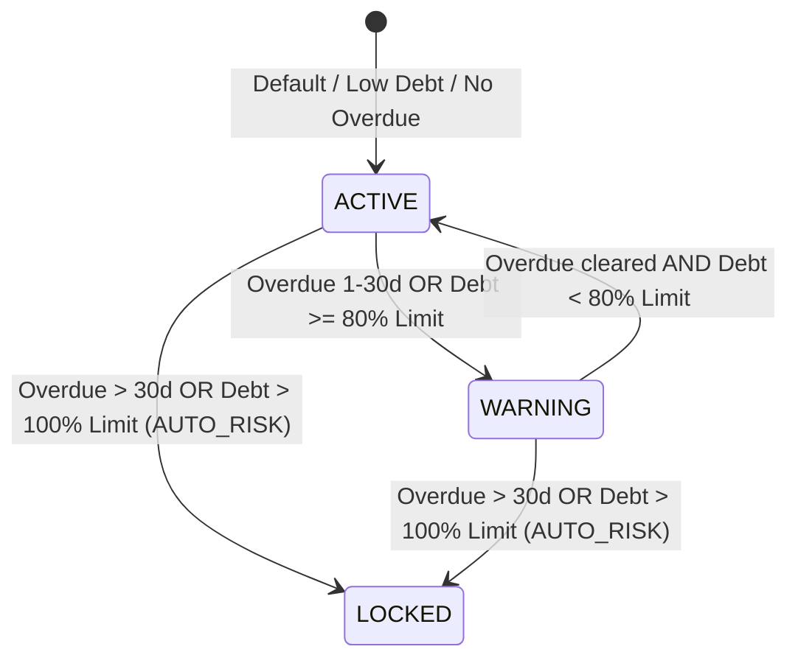

# BILLING_ONE — P1.5 GATE 2 DOMAIN SERVICE REPORT
# CUSTOMER CREDIT DOMAIN SERVICE ARCHITECTURE & VERIFICATION

**Document ID:** `BILLING_ONE_P1_5_GATE_2_DOMAIN_SERVICE_REPORT`  
**Milestone:** P1.5 — Customer Credit Risk Control & Enforcement Engine  
**Gate:** GATE 2 — Customer Credit Domain Service  
**Author:** Principal Financial Systems Architect + PostgreSQL Concurrency Engineer + QA Lead  
**Execution Timestamp:** 2026-10-07T20:55:00+07:00  
**Baseline Git Commit:** `8fbb8c8` (P1.4 Final Closure Baseline)  
**Status:** **GATE 2 — PASS**

---

## 1. OBJECTIVE & HARD SCOPE BOUNDARY

Gate 2 focuses strictly on constructing the **Domain Calculation and Business Rule Authority**:
`app/src/services/customerCreditService.js`

### Strict Gate 2 Scope Constraints:
- [x] **IN SCOPE:**
  1. Canonical current open debt calculation (`calculateCurrentDebt`).
  2. Available credit calculation (`calculateAvailableCredit`).
  3. Customer credit risk FSM evaluation (`evaluateCreditRisk`).
  4. Oldest overdue days retrieval (`getOldestOverdueDays`).
  5. Fortified invoice issuance eligibility checker (`checkInvoiceIssueEligibility`).
  6. Targeted unit & transactional integration test suite (`scripts/p1_5-domain-service-test.mjs`).
  7. Authoritative Gate 2 documentation report.
- [x] **STRICTLY EXCLUDED FROM GATE 2:**
  - Route handlers (`POST /api/invoices/:id/issue`, `POST /api/invoices/:id/issue-override`).
  - Customer routes (`POST /api/customers/:id/unlock`, `PUT /api/customers/:id`).
  - Scheduler background risk scanner (`runCustomerRiskScan`).
  - Invoice row-level locks (`SELECT ... FOR UPDATE` on invoices).
  - Audit logging inside the domain service (`recordAudit()`).
  - Frontend UI modifications (`app/public/app.js`, `styles.css`).
  - Concurrency fixes for legacy CP2 / paymentService.

---

## 2. SOURCE FILES INSPECTED

Prior to coding, the following authoritative system assets were inspected:
1. `app/src/services/paymentService.js`:
   - Inspected monetary rounding and outstanding balance formula `(total - paid_total - adjusted_total)::numeric(14, 2)`.
   - Verified fingerprinting and transaction lock ordering.
2. `app/src/routes/reports.js`:
   - Lines 19–21 & 36–42: Verified open receivables calculation filtering on `status IN ('ISSUED', 'PARTIALLY_PAID', 'OVERDUE')`.
3. `app/src/routes/invoices.js`:
   - Lines 183 & 236: Standard application error format `throw new AppError(404, 'CUSTOMER_NOT_FOUND', 'Customer was not found.')`.
4. `app/src/scheduler.js`:
   - Line 274: Overdue calculation using PostgreSQL date arithmetic `(CURRENT_DATE - due_date)::int AS days_overdue`.
5. `app/src/errors.js`:
   - Verified `AppError` class structure `(status, code, message)` and attached `details` payload conventions.
6. `app/src/db.js`:
   - Verified `pg.Pool` connection pooling and client checkout protocols.
7. `docs/BILLING_ONE_P1_5_OFFICIAL_SPEC.md`:
   - Verified Frozen Spec v1.0.0 sections 10 (Credit Limit Semantics), 11 (FSM), 12 (Auto-Lock), 14 (Issue Enforcement), and 16 (Lock Hierarchy DAG).
8. Database Schemas:
   - Verified `invoices` schema (`total`, `paid_total`, `adjusted_total` are `numeric(14,2) NOT NULL DEFAULT 0`).
   - Verified `idx_invoices_customer_open_debt` partial index on `(customer_id, status)` where `status IN ('ISSUED', 'PARTIALLY_PAID', 'OVERDUE')`.
   - Verified `customers` schema (`credit_limit numeric(14,2) NOT NULL DEFAULT 0`, `status IN ('ACTIVE', 'WARNING', 'LOCKED')`, `lock_source IN ('MANUAL', 'AUTO_RISK', NULL)`).

---

## 3. CANONICAL CURRENT DEBT FORMULA

### Mathematical Definition:
For customer $c$, current live debt $D_{current}(c)$ is the exact sum of open balances across all uncancelled open invoices:

$$D_{current}(c) = \sum_{i \in \text{Invoices}(c)} (i.total - i.paid\_total - i.adjusted\_total)$$

$$\text{WHERE } i.customer\_id = c \quad \land \quad i.status \in \{ \text{'ISSUED'}, \text{'PARTIALLY\_PAID'}, \text{'OVERDUE'} \}$$

### Parameterized SQL Implementation:
```sql
SELECT coalesce(sum(total - paid_total - adjusted_total), 0)::numeric(14, 2)::text AS current_debt
FROM public.invoices
WHERE customer_id = $1
  AND status IN ('ISSUED', 'PARTIALLY_PAID', 'OVERDUE')
```

### Invariant & Boundary Characteristics:
1. **Zero-row safety:** If a customer has no open invoices, `coalesce` guarantees the result is `'0.00'`.
2. **Exclusion of non-receivables:**
   - `DRAFT`: strictly excluded (uncommitted proposals).
   - `PAID`: strictly excluded (fully settled obligations).
   - `CANCELLED`: strictly excluded (voided obligations).
3. **Index acceleration:** Directly utilizes partial index `idx_invoices_customer_open_debt` added in Migration 08.
4. **Precision:** Computed inside PostgreSQL using arbitrary-precision `numeric(14, 2)` and returned as canonical string representation (e.g. `'0.00'`, `'18000000.00'`). Zero floating-point drift.

---

## 4. AVAILABLE CREDIT SEMANTICS

Implemented in `CustomerCreditService.calculateAvailableCredit(creditLimit, currentDebt)`:

### Unlimited Credit ($L_{credit} = 0$):
When `credit_limit = 0` (or `'0.00'`), credit enforcement is disabled:
```json
{
  "unlimited": true,
  "available": null
}
```

### Positive Credit Limit ($L_{credit} > 0$):
$$C_{available} = L_{credit} - D_{current}$$

Returns:
```json
{
  "unlimited": false,
  "available": "<centsToString(limitCents - debtCents)>"
}
```

### Verified Exact Boundary Arithmetic:
| Case | Credit Limit | Current Debt | Available Credit | Unlimited |
|---|---|---|---|---|
| Standard | `50,000,000.00` | `45,000,000.00` | `5,000,000.00` | `false` |
| At Limit | `50,000,000.00` | `50,000,000.00` | `0.00` | `false` |
| Over Limit (1 cent) | `50,000,000.00` | `50,000,000.01` | `-0.01` | `false` |
| Unlimited | `0.00` | `999,999,999.00` | `null` | `true` |

---

## 5. CUSTOMER RISK FSM SEMANTICS

Implemented in pure deterministic evaluator `CustomerCreditService.evaluateCreditRisk({ creditLimit, currentDebt, oldestOverdueDays, autoLockOverdueDays })`:



### Evaluation Logic:
1. **LOCKED Evaluation (Priority 1):**
   - Condition 1: `oldestOverdueDays > autoLockOverdueDays` (Severe Overdue Age).
   - Condition 2: `creditLimit > 0` AND `currentDebt > creditLimit` (Credit Breach).
   - Return: `{ targetStatus: 'LOCKED', reason: string, lockSource: 'AUTO_RISK' }`.
   - *Note:* `lockSource` is set strictly to `'AUTO_RISK'`. The service **NEVER** assigns `'MANUAL'`.
2. **WARNING Evaluation (Priority 2, if not LOCKED):**
   - Condition 1: `1 <= oldestOverdueDays <= autoLockOverdueDays` (Minor Overdue Age).
   - Condition 2: `creditLimit > 0` AND `0.80 * creditLimit <= currentDebt <= creditLimit` (Debt Utilization $\ge 80\%$).
   - Return: `{ targetStatus: 'WARNING', reason: string, lockSource: null }`.
3. **ACTIVE Evaluation (Priority 3):**
   - No lock or warning triggers apply.
   - Return: `{ targetStatus: 'ACTIVE', reason: null, lockSource: null }`.

### Boundary Thresholds ($T_{lock} = 30$):
- **29 days:** $29 \le 30 \implies$ `WARNING` (`lockSource: null`).
- **30 days:** $30 \le 30 \implies$ `WARNING` (`lockSource: null`).
- **31 days:** $31 > 30 \implies$ `LOCKED` (`lockSource: 'AUTO_RISK'`).
- **Utilization 79.999%:** `ACTIVE`.
- **Utilization 80.000%:** `WARNING`.
- **Utilization 100.000%:** `WARNING`.
- **Utilization 100.00002%:** `LOCKED`.

---

## 6. FORTIFIED INVOICE ISSUE ELIGIBILITY CHECKER

Implemented in `CustomerCreditService.checkInvoiceIssueEligibility(client, { customerId, invoiceTotal })`:

### Execution Sequence:
1. **Transaction Assertion:** Validates that `client` is an active PostgreSQL transaction client.
2. **Customer Row Lock:**
   ```sql
   SELECT id, name, status, credit_limit::text, lock_source, lock_reason
   FROM public.customers
   WHERE id = $1
   FOR UPDATE
   ```
   If not found: throws `AppError(404, 'CUSTOMER_NOT_FOUND', 'Customer was not found.')`.
3. **Status Lock Check:**
   If `customer.status === 'LOCKED'`:
   Throws `AppError(409, 'CUSTOMER_IS_LOCKED', 'Customer credit is locked.')` with:
   - `err.customer_id = customer.id`
   - `err.customer_status = customer.status`
   - `err.lock_source = customer.lock_source`
   - `err.lock_reason = customer.lock_reason`
4. **Live Debt Calculation:**
   Calls `calculateCurrentDebt(client, customer.id)`. Reads invoices via normal MVCC SELECT. **Zero invoice locks.**
5. **Credit Limit Check:**
   If `credit_limit > 0`:
   Computes $D_{projected} = D_{current} + \text{invoiceTotal}$.
   If $D_{projected} > \text{credit\_limit}$:
   Throws `AppError(409, 'CREDIT_LIMIT_EXCEEDED', 'Invoice total exceeds available credit limit.')` with structured details:
   ```json
   {
     "customer_id": 142,
     "credit_limit": "50000000.00",
     "current_debt": "40000000.00",
     "invoice_total": "10000000.01",
     "projected_debt": "50000000.01",
     "excess_amount": "0.01"
   }
   ```
6. **Success Return (Snapshot):**
   If eligible, returns:
   ```json
   {
     "eligible": true,
     "customer_id": 142,
     "status": "ACTIVE",
     "credit_limit": "50000000.00",
     "current_debt": "10000000.00",
     "invoice_total": "15000000.00",
     "projected_debt": "25000000.00",
     "available_credit": "40000000.00"
   }
   ```

---

## 7. CONCURRENCY & LOCKING SEMANTICS

1. **Customer Row Lock:**
   - Inside `checkInvoiceIssueEligibility`, customer row is locked with `FOR UPDATE`.
   - Verified via integration test T11: When Client 1 executes `checkInvoiceIssueEligibility` in transaction, concurrent Client 2 attempting `SELECT ... FOR UPDATE NOWAIT` immediately receives PostgreSQL error code `55P03` (`lock_not_available`).
2. **Zero Invoice Row Locks in Gate 2:**
   - Invoices are queried via pure MVCC `SELECT` without `FOR UPDATE`.
   - Prevents deadlock cycles and preserves the canonical global lock hierarchy (`invoices` $\to$ `customers` $\to$ `payments`).
3. **Zero Financial Mutation:**
   - The service performs zero database writes (no invoice update, no customer status mutation, no sequence increment).
4. **Zero Audit Logging:**
   - The service does **NOT** call `recordAudit()`. Audit logging is reserved for the mutating callers in Gate 4.

---

## 8. EXACT ARITHMETIC DESIGN

To completely eliminate IEEE-754 floating-point inaccuracies, `CustomerCreditService` implements exact BigInt cents scaling:
```javascript
function parseToCents(val) {
  // Parses decimal strings into BigInt cents (x 100)
  // Handles rounding half-up for sub-cents if present
}

function centsToString(cents) {
  // Formats BigInt cents to canonical decimal string 'XXXX.YY'
}
```
All comparisons and additions use native BigInt operators:
- Debt check: `limitCents > 0n && projectedDebtCents > limitCents`
- Excess amount: `projectedDebtCents - limitCents`
- Utilization check: `debtCents * 100n >= limitCents * 80n`

---

## 9. KNOWN AMBIGUITY DECISION: `credit_control_enabled = false`

**Context:** Migration 08 added `company_settings.credit_control_enabled BOOLEAN NOT NULL DEFAULT TRUE`.  
**Ambiguity:** Frozen Spec v1.0.0 defines the configuration column but provides zero functional specification or business rules for when this value is set to `FALSE`.  
**Architectural Decision:**
- `CustomerCreditService` does **NOT** invent undocumented bypass semantics for `credit_control_enabled = false`.
- Credit limit checks and locked customer checks remain unconditionally enforced as specified by Frozen Spec v1.0.0.
- If future Product Owner requirements specify a bypass mode for `false`, it can be wired cleanly in Gate 4 at the route orchestration layer without polluting the domain math.

---

## 10. TEST EXECUTION MATRIX

Executed via `scripts/p1_5-domain-service-test.mjs` against live PostgreSQL runtime:

| Test ID | Test Name | Scenario / Input | Expected Result | Status |
|---|---|---|---|---|
| **T01-Pure** | Unlimited Credit (Pure) | `limit = 0.00`, `debt = 15,000,000.00` | `{ unlimited: true, available: null }` | **PASS** |
| **T02-Pure** | Debt Below Limit (Pure) | `limit = 50M`, `debt = 10M` | `available = '40000000.00'`, `unlimited = false` | **PASS** |
| **T03-Pure** | Debt Equals Limit (Pure) | `limit = 50M`, `debt = 50M` | `available = '0.00'`, `unlimited = false` | **PASS** |
| **T04-Pure** | Debt Exceeds by 0.01 (Pure) | `limit = 50M`, `debt = 50M + 0.01` | `available = '-0.01'`, `unlimited = false` | **PASS** |
| **T07-Pure** | Exact Decimal Boundaries | 3 Frozen Spec boundary cases | Exact string matches `'5000000.00'`, `'0.00'`, `'-0.01'` | **PASS** |
| **T10-Pure** | Overdue Boundaries (29, 30, 31d) | Threshold 30d; test 29d, 30d, 31d | 29d $\to$ `WARNING`, 30d $\to$ `WARNING`, 31d $\to$ `LOCKED` (`AUTO_RISK`) | **PASS** |
| **T10-Pure** | Utilization Boundaries | Limit 50M; test 79.99%, 80%, 100%, 100.00002% | 79.99% $\to$ `ACTIVE`, 80% $\to$ `WARNING`, 100% $\to$ `WARNING`, 100.00002% $\to$ `LOCKED` | **PASS** |
| **T10-Pure** | Unlimited Credit FSM | Limit 0, Debt 1B | Debt alone never locks; overdue $> 30$ locks | **PASS** |
| **T08-DB** | Empty Open Invoices | Only DRAFT, PAID, CANCELLED invoices | `calculateCurrentDebt` returns `'0.00'` | **PASS** |
| **T09-DB** | Multiple Open Invoices | ISSUED 10M + PARTIALLY_PAID 5M + OVERDUE 3M | `calculateCurrentDebt` returns `'18000000.00'` | **PASS** |
| **T01-DB** | Unlimited Issue Check | Customer limit 0; invoice 1B | `checkInvoiceIssueEligibility` succeeds | **PASS** |
| **T02-DB** | Eligible Issue Check | Customer limit 50M; debt 10M; invoice 15M | `checkInvoiceIssueEligibility` succeeds | **PASS** |
| **T03-DB** | Exact Boundary Issue Check | Customer limit 50M; debt 40M; invoice 10M | `checkInvoiceIssueEligibility` succeeds | **PASS** |
| **T04-DB** | 0.01 Breach Issue Check | Customer limit 50M; debt 40M; invoice 10M + 0.01 | Throws 409 `CREDIT_LIMIT_EXCEEDED`, `excess = '0.01'` | **PASS** |
| **T05-DB** | Locked Customer Check | Customer status `LOCKED` | Throws 409 `CUSTOMER_IS_LOCKED` | **PASS** |
| **T06-DB** | Warning Customer Check | Customer status `WARNING`, within limit | `checkInvoiceIssueEligibility` succeeds | **PASS** |
| **T11-DB** | Row Lock Concurrency | Client 1 in transaction; Client 2 NOWAIT | Client 2 blocked with PostgreSQL `55P03` | **PASS** |
| **T12-DB** | Zero Audit & DB Mutation | Compare `audit_logs` before & after suite | Delta = 0 (Initial: 5766, Final: 5766) | **PASS** |

**Targeted Suite Result:** **18/18 TESTS PASSED (100%)**

---

## 11. REGRESSION VERIFICATION

1. **Full Milestone P1.4 Regression Suite (`scripts/p1_4-overdue-lifecycle-test.mjs`):**
   - Executed all 21 automated lifecycle, concurrency, and idempotent scan tests.
   - Executed all 12 regression test suites:
     - `p0-remediation-test.mjs`: PASS
     - `p1-refund-ledger-test.mjs`: PASS
     - `p1_2-payment-allocation-test.mjs`: PASS
     - `p1_2_1-idempotency-test.mjs`: PASS
     - `p1_2_2-mandatory-idempotency-test.mjs`: PASS
     - `p1_3-auto-settlement-test.mjs`: PASS
     - `p1_3_1-remediation-test.mjs`: PASS
     - `cp2-smoke.mjs`: PASS
     - `extended-features-test.mjs`: PASS
     - `frontend-e2e-test.mjs`: PASS
     - `verify-hardening.ps1`: PASS
     - `verify-audit-chain.mjs`: PASS
   - **All 9 Authoritative Financial Metrics = 0 violations.**
   - Result: **21/21 TESTS PASSED (100%)**.
2. **Cryptographic Audit Log Integrity (`scripts/verify-audit-chain.mjs`):**
   - Verified 100% of SHA-256 hash chains across 5,825 total audit entries.
   - Result: **VALID (0 tampered or broken hashes)**.

---

## 12. GIT DIFF & FILE AUDIT

```text
Untracked Files (Gate 2 Artifacts):
+ app/src/services/customerCreditService.js
+ scripts/p1_5-domain-service-test.mjs
+ docs/BILLING_ONE_P1_5_GATE_2_DOMAIN_SERVICE_REPORT.md

Modified Files:
(None - Working tree is 100% clean of unrelated modifications)
```

---

## 13. GATE 2 ACCEPTANCE CRITERIA VERIFICATION

| Criteria | Required State | Actual State | Verdict |
|---|---|---|---|
| 1. CustomerCreditService Exists | `app/src/services/customerCreditService.js` created | Created & operational | **PASS** |
| 2. Current Debt Formula | SUM(total - paid_total - adjusted_total) for open invoices | Matches canonical formula | **PASS** |
| 3. Unlimited Credit Behavior | limit = 0 $\implies$ unlimited, available = null | Matches spec | **PASS** |
| 4. Exact Boundary Arithmetic | BigInt cents arithmetic; 0.01 precision | Zero floating-point drift | **PASS** |
| 5. LOCKED Eligibility Rejection | HTTP 409 `CUSTOMER_IS_LOCKED` | Throws expected AppError | **PASS** |
| 6. Credit Breach Rejection | HTTP 409 `CREDIT_LIMIT_EXCEEDED` with exact excess | Throws with excess breakdown | **PASS** |
| 7. WARNING Eligibility | WARNING within limit permitted | Snapshot returned | **PASS** |
| 8. Risk Evaluation FSM | 29d, 30d $\to$ WARNING; 31d $\to$ LOCKED; 80% util | Matches Frozen Spec | **PASS** |
| 9. Customer Row Lock | `SELECT ... FOR UPDATE` inside transaction | Verified with `55P03` test | **PASS** |
| 10. Zero Financial Mutation | Service does not mutate invoices or customers | Zero DB mutations | **PASS** |
| 11. Zero Audit Mutation | Service does not call `recordAudit()` | Zero audit emission | **PASS** |
| 12. Zero Invoice Row Lock | No `FOR UPDATE` on invoices | Preserves DAG | **PASS** |
| 13. Unit & Integration Tests | Comprehensive test suite covering T01-T12 | 18/18 tests pass | **PASS** |
| 14. Zero Regression | P0-P1.4 suites pass; 9 financial invariants = 0 | 100% regression pass | **PASS** |
| 15. Scope Hygiene | Zero unrelated files changed | Clean working tree | **PASS** |
