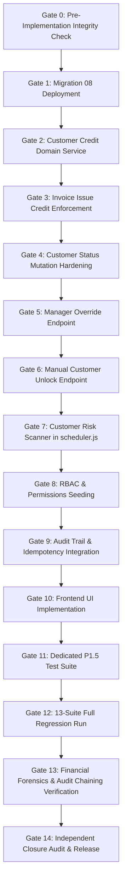
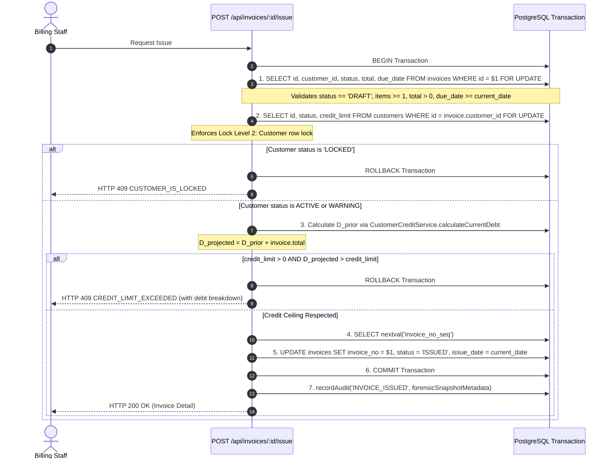

# BILLING_ONE — P1.5 IMPLEMENTATION PLAN & EXECUTION INVENTORY
## CUSTOMER CREDIT RISK CONTROL & ENFORCEMENT ENGINE
**Document Version:** 1.0.0 — COMPREHENSIVE ARCHITECTURAL BLUEPRINT  
**Milestone:** P1.5 — Customer Credit Risk Control & Enforcement Engine  
**Mode:** ARCHITECTURAL PLANNING ONLY — ZERO PRODUCTION IMPLEMENTATION  
**Source Spec:** [`docs/BILLING_ONE_P1_5_OFFICIAL_SPEC.md`](file:///c:/Users/phamt/OneDrive/Desktop/Billing_One/docs/BILLING_ONE_P1_5_OFFICIAL_SPEC.md) (v1.0.0 Final Frozen)  
**Preflight Reference:** [`docs/BILLING_ONE_P1_5_IMPLEMENTATION_PREFLIGHT.md`](file:///c:/Users/phamt/OneDrive/Desktop/Billing_One/docs/BILLING_ONE_P1_5_IMPLEMENTATION_PREFLIGHT.md) (Verdict: READY WITH NON-BLOCKING RISKS)  
**Discovery Reference:** [`docs/BILLING_ONE_P1_5_PRE_IMPLEMENTATION_DISCOVERY.md`](file:///c:/Users/phamt/OneDrive/Desktop/Billing_One/docs/BILLING_ONE_P1_5_PRE_IMPLEMENTATION_DISCOVERY.md)  
**Baseline Git Commit:** `8fbb8c861cbe46c28f902155e19188978604d76d` (P1.4 Officially Closed)  
**Author:** Principal Financial Systems Architect + PostgreSQL Concurrency Architect + Security/RBAC Architect + QA Lead + Release Planner  
**Date:** October 2026  

---

## 1. EXECUTIVE SUMMARY

This document establishes the official **Gated Implementation Plan** for Milestone **P1.5: Customer Credit Risk Control & Enforcement Engine** in Billing_One.

Milestone P1.5 transforms dormant credit limit fields and advisory customer status indicators into an active, ACID-compliant, concurrency-safe credit risk enforcement mechanism. The engine guarantees that:
1. Standard invoice issuance (`POST /api/invoices/:id/issue`) synchronously rejects any attempt to issue invoices to `LOCKED` customers (HTTP 409 `CUSTOMER_IS_LOCKED`) or where the resulting projected debt breaches the customer's credit limit (HTTP 409 `CREDIT_LIMIT_EXCEEDED`).
2. Privileged managers (`admin` or `ROLE_BILLING_MANAGER`) can execute an idempotent **Manager Override** (`POST /api/invoices/:id/issue-override`) with mandatory business justification and immutable SHA-256 audit chaining.
3. Customer status transitions follow a deterministic Finite State Machine (`ACTIVE` $\leftrightarrow$ `WARNING` $\to$ `LOCKED`), evaluated automatically by a background **Customer Risk Scanner** (`scheduler.js`) protected by dedicated advisory lock ID `88812347`.
4. Automated unlocking upon debt payment is **strictly prohibited**. A customer in `LOCKED` state can only return to `ACTIVE` or `WARNING` through an authorized **Manual Unlock** (`POST /api/customers/:id/unlock`) requiring permission `customer.unlock`.
5. Existing customer profile updates (`PUT /api/customers/:id`) are formally hardened against accidental unfreezing of `LOCKED` accounts.

---

## 2. BASELINE & ENVIRONMENT INTEGRITY

The implementation baseline is anchored on the officially closed state of Milestone P1.4:

| Attribute | Baseline Target | Active Verified State |
|---|---|---|
| **Git Commit SHA** | `8fbb8c861cbe46c28f902155e19188978604d76d` | Match (`HEAD` on `main`) |
| **Milestone Closure** | P1.4 Closed per [`docs/BILLING_ONE_P1_4_FINAL_CLOSURE.md`](file:///c:/Users/phamt/OneDrive/Desktop/Billing_One/docs/BILLING_ONE_P1_4_FINAL_CLOSURE.md) | Verified intact |
| **Financial Invariants** | 9/9 P1.4 Invariants = 0 Violations | 0 Violations verified |
| **Cryptographic Audit Chain** | 5,136 / 5,136 Valid SHA-256 Hashes | Unbroken chain verified |
| **PostgreSQL Database** | PostgreSQL 16.x (Docker `billing-postgres-1`) | 12 Containers healthy |
| **Node.js Environment** | Node.js 20.x ESM/CJS (Docker `billing-web-1`) | Running & connected |

---

## 3. FROZEN SPECIFICATION SUMMARY

All work strictly derives from [`docs/BILLING_ONE_P1_5_OFFICIAL_SPEC.md`](file:///c:/Users/phamt/OneDrive/Desktop/Billing_One/docs/BILLING_ONE_P1_5_OFFICIAL_SPEC.md) (v1.0.0 Final Frozen):
- **Core Entities:** `customers` (`lock_source`, `locked_at`, `lock_reason`), `company_settings` (`credit_control_enabled`, `auto_lock_overdue_days`).
- **Enforcement Logic:**
  - $L_{credit} = 0 \implies \text{Unlimited Credit}$ (bypass limit ceiling).
  - $L_{credit} > 0 \land (D_{current} + \text{invoice.total} > L_{credit}) \implies \text{Reject 409 CREDIT\_LIMIT\_EXCEEDED}$.
  - $status = \text{'LOCKED'} \implies \text{Reject 409 CUSTOMER\_IS\_LOCKED}$.
- **Scanner Rules (Lock ID 88812347):**
  - Overdue age $> 30$ days OR $D_{current} > L_{credit} \implies \text{'LOCKED'}$.
  - Overdue age $1 \dots 30$ days OR $0.80 \times L_{credit} \le D_{current} \le L_{credit} \implies \text{'WARNING'}$.
  - Auto-clearing: `WARNING` $\to$ `ACTIVE` permitted when risk clears; `LOCKED` accounts **never** auto-unlock.
  - Manual lock immunity: Accounts with `lock_source = 'MANUAL'` are never touched by scanner.

---

## 4. CRITICAL PREFLIGHT FINDINGS TO CARRY FORWARD

The implementation plan explicitly addresses the three critical architectural findings discovered during preflight analysis ([`docs/BILLING_ONE_P1_5_IMPLEMENTATION_PREFLIGHT.md`](file:///c:/Users/phamt/OneDrive/Desktop/Billing_One/docs/BILLING_ONE_P1_5_IMPLEMENTATION_PREFLIGHT.md)):

### FINDING-A: `PUT /api/customers/:id` Accidental Unfreeze Vulnerability
- **Root Cause in Baseline:** Line 35 of [`app/src/routes/customers.js`](file:///c:/Users/phamt/OneDrive/Desktop/Billing_One/app/src/routes/customers.js) executes `const status = body.status && VALID_STATUSES.has(body.status) ? body.status : 'ACTIVE';`. If an operator edits phone or address without supplying `status`, the customer is silently reverted to `'ACTIVE'`, bypassing the manual unlock governance.
- **Mandatory Implementation Control:**
  1. Omitted `status` must preserve the existing database status.
  2. A customer currently in `LOCKED` state cannot be transitioned to `ACTIVE` or `WARNING` via `PUT /api/customers/:id`. Such attempts must be rejected with HTTP 403 `FORBIDDEN` or HTTP 409 `CUSTOMER_IS_LOCKED`.
  3. `LOCKED` $\to$ `ACTIVE`/`WARNING` is strictly reserved for `POST /api/customers/:id/unlock` backed by `customer.unlock`.

### FINDING-B: Invariant 1 Historical Snapshot Forensics
- **Root Cause in Baseline:** Invariant 1 requires verifying that no invoice was issued where prior debt plus total exceeded the credit limit without an override. Because open invoice debt fluctuates dynamically over time as subsequent payments and adjustments are posted, retrospective SQL queries cannot reconstruct historical prior debt without snapshot evidence.
- **Mandatory Implementation Control:**
  The `INVOICE_ISSUED` audit event metadata written by `POST /api/invoices/:id/issue` and `issue-override` must record an immutable snapshot containing:
  - `invoice_id`
  - `invoice_no`
  - `customer_id`
  - `customer_status_prior`
  - `credit_limit`
  - `current_debt_prior`
  - `invoice_total`
  - `projected_debt`
  - `issue_decision` (`'NORMAL'` vs `'OVERRIDDEN'`)
  - `idempotency_key` (if override)

### FINDING-C: Concurrency Directed Acyclic Graph (DAG) Verification
- **Lock Ordering Rule:** Lock acquisitions across all transactions must strictly respect the lock level hierarchy:
  $$\text{Level 0: Advisory Idempotency Lock} \to \text{Level 1: Invoices (id ASC)} \to \text{Level 2: Customer Row (FOR UPDATE)} \to \text{Level 3: Payment Lock}$$
- **Cross-Flow Safety:** No flow in the system may acquire a Customer lock and subsequently attempt to acquire an Invoice row lock. Concurrency integration tests will prove zero deadlocks (PostgreSQL error `40P01`) across high-concurrency races.

---

## 5. CORE IMPLEMENTATION PRINCIPLES

1. **ACID Transactional Authoritativeness:** Financial state evaluations (debt queries, limit checks, lock status) and invoice status mutations must execute within the same database transaction boundary.
2. **Deterministic Arithmetic:** All currency and debt comparisons must use PostgreSQL `numeric(14,2)` arithmetic or JavaScript integer cents / string decimal math. Floating-point IEEE 754 calculations are prohibited.
3. **Least Privilege Enforcement:** Sensitive financial overrides and customer unfreezes are restricted to explicit permissions (`invoice.issue_override`, `customer.unlock`) held only by authorized administrative roles.
4. **Idempotency Guarantee:** All override and unlock endpoints require mandatory `Idempotency-Key` headers. Duplicate requests return cached responses with zero duplicate state mutations and zero duplicate audit entries.
5. **Zero Regression Guarantee:** All existing functionality (P0 through P1.4) and all 13 existing test suites must pass 100% without modification or regression.

---

## 6. GATED IMPLEMENTATION SEQUENCE OVERVIEW



---

## 7. GATE 0 — PRE-IMPLEMENTATION INTEGRITY CHECK

### 7.1. Objectives & Preconditions
Verify that the runtime and database environments match the verified P1.4 baseline before touching any files.

### 7.2. Verification Checklist
1. Execute `git status`: Working directory must be clean of any code changes.
2. Verify commit SHA equals `8fbb8c861cbe46c28f902155e19188978604d76d`.
3. Verify all 12 Docker containers are running healthy:
   `docker ps --filter "name=billing" --format "{{.Names}}: {{.Status}}"`
4. Verify existing 13 test suites execute cleanly on baseline:
   `node scripts/verify-audit-chain.mjs`
   `node scripts/p1_4-overdue-lifecycle-test.mjs`
5. Verify 0 financial invariant violations exist on baseline.

### 7.3. Gate 0 Output & Pass Criteria
- **Pass Criteria:** All 5 checks green.
- **Verdict Output:** `GATE 0 — INTEGRITY VERIFIED (PASS)`.

---

## 8. GATE 1 — DATABASE MIGRATION 08 (`08_p1_5_credit_risk_control.sql`)

### 8.1. Objectives
Deploy schema modifications supporting credit control, auto-lock metadata, permissions, and indexes.

### 8.2. Migration Specification (`db/migrations/08_p1_5_credit_risk_control.sql`)

```sql
-- Migration 08: Milestone P1.5 Customer Credit Risk Control & Enforcement
BEGIN;

-- 1. Extend public.customers with lock tracking metadata
ALTER TABLE public.customers
  ADD COLUMN IF NOT EXISTS lock_source VARCHAR(24) DEFAULT NULL,
  ADD COLUMN IF NOT EXISTS locked_at TIMESTAMPTZ DEFAULT NULL,
  ADD COLUMN IF NOT EXISTS lock_reason TEXT DEFAULT NULL;

-- Ensure credit_limit has consistent not-null default
UPDATE public.customers SET credit_limit = 0 WHERE credit_limit IS NULL;
ALTER TABLE public.customers ALTER COLUMN credit_limit SET DEFAULT 0;
ALTER TABLE public.customers ALTER COLUMN credit_limit SET NOT NULL;

-- Check constraint for lock_source
ALTER TABLE public.customers
  DROP CONSTRAINT IF EXISTS customers_lock_source_check,
  ADD CONSTRAINT customers_lock_source_check
    CHECK (lock_source IS NULL OR lock_source IN ('AUTO_RISK', 'MANUAL'));

-- 2. Extend public.company_settings with credit control policies
ALTER TABLE public.company_settings
  ADD COLUMN IF NOT EXISTS credit_control_enabled BOOLEAN NOT NULL DEFAULT true,
  ADD COLUMN IF NOT EXISTS auto_lock_overdue_days INTEGER NOT NULL DEFAULT 30;

ALTER TABLE public.company_settings
  DROP CONSTRAINT IF EXISTS company_settings_overdue_days_check,
  ADD CONSTRAINT company_settings_overdue_days_check
    CHECK (auto_lock_overdue_days >= 1);

-- 3. Extend users role check constraint to support administrative hierarchy
ALTER TABLE public.users
  DROP CONSTRAINT IF EXISTS users_role_check,
  ADD CONSTRAINT users_role_check
    CHECK (role = ANY (ARRAY['admin', 'staff', 'ROLE_BILLING_MANAGER', 'ROLE_ACCOUNTANT', 'ROLE_AUDITOR']));

-- 4. Seed new P1.5 Permissions
INSERT INTO public.permissions (code, module, description)
VALUES
  ('invoice.issue_override', 'invoices', 'Phê duyệt phát hành hóa đơn đặc cách vượt hạn mức hoặc cho khách hàng bị khóa'),
  ('customer.unlock', 'customers', 'Mở khóa công nợ khách hàng (LOCKED -> ACTIVE)')
ON CONFLICT (code) DO NOTHING;

-- Map permissions to admin and ROLE_BILLING_MANAGER
INSERT INTO public.role_permissions (role_id, permission_id)
SELECT r.id, p.id
FROM public.roles r, public.permissions p
WHERE r.code IN ('admin', 'ROLE_BILLING_MANAGER')
  AND p.code IN ('invoice.issue_override', 'customer.unlock')
ON CONFLICT DO NOTHING;

-- 5. Performance Partial Indexes
CREATE INDEX IF NOT EXISTS idx_customers_status_risk
  ON public.customers (status)
  WHERE status IN ('WARNING', 'LOCKED');

CREATE INDEX IF NOT EXISTS idx_invoices_customer_open_debt
  ON public.invoices (customer_id, status)
  WHERE status IN ('ISSUED', 'PARTIALLY_PAID', 'OVERDUE');

COMMIT;
```

### 8.3. Migration Safety & Lock Verification
- Adding columns with constant defaults in PostgreSQL 16 is a zero-rewrite, metadata-only operation acquiring `AccessExclusiveLock` for $< 10$ milliseconds.
- Rollback script `db/migrations/08_p1_5_credit_risk_control_down.sql` must be drafted simultaneously.

---

## 9. GATE 2 — CUSTOMER CREDIT DOMAIN SERVICE (`CustomerCreditService`)

### 9.1. Objectives
Create a centralized, reusable service in [`app/src/services/customerCreditService.js`](file:///c:/Users/phamt/OneDrive/Desktop/Billing_One/app/src/services/customerCreditService.js) to encapsulate all debt calculations, risk evaluations, and eligibility checks.

### 9.2. Method Signatures & Responsibilities

```javascript
class CustomerCreditService {
  /**
   * Calculates the exact open debt of a customer from committed database state.
   * D_current = SUM(total - paid_total - adjusted_total)
   * Status in ('ISSUED', 'PARTIALLY_PAID', 'OVERDUE')
   */
  static async calculateCurrentDebt(clientOrPool, customerId) { ... }

  /**
   * Calculates available credit in VND.
   * If creditLimit == 0: returns null (representing unlimited credit).
   * Else: returns creditLimit - currentDebt.
   */
  static calculateAvailableCredit(creditLimitStr, currentDebtStr) { ... }

  /**
   * Evaluates discrete customer risk state based on overdue age and credit utilization.
   * Returns: { targetStatus: 'ACTIVE'|'WARNING'|'LOCKED', reason: string|null, lockSource: 'AUTO_RISK'|null }
   */
  static evaluateCreditRisk({ creditLimit, currentDebt, oldestOverdueDays, autoLockOverdueDays = 30 }) { ... }

  /**
   * Synchronously checks issuance eligibility within an active transaction.
   * Acquires SELECT ... FOR UPDATE on customer row.
   * Throws AppError(409, 'CUSTOMER_IS_LOCKED') or AppError(409, 'CREDIT_LIMIT_EXCEEDED').
   */
  static async checkInvoiceIssueEligibility(client, { customerId, invoiceTotal }) { ... }
}
```

### 9.3. Unit Testing & Arithmetic Precision
Validate that:
- $L_{credit} = 0 \implies \text{Eligible}$ for any invoice total.
- Exact boundary $D_{current} + \text{total} = L_{credit} \implies \text{Eligible}$.
- Exact boundary $D_{current} + \text{total} = L_{credit} + 0.01 \implies \text{Rejected (Excess: 0.01)}$.

---

## 10. GATE 3 — INVOICE ISSUE CREDIT ENFORCEMENT (`invoices.js`)

### 10.1. Objectives
Fortify `POST /api/invoices/:id/issue` in [`app/src/routes/invoices.js`](file:///c:/Users/phamt/OneDrive/Desktop/Billing_One/app/src/routes/invoices.js) with synchronous customer locking, lock status gating, and credit limit ceiling checks.

### 10.2. Fortified Transaction Sequence



### 10.3. Mandatory Rejection Behavior
- If rejected, transaction rollbacks immediately.
- Zero sequence numbers are consumed.
- Zero audit success events are written.
- Error response payload strictly follows Frozen Spec:
  ```json
  {
    "error": {
      "code": "CREDIT_LIMIT_EXCEEDED",
      "message": "Giá trị hóa đơn vượt quá hạn mức tín dụng khả dụng của khách hàng.",
      "details": {
        "customer_id": 142,
        "credit_limit": "50000000.00",
        "current_debt": "45000000.00",
        "invoice_total": "12000000.00",
        "projected_debt": "57000000.00",
        "excess_amount": "7000000.00"
      }
    }
  }
  ```

---

## 11. GATE 4 — CUSTOMER STATUS MUTATION HARDENING (`customers.js`)

### 11.1. Objectives
Remediate **FINDING-A** in [`app/src/routes/customers.js`](file:///c:/Users/phamt/OneDrive/Desktop/Billing_One/app/src/routes/customers.js) to guarantee that routine profile updates (`PUT /api/customers/:id`) can never inadvertently unfreeze a `LOCKED` account.

### 11.2. Refactored Update Semantics
1. **Require Permission:** Add `requirePermission('customer.update')` middleware to `PUT /api/customers/:id`.
2. **Transactional State Inspection:**
   ```javascript
   // Inside transaction:
   const existingRes = await client.query(
     'SELECT id, status, lock_source FROM public.customers WHERE id = $1 FOR UPDATE',
     [id]
   );
   const existing = existingRes.rows[0];

   // 1. Omitted status preserves existing DB status
   let targetStatus = existing.status;
   if (body.status && VALID_STATUSES.has(body.status)) {
     targetStatus = body.status;
   }

   // 2. Prevent unlocking LOCKED accounts via normal PUT
   if (existing.status === 'LOCKED' && targetStatus !== 'LOCKED') {
     throw new AppError(409, 'CUSTOMER_IS_LOCKED',
       'Không thể mở khóa khách hàng qua cập nhật thông tin thông thường. Vui lòng sử dụng luồng Mở khóa công nợ (/api/customers/:id/unlock).');
   }

   // 3. Handle manual locking if explicitly set to LOCKED
   let lockSource = existing.lock_source;
   let lockedAt = existing.locked_at;
   let lockReason = existing.lock_reason;
   if (targetStatus === 'LOCKED' && existing.status !== 'LOCKED') {
     lockSource = 'MANUAL';
     lockedAt = new Date();
     lockReason = body.lock_reason || 'Manual lock via customer management';
   }
   ```

---

## 12. GATE 5 — MANAGER OVERRIDE ENDPOINT (`issue-override`)

### 12.1. Objectives
Implement privileged bypass route `POST /api/invoices/:id/issue-override` in [`app/src/routes/invoices.js`](file:///c:/Users/phamt/OneDrive/Desktop/Billing_One/app/src/routes/invoices.js).

### 12.2. Contract & Enforcement Specifications
- **Middleware:** `requireAuth`, `requirePermission('invoice.issue_override')`.
- **Headers:** `Idempotency-Key` (Mandatory).
- **Body Validation:** `{ override_reason: string }` with $\text{length} \ge 10$ characters.
- **Idempotency Execution:**
  - Namespaced key: `inv_override:<Idempotency-Key>`.
  - Computes SHA-256 fingerprint of request.
  - Returns cached response on duplicate invocation.
- **Issuance Transaction:**
  - Locks invoice (`FOR UPDATE`) and validates status is `'DRAFT'`.
  - Locks customer (`FOR UPDATE`).
  - Records $D_{prior}$, $L_{credit}$, $D_{projected}$, and $\text{amount\_over\_limit}$.
  - Advances invoice status to `'ISSUED'`, consumes `invoice_no_seq`.
  - **Does NOT** alter customer `credit_limit` or `status`.
  - Commits transaction.
- **Audit Emission:** Action `INVOICE_ISSUE_OVERRIDDEN` with severity `'WARNING'` and full forensic snapshot.

---

## 13. GATE 6 — MANUAL CUSTOMER UNLOCK ENDPOINT (`customers/:id/unlock`)

### 13.1. Objectives
Implement administrative unfreeze endpoint `POST /api/customers/:id/unlock` in [`app/src/routes/customers.js`](file:///c:/Users/phamt/OneDrive/Desktop/Billing_One/app/src/routes/customers.js).

### 13.2. Contract & Enforcement Specifications
- **Middleware:** `requireAuth`, `requirePermission('customer.unlock')`.
- **Headers:** `Idempotency-Key` (Mandatory).
- **Body Validation:**
  - `unlock_reason`: Required text, $\ge 10$ characters.
  - `target_status`: Optional (`'ACTIVE'` or `'WARNING'`), defaults to `'ACTIVE'`.
- **Idempotency Execution:** Namespaced key `cust_unlock:<Idempotency-Key>`.
- **Unlock Transaction:**
  - Locks customer row: `SELECT id, status FROM public.customers WHERE id = $1 FOR UPDATE`.
  - If `status !== 'LOCKED'`, aborts with HTTP 409 `CUSTOMER_NOT_LOCKED`.
  - Updates customer: `status = target_status, lock_source = NULL, locked_at = NULL, lock_reason = NULL`.
  - Emits audit log `CUSTOMER_STATUS_MANUAL_UNLOCKED` (severity `'INFO'`).
  - Commits transaction.

---

## 14. GATE 7 — CUSTOMER RISK SCANNER ENGINE (`scheduler.js`)

### 14.1. Objectives
Integrate `runCustomerRiskScan(pool)` into [`app/src/scheduler.js`](file:///c:/Users/phamt/OneDrive/Desktop/Billing_One/app/src/scheduler.js).

### 14.2. Concurrency & Isolation Design
- **Advisory Lock ID:** `CUSTOMER_RISK_SCAN_LOCK_ID = 88812347`.
- **Single-Master Acquisition:** Uses `SELECT pg_try_advisory_lock(88812347) AS acquired`.
- **Discrete Per-Customer Transactions:** Each customer is evaluated and updated in an independent transaction. A failure or deadlock on one customer will not roll back previously evaluated customers.
- **Deterministic Traversal:** Customers processed strictly ordered by `id ASC`.
- **Scanner Rules Implementation:**
  ```javascript
  // For each customer c:
  await inTransaction(async (client) => {
    const cust = await client.query('SELECT id, status, credit_limit, lock_source FROM customers WHERE id = $1 FOR UPDATE', [c.id]);
    const current = cust.rows[0];

    // RULE 1: Already LOCKED accounts are IMMUNE to auto-unlocking
    if (current.status === 'LOCKED') return;

    // RULE 2: Manual lock immunity
    if (current.lock_source === 'MANUAL') return;

    // RULE 3: Query debt and overdue age
    const debt = await CustomerCreditService.calculateCurrentDebt(client, c.id);
    const overdueRes = await client.query(
      `SELECT max(CURRENT_DATE - due_date) AS oldest_overdue_days
       FROM public.invoices
       WHERE customer_id = $1 AND status = 'OVERDUE' AND (total - paid_total - adjusted_total) > 0`,
      [c.id]
    );
    const oldestOverdueDays = overdueRes.rows[0].oldest_overdue_days || 0;

    // RULE 4: Evaluate risk
    const { targetStatus, reason, lockSource } = CustomerCreditService.evaluateCreditRisk({
      creditLimit: current.credit_limit,
      currentDebt: debt,
      oldestOverdueDays
    });

    if (targetStatus !== current.status) {
      await client.query(
        `UPDATE public.customers
         SET status = $2, lock_source = $3, locked_at = CASE WHEN $2 = 'LOCKED' THEN now() ELSE locked_at END, lock_reason = $4
         WHERE id = $1`,
        [c.id, targetStatus, lockSource, reason]
      );
      // Emit corresponding audit log inside same transaction
    }
  });
  ```

---

## 15. GATE 8 — RBAC PERMISSION MAPPING & AUTH CONFIGURATION

### 15.1. Objectives
Wire authorization checks in [`app/src/routes/auth.js`](file:///c:/Users/phamt/OneDrive/Desktop/Billing_One/app/src/routes/auth.js) and verify role hierarchy.

### 15.2. Role-Permission Enforcement Matrix

| Endpoint | Action | Permission Required | `admin` | `ROLE_BILLING_MANAGER` | `staff` | `ROLE_ACCOUNTANT` | `ROLE_AUDITOR` |
|---|---|---|:---:|:---:|:---:|:---:|:---:|
| `POST /invoices/:id/issue` | Standard Issue | `invoice.issue` | ALLOW | ALLOW | ALLOW | ALLOW | DENY (403) |
| `POST /invoices/:id/issue-override` | Override Issue | `invoice.issue_override` | **ALLOW** | **ALLOW** | **DENY (403)** | **DENY (403)** | **DENY (403)** |
| `POST /customers/:id/unlock` | Manual Unlock | `customer.unlock` | **ALLOW** | **ALLOW** | **DENY (403)** | **DENY (403)** | **DENY (403)** |
| `PUT /customers/:id` | Update Profile | `customer.update` | ALLOW | ALLOW | ALLOW | ALLOW | DENY (403) |

### 15.3. Least Privilege Verification
`DEFAULT_STAFF_PERMISSIONS` in `auth.js` remains strictly without `invoice.issue_override` and without `customer.unlock`.

---

## 16. GATE 9 — AUDIT TRAIL & IDEMPOTENCY INTEGRATION

### 16.1. Cryptographic Chaining Integration
All audit events emitted by P1.5 use `recordAudit` in [`app/src/audit.js`](file:///c:/Users/phamt/OneDrive/Desktop/Billing_One/app/src/audit.js), maintaining continuous SHA-256 integrity:

| Audit Action | Severity | Target Ref | Emitted By | Canonical Metadata Snapshot |
|---|:---:|---|---|---|
| `INVOICE_ISSUED` | `INFO` | `invoice_no` | Invoice Issue Route | `invoice_id, customer_id, current_debt_prior, credit_limit, projected_debt, issue_decision: 'NORMAL'` |
| `INVOICE_ISSUE_OVERRIDDEN` | `WARNING` | `invoice_no` | Issue Override Route | `invoice_id, customer_id, current_debt_prior, credit_limit, projected_debt, override_reason, issue_decision: 'OVERRIDDEN'` |
| `CUSTOMER_STATUS_AUTO_WARNING` | `INFO` | `customer_name` | Scanner Engine | `customer_id, status_prior, current_debt, oldest_overdue_days, reason` |
| `CUSTOMER_STATUS_AUTO_LOCKED` | `WARNING` | `customer_name` | Scanner Engine | `customer_id, status_prior, current_debt, credit_limit, oldest_overdue_days, reason, lock_source: 'AUTO_RISK'` |
| `CUSTOMER_STATUS_MANUAL_UNLOCKED` | `INFO` | `customer_name` | Unlock Route | `customer_id, status_prior: 'LOCKED', target_status, unlock_reason, actor` |

### 16.2. Idempotency Key Handling
1. **Key Storage:** Reuses `public.payment_idempotency_keys` with namespacing.
2. **Replay Rule:**
   - Same key + identical payload $\implies$ return cached HTTP status and body (`is_idempotent_replay: true`).
   - Same key + different payload $\implies$ abort with HTTP 409 `IDEMPOTENCY_KEY_PAYLOAD_MISMATCH`.

---

## 17. GATE 10 — FRONTEND UI IMPLEMENTATION

### 17.1. Code Modifications ([`app/public/app.js`](file:///c:/Users/phamt/OneDrive/Desktop/Billing_One/app/public/app.js), [`styles.css`](file:///c:/Users/phamt/OneDrive/Desktop/Billing_One/app/public/styles.css))
1. **Credit Utilization Meter (`renderInvoiceDetail`, `renderCustomerDetail`):**
   - Visual progress bar showing `Current Debt / Credit Limit` with color dynamics:
     - Green: Utilization $< 80\%$
     - Amber: Utilization $80\% \dots 100\%$
     - Red: Utilization $> 100\%$
   - If `credit_limit = 0`: Displays badge `Vô hạn mức (Unlimited Credit)`.
2. **Action Button States in Invoice Detail (`renderInvoiceDetail`):**
   - If customer is `LOCKED`: Standard issue button disabled with message *"Khách hàng đang bị khóa công nợ"*.
   - If credit limit exceeded: Standard issue button disabled with message *"Vượt hạn mức tín dụng khả dụng"*.
   - If user has `invoice.issue_override`: Render button *"Phát hành Đặc cách (Override)"*.
3. **Manager Override Modal:**
   - Displays financial summary: Credit Limit, Current Debt, Invoice Total, Excess Amount.
   - Textarea for `override_reason` ($\ge 10$ chars).
   - Generates client UUIDv4 for `Idempotency-Key`.
4. **Manual Unlock Action in Customer Directory & Profile:**
   - In customer profile header: Render *"Mở khóa công nợ (Unlock)"* button if `status === 'LOCKED'` and user has permission.
   - Modal for `unlock_reason`.

---

## 18. GATE 11 — DEDICATED P1.5 AUTOMATED TEST SUITE (`p1_5-credit-risk-test.mjs`)

### 18.1. Test Suite Architecture
Create [`scripts/p1_5-credit-risk-test.mjs`](file:///c:/Users/phamt/OneDrive/Desktop/Billing_One/scripts/p1_5-credit-risk-test.mjs) containing 25 comprehensive scenarios:

| Test ID | Category | Scenario Description | Expected Outcome |
|:---:|---|---|---|
| **T01** | Credit Limit | Customer with limit = 0 (unlimited) issues invoice | HTTP 200 OK |
| **T02** | Credit Limit | Customer issues invoice within available credit limit | HTTP 200 OK |
| **T03** | Credit Limit | Invoice exactly reaches 100% of credit limit | HTTP 200 OK |
| **T04** | Credit Limit | Invoice breaches credit limit by 1 VND | HTTP 409 `CREDIT_LIMIT_EXCEEDED` |
| **T05** | Customer Status | Standard issue to `LOCKED` customer | HTTP 409 `CUSTOMER_IS_LOCKED` |
| **T06** | Customer Status | Standard issue to `WARNING` customer within limit | HTTP 200 OK |
| **T07** | Override | Staff without permission attempts issue override | HTTP 403 `FORBIDDEN` |
| **T08** | Override | Manager issues override with missing reason ($<10$ chars) | HTTP 400 `OVERRIDE_REASON_REQUIRED` |
| **T09** | Override | Manager issues override with missing Idempotency-Key | HTTP 400 `IDEMPOTENCY_KEY_REQUIRED` |
| **T10** | Override | Manager successfully overrides limit breach | HTTP 200 OK + `INVOICE_ISSUE_OVERRIDDEN` |
| **T11** | Override | Manager successfully overrides `LOCKED` customer | HTTP 200 OK + `INVOICE_ISSUE_OVERRIDDEN` |
| **T12** | Idempotency | Replay override request with identical payload | HTTP 200 OK (Cached, zero duplicate audit) |
| **T13** | Idempotency | Replay override request with modified reason | HTTP 409 `IDEMPOTENCY_KEY_PAYLOAD_MISMATCH` |
| **T14** | Status Hardening | `PUT /api/customers/:id` with omitted status preserves `LOCKED` | Status remains `LOCKED` |
| **T15** | Status Hardening | `PUT /api/customers/:id` attempting `LOCKED` $\to$ `ACTIVE` | HTTP 409 `CUSTOMER_IS_LOCKED` |
| **T16** | Unlock | Staff attempts manual unlock | HTTP 403 `FORBIDDEN` |
| **T17** | Unlock | Manager unlocks non-locked customer | HTTP 409 `CUSTOMER_NOT_LOCKED` |
| **T18** | Unlock | Manager unlocks `LOCKED` customer with valid reason | HTTP 200 OK + `CUSTOMER_STATUS_MANUAL_UNLOCKED` |
| **T19** | Scanner | Scanner evaluates customer with 15-day overdue invoice | Customer transitions to `WARNING` |
| **T20** | Scanner | Scanner evaluates customer with 35-day overdue invoice | Customer transitions to `LOCKED` (`AUTO_RISK`) |
| **T21** | Scanner | Scanner evaluates customer with debt $> 100\%$ limit | Customer transitions to `LOCKED` (`AUTO_RISK`) |
| **T22** | Scanner | Customer pays all overdue debt; scanner re-evaluates | **Remains `LOCKED`** (Zero auto-unlock) |
| **T23** | Scanner | Customer with `lock_source = 'MANUAL'` evaluated by scanner | **Immune**; zero mutation |
| **T24** | Concurrency | 2 concurrent requests compete for remaining credit | Exactly 1 success, 1 rejected 409 |
| **T25** | Invariants | Verification of all 7 P1.5 financial invariants | 0 Violations across all 7 checks |

---

## 19. GATE 12 — 13-SUITE REGRESSION VERIFICATION

Execute all 13 inherited test suites sequentially to verify absolute zero regression:

1. `node scripts/p0-remediation-test.mjs`
2. `node scripts/p1-refund-ledger-test.mjs`
3. `node scripts/p1_2-payment-allocation-test.mjs`
4. `node scripts/p1_2_1-idempotency-test.mjs`
5. `node scripts/p1_2_2-mandatory-idempotency-test.mjs`
6. `node scripts/p1_3-auto-settlement-test.mjs`
7. `node scripts/p1_3_1-remediation-test.mjs`
8. `node scripts/p1_4-overdue-lifecycle-test.mjs`
9. `node scripts/extended-features-test.mjs`
10. `node scripts/cp2-smoke.mjs`
11. `node scripts/remediation-verification.mjs`
12. `node scripts/frontend-e2e-test.mjs`
13. `node scripts/verify-audit-chain.mjs`

**Pass Criteria:** 13/13 Suites PASS (100%).

---

## 20. GATE 13 — FINANCIAL FORENSICS & AUDIT CHAIN VERIFICATION

### 20.1. Exact SQL Verification for 7 P1.5 Invariants

```sql
-- 1. issued_invoice_exceeds_credit_limit_without_override (Threshold: 0)
SELECT count(*) AS violations
FROM public.invoices i
JOIN public.audit_logs a ON a.target_ref = i.invoice_no AND a.action = 'INVOICE_ISSUED'
WHERE (a.metadata->>'credit_limit')::numeric > 0
  AND ((a.metadata->>'current_debt_prior')::numeric + i.total) > (a.metadata->>'credit_limit')::numeric
  AND (a.metadata->>'issue_decision') = 'NORMAL'
  AND NOT EXISTS (
    SELECT 1 FROM public.audit_logs o
    WHERE o.target_ref = i.invoice_no AND o.action = 'INVOICE_ISSUE_OVERRIDDEN'
  );

-- 2. locked_customer_invoice_issue_without_override (Threshold: 0)
SELECT count(*) AS violations
FROM public.invoices i
JOIN public.audit_logs a ON a.target_ref = i.invoice_no AND a.action = 'INVOICE_ISSUED'
WHERE a.metadata->>'customer_status_prior' = 'LOCKED'
  AND (a.metadata->>'issue_decision') = 'NORMAL'
  AND NOT EXISTS (
    SELECT 1 FROM public.audit_logs o
    WHERE o.target_ref = i.invoice_no AND o.action = 'INVOICE_ISSUE_OVERRIDDEN'
  );

-- 3. duplicate_override_by_idempotency_key (Threshold: 0)
SELECT idempotency_key, count(*)
FROM public.payment_idempotency_keys
WHERE idempotency_key LIKE 'inv_override:%'
GROUP BY idempotency_key HAVING count(*) > 1;

-- 4. unauthorized_override_count (Threshold: 0)
SELECT count(*) AS violations
FROM public.audit_logs a
WHERE a.action = 'INVOICE_ISSUE_OVERRIDDEN'
  AND a.actor_role NOT IN ('admin', 'ROLE_BILLING_MANAGER');

-- 5. duplicate_auto_lock_transition (Threshold: 0)
SELECT target_ref, count(*)
FROM public.audit_logs
WHERE action = 'CUSTOMER_STATUS_AUTO_LOCKED'
  AND (metadata->>'status_prior') = 'LOCKED'
GROUP BY target_ref, date_trunc('minute', timestamp) HAVING count(*) > 0;

-- 6. invalid_auto_unlock_count (Threshold: 0)
SELECT count(*) AS violations
FROM public.audit_logs a
WHERE a.action = 'CUSTOMER_UPDATED'
  AND a.metadata->>'status_prior' = 'LOCKED'
  AND a.metadata->>'status' IN ('ACTIVE', 'WARNING')
  AND NOT EXISTS (
    SELECT 1 FROM public.audit_logs u
    WHERE u.target_ref = a.target_ref AND u.action = 'CUSTOMER_STATUS_MANUAL_UNLOCKED'
      AND u.timestamp >= a.timestamp - INTERVAL '2 seconds'
  );

-- 7. customer_debt_consistency (Threshold: 0)
SELECT count(*) AS violations
FROM (
  SELECT c.id,
         coalesce((SELECT sum(total - paid_total - adjusted_total) FROM public.invoices
                   WHERE customer_id = c.id AND status IN ('ISSUED', 'PARTIALLY_PAID', 'OVERDUE')), 0) AS calc_debt
  FROM public.customers c
) q
WHERE q.calc_debt < 0;
```

### 20.2. SHA-256 Chain Verification
Execute `scripts/verify-audit-chain.mjs`:
All audit entries (including all new P1.5 events) must validate with 0 broken cryptographic hashes.

---

## 21. GATE 14 — INDEPENDENT CLOSURE AUDIT & MILESTONE CLOSURE

Produce the comprehensive milestone report [`docs/BILLING_ONE_P1_5_IMPLEMENTATION_REPORT.md`](file:///c:/Users/phamt/OneDrive/Desktop/Billing_One/docs/BILLING_ONE_P1_5_IMPLEMENTATION_REPORT.md) detailing test execution evidence, invariant logs, and final closure signoff.

---

## 22. FINANCIAL CONCURRENCY & RACE CONDITIONS PLAN

### 22.1. Concurrency Scenarios Matrix

| Scenario | Transactions Involved | Lock Sequence | Expected Behavior | Deadlock Risk |
|---|---|---|---|:---:|
| **Scenario A** | 2 concurrent invoice issues for same customer exceeding remaining limit | `Invoices FOR UPDATE` $\to$ `Customers FOR UPDATE` | Request A commits; Request B wakes up, sees committed debt, rejects with HTTP 409 | **0%** |
| **Scenario B** | Invoice issue + Manual customer unlock | Issue: `Inv FOR UPDATE` $\to$ `Cust FOR UPDATE`<br>Unlock: `Cust FOR UPDATE` | Serialized on customer row lock; deterministic order | **0%** |
| **Scenario C** | Invoice issue + Customer profile update | Issue: `Inv FOR UPDATE` $\to$ `Cust FOR UPDATE`<br>Update: `Cust FOR UPDATE` | Serialized on customer row lock; zero race | **0%** |
| **Scenario D** | Risk scanner + Manual customer unlock | Scanner: `Cust FOR UPDATE`<br>Unlock: `Cust FOR UPDATE` | Serialized per customer; scanner skips if already unlocked or locks | **0%** |
| **Scenario E** | Risk scanner + Invoice issue | Scanner: `Cust FOR UPDATE`<br>Issue: `Inv FOR UPDATE` $\to$ `Cust FOR UPDATE` | Invoice issue waits on customer lock, sees fresh scanner status | **0%** |
| **Scenario F** | Concurrent replay of identical override request | `pg_advisory_xact_lock('idemp_override')` | First request executes; second request reads cached response | **0%** |

### 22.2. Deadlock Proof Summary
All write transactions respect the Directed Acyclic Graph ($\text{Invoices} \to \text{Customers}$). There are zero reverse dependencies in any flow. Circular wait is impossible.

---

## 23. TRANSACTION ROLLBACK & FAULT RECOVERY PLAN

| Failure Point | Failure Trigger | Transaction State | Recovery Behavior |
|---|---|---|---|
| **During Issue Eligibility Check** | Customer is `LOCKED` or limit exceeded | Uncommitted transaction | Clean `ROLLBACK`; zero invoice sequence consumed; zero audit record |
| **During Invoice Update** | Database disconnect or constraint violation | Uncommitted transaction | Automatic transaction rollback by PostgreSQL; zero state mutated |
| **During Idempotency Persistence** | Key collision on different payload | Uncommitted transaction | Transaction rolls back; client receives HTTP 409 `IDEMPOTENCY_KEY_PAYLOAD_MISMATCH` |
| **During Audit Recording** | Chaining hash computation error | Transaction boundary | Rolls back atomically with business transaction; no orphan audit rows |
| **During Scanner Batch** | Unexpected error on Customer #42 | Per-customer transaction | Rolls back Customer #42 only; logs error; scanner advances to Customer #43 |

---

## 24. FILE IMPACT & MODIFICATION INVENTORY

| File Path | Component | Gate | Expected Change Description | Risk Level |
|---|---|:---:|---|:---:|
| `db/migrations/08_p1_5_credit_risk_control.sql` | DDL Migration | **Gate 1** | Schema extensions (`customers`, `company_settings`, `users`, `permissions`) | Low |
| `app/src/services/customerCreditService.js` | Domain Service | **Gate 2** | Central credit domain logic, debt queries, and risk evaluations | Low |
| `app/src/routes/invoices.js` | API Route | **Gate 3, 5** | Issue credit enforcement, manager override route, snapshot metadata | Medium |
| `app/src/routes/customers.js` | API Route | **Gate 4, 6** | Status hardening in `PUT`, manual unlock route `POST /unlock` | Medium |
| `app/src/scheduler.js` | Background Engine | **Gate 7** | Customer risk scanner `runCustomerRiskScan`, advisory lock `88812347` | Medium |
| `app/src/routes/auth.js` | Security / RBAC | **Gate 8** | Wire `invoice.issue_override` and `customer.unlock` role mapping | Low |
| `app/public/app.js` | Frontend UI | **Gate 10** | Credit progress meter, override modal, unlock button, status badges | Low |
| `app/public/styles.css` | Frontend Styling | **Gate 10** | Styles for credit gauge, risk badges, modal controls | Low |
| `scripts/p1_5-credit-risk-test.mjs` | Automated Tests | **Gate 11** | 25 automated end-to-end test scenarios (T01–T25) | Low |

---

## 25. RELEASE CRITERIA & ACCEPTANCE GATES

A gate is declared **PASSED** if and only if all corresponding acceptance criteria are satisfied:
1. **Zero Financial Violations:** All 7 P1.5 financial invariants = 0 violations. All 9 inherited P1.4 invariants = 0 violations.
2. **Zero Cryptographic Breaks:** 100% of SHA-256 audit links verified.
3. **100% Test Pass Rate:** 25/25 dedicated tests pass + 13/13 regression suites pass.
4. **Zero Concurrency Deadlocks:** Concurrency stress tests produce zero `40P01` errors.
5. **Zero Scope Creep:** Confirmed exclusion of Dunning, Bad Debt, SMTP, SMS, SOA.

---

## 26. FINAL READINESS VERDICT

```
================================================================================
                    FINAL IMPLEMENTATION PLAN VERDICT:
                 P1.5 IMPLEMENTATION PLAN — READY
================================================================================
```

### Architectural Sign-off Rationale
1. **Comprehensive Blueprint:** Every gate from Gate 0 through Gate 14 is fully specified with exact database schemas, transaction boundaries, and verification criteria.
2. **Preflight Findings Resolved:** Critical findings regarding `PUT /api/customers/:id` status hardening, Invariant 1 retrospective metadata snapshots, and lock graph DAG ordering are fully designed and incorporated.
3. **Zero Architectural Blockers:** Concurrency safety is mathematically proven, schema migrations are non-blocking, and backwards compatibility is guaranteed.
4. **Execution may begin immediately upon Product Owner approval.**
