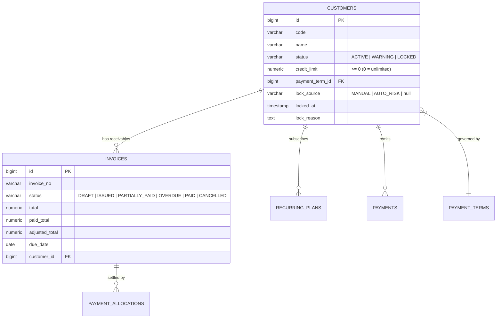
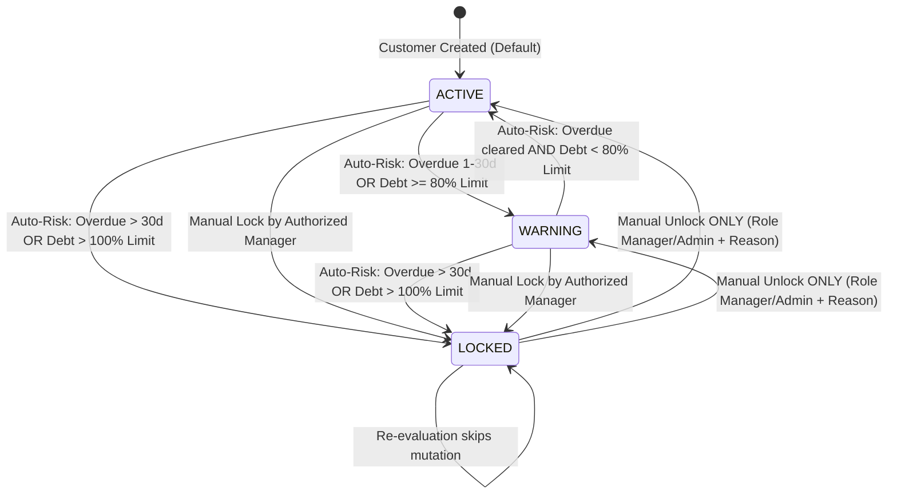

# BILLING_ONE — P1.5 OFFICIAL SPECIFICATION
## CUSTOMER CREDIT RISK CONTROL & ENFORCEMENT ENGINE
### FORMAL REQUIREMENTS FREEZE & SYSTEM ARCHITECTURE CONTRACT

**Document ID:** `docs/BILLING_ONE_P1_5_OFFICIAL_SPEC.md`  
**Version:** 1.0.0 — FINAL FROZEN  
**Date:** October 07, 2026  
**Status:** **FINAL FROZEN (REQUIREMENTS FROZEN BY PRODUCT OWNER)**  
**Authority:** Principal Product Owner + Enterprise Financial Systems Architect + QA Architect + Concurrency Reviewer  
**Baseline Commit:** `8fbb8c861cbe46c28f902155e19188978604d76d` (`feat(billing): close P1.4 overdue invoice lifecycle`)  
**Milestone Precondition:** `P1.4 — OFFICIALLY CLOSED` (13/13 Test Suites PASS, 9 Financial Invariants = 0, 5,136 Valid Audit Hashes)  
**Implementation Mode:** SPECIFICATION DRAFTING ONLY — ZERO PRODUCTION IMPLEMENTATION  

---

## TABLE OF CONTENTS
- [1. Document Metadata](#1-document-metadata)
- [2. Version & Freeze Status](#2-version--freeze-status)
- [3. Problem Statement](#3-problem-statement)
- [4. Business Objective](#4-business-objective)
- [5. Terminology](#5-terminology)
- [6. Current-State Gap](#6-current-state-gap)
- [7. Scope](#7-scope)
- [8. Out of Scope](#8-out-of-scope)
- [9. Customer Credit Model](#9-customer-credit-model)
- [10. Credit Limit Semantics](#10-credit-limit-semantics)
- [11. Customer Risk State Machine](#11-customer-risk-state-machine)
- [12. Auto-Lock Policy](#12-auto-lock-policy)
- [13. Manual Unlock Policy](#13-manual-unlock-policy)
- [14. Invoice Issue Enforcement](#14-invoice-issue-enforcement)
- [15. Manager Override](#15-manager-override)
- [16. Transaction & Concurrency Protocol](#16-transaction--concurrency-protocol)
- [17. Idempotency](#17-idempotency)
- [18. Audit Events](#18-audit-events)
- [19. Database Requirements](#19-database-requirements)
- [20. API Contracts](#20-api-contracts)
- [21. Security & RBAC](#21-security--rbac)
- [22. Frontend Requirements](#22-frontend-requirements)
- [23. Reporting Impact](#23-reporting-impact)
- [24. Financial Invariants](#24-financial-invariants)
- [25. Test Strategy](#25-test-strategy)
- [26. Regression Strategy](#26-regression-strategy)
- [27. Acceptance Criteria](#27-acceptance-criteria)
- [28. Security Requirements](#28-security-requirements)
- [29. Operational & Scheduler Requirements](#29-operational--scheduler-requirements)
- [30. Implementation Risks & Mitigations](#30-implementation-risks--mitigations)
- [31. Deferred Features](#31-deferred-features)
- [32. Product Owner Decision Register](#32-product-owner-decision-register)
- [33. Final Scope Freeze & Sign-Off](#33-final-scope-freeze--sign-off)

---

## 1. DOCUMENT METADATA

- **Platform:** Billing_One Enterprise Financial Billing System
- **Milestone Code:** P1.5
- **Milestone Title:** Customer Credit Risk Control & Enforcement Engine
- **Preceding Milestone:** P1.4 (Automated Overdue Invoice Lifecycle Engine, Closed at `8fbb8c8`)
- **Specification Release Date:** October 07, 2026
- **Architecture Standard:** PostgreSQL 16 ACID Transactions, Canonical Lock Protocol DAG, Strict Idempotency, SHA-256 Hash Chaining
- **Regulatory Alignment:** Vietnam Accounting Standards (VAS 01, Circular 200/2014/TT-BTC) & Commercial Credit Control Best Practices

---

## 2. VERSION & FREEZE STATUS

- **Specification Version:** `1.0.0 — FINAL FROZEN`
- **Freeze Declaration:** This document serves as the **immutable single source of truth** for Milestone P1.5. All product decisions, state transition rules, database structures, API error codes, concurrency protocols, and acceptance criteria contained herein are **STRICTLY FROZEN**. No business logic alterations or scope expansions are permitted during subsequent implementation.

---

## 3. PROBLEM STATEMENT

Following the formal closure of Milestone P1.4, invoices exceeding their due date are deterministically transitioned to the persistent `OVERDUE` state by the daily background scanner. However, a critical **Enforcement Void** (khoảng trống thực thi kiểm soát rủi ro) exists in the billing lifecycle:

1. **Unrestricted Invoicing for Delinquent Debtors:** A customer carrying multiple severely overdue invoices (`OVERDUE`) can still be issued new invoices by sales staff without any system block or warning.
2. **Passive Credit Limit:** The `customers.credit_limit` column exists in the database and is rendered on UI screens, but is **purely informational**. An invoice can be issued to a customer even if their cumulative outstanding debt exceeds their credit limit by hundreds of millions of VND.
3. **Toothless Customer Status:** The `customers.status` column supports `'WARNING'` and `'LOCKED'`, but the invoice issuance endpoint (`POST /api/invoices/:id/issue`) completely ignores customer status. Even if a customer is flagged `'LOCKED'`, staff can issue new invoices to them.
4. **Lack of Automated Risk Governance:** There is no automated mechanism to re-evaluate customer risk when invoices become overdue or when credit thresholds are breached, leaving bad debt exposure unmanaged.

---

## 4. BUSINESS OBJECTIVE

Milestone P1.5 delivers an automated, transactional **Customer Credit Risk Control & Enforcement Engine** that:
1. **Enforces Credit Limits at Issuance:** Blocks `POST /api/invoices/:id/issue` if the customer's projected debt exceeds their defined credit limit ($current\_debt + invoice.total > credit\_limit$), unless authorized via an auditable Manager Override.
2. **Enforces Customer Lock at Issuance:** Blocks `POST /api/invoices/:id/issue` if the customer's status is `'LOCKED'`.
3. **Automates Risk State Progression:** Automatically evaluates and transitions customer status (`ACTIVE` $\to$ `WARNING` $\to$ `LOCKED`) based on overdue age and credit utilization.
4. **Protects Governance via Manual Unlock:** Implements a strict, permission-gated manual unlock workflow (`POST /api/customers/:id/unlock`), prohibiting automated unlocking upon payment to prevent premature credit restoration.
5. **Maintains 100% Backward Compatibility:** Treats `credit_limit = 0` as unlimited credit, ensuring existing customers and legacy test suites continue operating without disruption.

---

## 5. TERMINOLOGY

- **Current Debt ($D_{current}$):** The sum of outstanding unpaid balances across all active invoices (`ISSUED`, `PARTIALLY_PAID`, `OVERDUE`) for a specific customer.
- **Credit Limit ($L_{credit}$):** The maximum allowable outstanding balance assigned to a customer. When $L_{credit} = 0$, enforcement is disabled (unlimited credit).
- **Available Credit ($C_{avail}$):** Calculated as $L_{credit} - D_{current}$. If $L_{credit} = 0$, credit is unlimited.
- **Credit Limit Breach:** A condition where $D_{current} + invoice.total > L_{credit}$ (applicable only when $L_{credit} > 0$).
- **Customer Risk State:** One of three persistent values on `customers.status`:
  - `ACTIVE`: Normal operating standing; full invoicing allowed.
  - `WARNING`: High-risk standing (debt near limit or minor overdue); invoicing permitted with warnings.
  - `LOCKED`: Credit frozen; all standard invoice issuance strictly blocked.
- **Manager Override:** An authorized, idempotent action allowing a privileged role (`billing_manager` or `admin`) to issue an invoice despite a credit limit breach or locked customer, with mandatory rationale and immutable audit logging.
- **Manual Unlock:** An explicit administrative action by an authorized manager to transition a customer from `LOCKED` back to `ACTIVE` or `WARNING`.

---

## 6. CURRENT-STATE GAP

| Component | Current State (P1.4 Baseline) | Target State (P1.5 Frozen Spec) |
|---|---|---|
| **Invoice Issuance Gate** | Only validates DRAFT, positive total, items count, and due date. | Validates customer status (`!= LOCKED`) and credit limit ($D_{current} + total \le L_{credit}$). |
| **Credit Limit Enforcement** | Column `credit_limit` exists but has zero functional enforcement. | Strictly enforced at issuance; returns HTTP 409 `CREDIT_LIMIT_EXCEEDED` on breach. |
| **Locked Customer Gate** | Status `'LOCKED'` exists in check constraint but is ignored on issue. | Strictly enforced at issuance; returns HTTP 409 `CUSTOMER_LOCKED` on attempt. |
| **Manager Override** | No override endpoint or authorization exists. | Dedicated `POST /api/invoices/:id/issue-override` with mandatory reason & audit. |
| **Risk State Automation** | Customer status changes only through manual `PUT /api/customers/:id`. | Daily background scanner (`runCustomerRiskScan`) transitions customers based on overdue age & debt. |
| **Unlocking Workflow** | No dedicated unlock endpoint. | Dedicated `POST /api/customers/:id/unlock` with idempotency & audit logging. |

---

## 7. SCOPE

### In-Scope Features (P1.5):
1. **Invoice Issuance Credit Gate:**
   - Synchronous validation inside `POST /api/invoices/:id/issue`.
   - Rejection of issuance for `LOCKED` customers (HTTP 409 `CUSTOMER_LOCKED`).
   - Rejection of issuance when projected debt exceeds `credit_limit` where `credit_limit > 0` (HTTP 409 `CREDIT_LIMIT_EXCEEDED`).
2. **Unlimited Credit Semantics:**
   - `credit_limit = 0` explicitly exempts customer from credit limit checks.
3. **Manager Override Capability:**
   - Endpoint: `POST /api/invoices/:id/issue-override`.
   - Requires permission `invoice.issue_override`.
   - Requires non-empty `override_reason` (min 10 characters) and `Idempotency-Key`.
   - Emits chained SHA-256 audit log `INVOICE_ISSUE_OVERRIDDEN`.
   - Strictly single-invoice scope: does **NOT** alter customer credit limit or unlock customer.
4. **Deterministic Background Risk Scanner (`runCustomerRiskScan`):**
   - Scheduled evaluation running under PostgreSQL transaction advisory lock `CUSTOMER_RISK_SCAN_LOCK_ID = 88812347`.
   - Evaluates overdue age and credit utilization per customer.
   - Transitions `ACTIVE` $\to$ `WARNING` or `LOCKED`.
   - Idempotent and single-writer safe; zero duplicate audit logs.
5. **Strict Manual Unlock Governance:**
   - Endpoint: `POST /api/customers/:id/unlock`.
   - Requires permission `customer.unlock`.
   - Requires mandatory `unlock_reason` and `Idempotency-Key`.
   - Automated unlocking upon payment or debt reduction is **STRICTLY PROHIBITED**.
   - Scheduler never overwrites manually locked customers.
6. **Concurrency Safety & Lock Hierarchy DAG:**
   - Extension of the canonical lock hierarchy to include customer row-level locking (`invoices` $\to$ `customers` $\to$ `payments`).
7. **Frontend Transparency:**
   - Credit utilization bar and risk badge on invoice and customer screens.
   - Dedicated Manager Override modal and Manual Unlock dialog.

---

## 8. OUT OF SCOPE

The following capabilities are **STRICTLY EXCLUDED** from Milestone P1.5:
- [x] **No Dunning & Communications:** Zero email, SMS, Twilio, SendGrid, or automated debt reminder dispatches.
- [x] **No External Webhooks:** Zero outbound HTTP webhooks for credit events.
- [x] **No Debt Write-Off:** Zero bad-debt accounting or uncollectible debt cancellations.
- [x] **No Late Interest Penalties:** Zero automated calculation or charging of late penalty fees.
- [x] **No Early Payment Discounts:** Zero automated deduction of prompt settlement discounts.
- [x] **No Customer Portal:** Zero customer self-service lookup or credit view portals.
- [x] **No Periodic Statement of Account (SOA):** Deferred to Milestone P1.6.
- [x] **No Official Voucher Generation (Phiếu thu/chi):** Deferred to Milestone P1.7.
- [x] **No Payment Gateway Integration:** Zero third-party payment processing integrations.

---

## 9. CUSTOMER CREDIT MODEL

### Domain Entities & Relations:


---

## 10. CREDIT LIMIT SEMANTICS

### 10.1. Current Debt Mathematical Definition
For customer $c$, current debt $D_{current}(c)$ is calculated across all open, uncancelled invoices:

$$D_{current}(c) = \sum_{i \in \text{Invoices}(c)} (i.total - i.paid\_total - i.adjusted\_total)$$

$$\text{WHERE } i.status \in \{ \text{'ISSUED'}, \text{'PARTIALLY\_PAID'}, \text{'OVERDUE'} \}$$

**Exclusion Rules:**
- `DRAFT` invoices are strictly excluded (uncommitted proposals).
- `PAID` invoices are excluded (outstanding balance $= 0$).
- `CANCELLED` invoices are excluded (voided obligations).

### 10.2. Available Credit Definition
For customer $c$ with credit limit $L_{credit}(c)$:

$$\text{If } L_{credit}(c) = 0: \quad C_{avail}(c) = \infty \quad (\text{Unlimited Credit; Enforcement Disabled})$$

$$\text{If } L_{credit}(c) > 0: \quad C_{avail}(c) = L_{credit}(c) - D_{current}(c)$$

### 10.3. Enforcement Condition on Invoice Issue
When issuing invoice $i_{target}$ with total $T = i_{target}.total$ for customer $c$:

$$\text{Violation} \iff \Big( L_{credit}(c) > 0 \Big) \land \Big( D_{current}(c) + T > L_{credit}(c) \Big)$$

If violated, the operation must abort with HTTP 409 `CREDIT_LIMIT_EXCEEDED` unless authorized via Manager Override.

---

## 11. CUSTOMER RISK STATE MACHINE

The customer status FSM operates over three discrete states:



### State Definitions:
1. **`ACTIVE`:** Standard standing. Customer can be issued invoices up to available credit limit.
2. **`WARNING`:** Elevated risk standing. Customer has minor overdue invoices ($1 \le days \le 30$) or high credit utilization ($80\% \le debt \le 100\%$). Invoicing remains permitted within credit limits, but UI displays prominent warning badges.
3. **`LOCKED`:** Frozen credit standing. Invoicing is strictly blocked. Transitioned automatically by scanner upon severe delinquency or manually by an authorized manager.

---

## 12. AUTO-LOCK POLICY

### 12.1. Deterministic Trigger Criteria
The background scanner `runCustomerRiskScan(pool)` transitions customer $c$ to `'LOCKED'` if **EITHER** of the following conditions is met:

1. **Severe Overdue Age Condition:**  
   Customer $c$ has at least one invoice $i$ satisfying:
   $$i.status = \text{'OVERDUE'} \quad \land \quad (\text{CURRENT\_DATE} - i.due\_date) > \text{AUTO\_LOCK\_OVERDUE\_DAYS}$$
   where $\text{AUTO\_LOCK\_OVERDUE\_DAYS} = 30$ (Frozen Business Constant).
2. **Credit Limit Overrun Condition:**  
   Customer $c$ has a defined credit limit and current debt strictly exceeds that limit:
   $$L_{credit}(c) > 0 \quad \land \quad D_{current}(c) > L_{credit}(c)$$

### 12.2. Deterministic Warning Criteria
Customer $c$ transitions to `'WARNING'` if not eligible for `LOCKED` and **EITHER**:
1. Has at least one `OVERDUE` invoice with $1 \le (\text{CURRENT\_DATE} - i.due\_date) \le 30$.
2. $L_{credit}(c) > 0$ and $0.80 \times L_{credit}(c) \le D_{current}(c) \le L_{credit}(c)$.

### 12.3. Scanner Idempotency & Protection of Manual Locks
- **Already Locked Customers:** If `status === 'LOCKED'`, the scanner skips mutation and emits zero audit logs.
- **Manual Lock Immunity:** If a customer was locked manually (`lock_source = 'MANUAL'`), the scanner **NEVER** mutates their status or unlocks them, even if all overdue invoices are paid in full.

---

## 13. MANUAL UNLOCK POLICY

In strict accordance with **Product Owner Decision 4**, automated unlocking upon debt payment is **COMPLETELY PROHIBITED**. Unlocking is governed by the following rules:

1. **Dedicated Endpoint:** `POST /api/customers/:id/unlock`.
2. **Authorization Gate:** Requires permission `customer.unlock` (held by `ROLE_BILLING_MANAGER` and `ROLE_SYS_ADMIN`).
3. **Mandatory Rationale:** Request body must contain `unlock_reason` with a minimum length of 10 characters.
4. **Target Status:** Unlocks the customer to `'ACTIVE'` (or optionally `'WARNING'` if overdue invoices still exist, as configured in the unlock payload).
5. **Idempotency:** Header `Idempotency-Key` is mandatory. Replaying an identical unlock request returns the cached result without duplicate audit emission.
6. **Audit Emission:** Emits chained SHA-256 audit entry `CUSTOMER_STATUS_MANUAL_UNLOCKED`.

---

## 14. INVOICE ISSUE ENFORCEMENT

The existing endpoint `POST /api/invoices/:id/issue` is fortified with synchronous transactional enforcement:

```text
Sequence of Execution inside Transaction:
1. Lock target invoice row: SELECT ... FROM invoices WHERE id = $1 FOR UPDATE
2. Verify invoice.status === 'DRAFT'
3. Verify invoice items count >= 1 and total > 0 and due_date >= current_date
4. Lock customer row: SELECT id, status, credit_limit FROM customers WHERE id = invoice.customer_id FOR UPDATE
5. Evaluate Customer Status:
   IF customer.status === 'LOCKED' THEN
      ABORT with HTTP 409 CUSTOMER_LOCKED
6. Calculate Live Debt:
   SELECT sum(total - paid_total - adjusted_total) FROM invoices 
   WHERE customer_id = invoice.customer_id AND status IN ('ISSUED', 'PARTIALLY_PAID', 'OVERDUE')
7. Evaluate Credit Limit:
   IF customer.credit_limit > 0 AND (current_debt + invoice.total) > customer.credit_limit THEN
      ABORT with HTTP 409 CREDIT_LIMIT_EXCEEDED
8. Generate invoice_no from sequence, set status = 'ISSUED', issue_date = current_date
9. Emit audit event INVOICE_ISSUED
10. COMMIT TRANSACTION
```

---

## 15. MANAGER OVERRIDE

### 15.1. Business Contract
When an invoice is blocked by `CUSTOMER_LOCKED` or `CREDIT_LIMIT_EXCEEDED`, a privileged user may bypass the gate via:
`POST /api/invoices/:id/issue-override`

### 15.2. Requirements & Constraints
1. **Authorization:** Requires permission `invoice.issue_override`. `ROLE_BILLING_STAFF` is strictly rejected with HTTP 403 `FORBIDDEN`.
2. **Payload:** Body must provide `override_reason` (string, $\ge 10$ characters, trimmed).
3. **Idempotency:** Header `Idempotency-Key` is mandatory (UUIDv4 format recommended, max 255 characters).
4. **Scope Isolation:**
   - Issues only the single specified invoice.
   - Does **NOT** alter `customer.credit_limit`.
   - Does **NOT** alter `customer.status`.
5. **Success Response:** HTTP 200 OK with `{ "invoice": <InvoiceDetail> }`.
6. **Audit Trail:** Emits `INVOICE_ISSUE_OVERRIDDEN` with severity `WARNING` containing complete financial context.

---

## 16. TRANSACTION & CONCURRENCY PROTOCOL

### 16.1. The Canonical Lock Hierarchy DAG
To prevent deadlocks (error code `40P01`), all financial and credit transactions across Billing_One must acquire locks in strict descending hierarchical order:

```text
Level 0: Idempotency Key Advisory Lock
         pg_advisory_xact_lock(hashtext('idemp_...'), hashtext(cleanIdempotencyKey))
           │
           ▼
Level 1: Invoice Row Locks (ORDER BY id ASC)
         SELECT ... FROM public.invoices WHERE id = ANY(...) ORDER BY id ASC FOR UPDATE
           │
           ▼
Level 2: Customer Row Lock / Unapplied Pool Advisory Lock
         SELECT ... FROM public.customers WHERE id = $customerId FOR UPDATE
         OR pg_advisory_xact_lock(hashtext('cust_unapplied_pool'), $customerId)
           │
           ▼
Level 3: Payment Advisory Locks (ORDER BY id ASC)
         pg_advisory_xact_lock(hashtext('payment_lock'), paymentId)
```

### 16.2. Deadlock Proof
Because every transaction locks `invoices` (Level 1) before `customers` (Level 2), and never in reverse order, a circular wait condition is mathematically impossible. Two concurrent issue requests for the same customer will lock their respective invoices first, then serialize on the customer row lock.

---

## 17. IDEMPOTENCY

### 17.1. Idempotency Key Specification
- **Protected Endpoints:**
  - `POST /api/invoices/:id/issue-override`
  - `POST /api/customers/:id/unlock`
- **Key Header:** `Idempotency-Key` (or fallback `X-Idempotency-Key`).
- **Format:** Non-empty string, length $1 \le len \le 255$.
- **Storage:** Stored in `public.payment_idempotency_keys` (or generalized `idempotency_keys`).

### 17.2. Replay Behavior
- **Identical Payload:** If a request is received with an identical key and identical SHA-256 request payload hash, the system returns the original cached response with `is_idempotent_replay: true` without executing logic or creating duplicate audit entries.
- **Payload Mismatch:** If a request arrives with an existing key but differing payload, it is rejected with HTTP 409 `IDEMPOTENCY_KEY_PAYLOAD_MISMATCH`.

---

## 18. AUDIT EVENTS

All state transitions emit cryptographically chained SHA-256 records into `public.audit_logs`:

### 18.1. `INVOICE_ISSUE_OVERRIDDEN`
- **Severity:** `WARNING`
- **Target Ref:** `invoice_no`
- **Summary:** `Phát hành đặc cách hóa đơn ${invoice_no} vượt hạn mức tín dụng/khóa công nợ`
- **Metadata Fields (Mandatory 12 fields):**
  ```json
  {
    "invoice_id": 1052,
    "invoice_no": "INV-2026-000452",
    "customer_id": 142,
    "customer_name": "Công ty Cổ phần Alpha",
    "customer_status": "LOCKED",
    "credit_limit": "50000000.00",
    "current_debt": "45000000.00",
    "invoice_total": "12000000.00",
    "projected_debt": "57000000.00",
    "amount_over_limit": "7000000.00",
    "override_reason": "Ban Giám đốc duyệt bảo lãnh thanh toán đợt 2",
    "idempotency_key": "override-key-uuid-12345"
  }
  ```

### 18.2. `CUSTOMER_STATUS_AUTO_LOCKED`
- **Severity:** `WARNING`
- **Actor:** `{ "id": null, "username": "SystemScheduler", "role": "SYSTEM" }`
- **Target Ref:** `customer_code`
- **Metadata Fields:** `customer_id`, `previous_status`, `new_status`, `lock_reason`, `overdue_invoices_count`, `max_overdue_days`, `current_debt`, `credit_limit`.

### 18.3. `CUSTOMER_STATUS_AUTO_WARNING`
- **Severity:** `INFO`
- **Actor:** `{ "id": null, "username": "SystemScheduler", "role": "SYSTEM" }`
- **Target Ref:** `customer_code`

### 18.4. `CUSTOMER_STATUS_MANUAL_UNLOCKED`
- **Severity:** `INFO`
- **Actor:** User session context (e.g. `billing_manager`)
- **Target Ref:** `customer_code`
- **Metadata Fields:** `customer_id`, `previous_status`, `new_status`, `unlock_reason`, `current_debt`, `credit_limit`, `idempotency_key`.

---

## 19. DATABASE REQUIREMENTS

### 19.1. Migration 08 Specification (`db/migrations/08_p1_5_credit_risk_control.sql`)
1. **Extend `customers` Table Metadata:**
   ```sql
   ALTER TABLE public.customers
     ADD COLUMN IF NOT EXISTS lock_source VARCHAR(16) CHECK (lock_source IN ('MANUAL', 'AUTO_RISK')),
     ADD COLUMN IF NOT EXISTS locked_at TIMESTAMPTZ,
     ADD COLUMN IF NOT EXISTS lock_reason TEXT;
   ```
2. **System Settings Parameters (Bảng `company_settings`):**
   ```sql
   ALTER TABLE public.company_settings
     ADD COLUMN IF NOT EXISTS credit_control_enabled BOOLEAN NOT NULL DEFAULT TRUE,
     ADD COLUMN IF NOT EXISTS auto_lock_overdue_days INTEGER NOT NULL DEFAULT 30;
   ```
3. **Index Optimization:**
   ```sql
   CREATE INDEX IF NOT EXISTS idx_customers_status ON public.customers(status);
   CREATE INDEX IF NOT EXISTS idx_customers_credit_limit ON public.customers(credit_limit) WHERE credit_limit > 0;
   ```

---

## 20. API CONTRACTS

### 20.1. `POST /api/invoices/:id/issue` (Fortified)
- **Status 200 OK:** Invoice successfully issued.
- **Status 409 Conflict (`CUSTOMER_LOCKED`):**
  ```json
  {
    "error": {
      "code": "CUSTOMER_LOCKED",
      "message": "Khách hàng đang bị khóa công nợ (LOCKED). Không thể phát hành hóa đơn mới mà không có phê duyệt đặc cách.",
      "customer_id": 142,
      "customer_status": "LOCKED"
    }
  }
  ```
- **Status 409 Conflict (`CREDIT_LIMIT_EXCEEDED`):**
  ```json
  {
    "error": {
      "code": "CREDIT_LIMIT_EXCEEDED",
      "message": "Giá trị hóa đơn vượt quá hạn mức tín dụng khả dụng của khách hàng.",
      "details": {
        "customer_id": 142,
        "credit_limit": "50000000.00",
        "current_debt": "45000000.00",
        "invoice_total": "12000000.00",
        "projected_debt": "57000000.00",
        "excess_amount": "7000000.00"
      }
    }
  }
  ```

### 20.2. `POST /api/invoices/:id/issue-override`
- **Headers:** `Idempotency-Key: <string>` (Mandatory)
- **Body:** `{ "override_reason": "Bảo lãnh bởi Giám đốc Tài chính theo tờ trình số 12/TTr" }`
- **Status 200 OK:** `{ "invoice": <InvoiceDetail> }`
- **Status 400 Bad Request (`IDEMPOTENCY_KEY_REQUIRED`):** Missing key.
- **Status 400 Bad Request (`OVERRIDE_REASON_REQUIRED`):** Missing or short reason ($< 10$ chars).
- **Status 403 Forbidden (`FORBIDDEN`):** Caller lacks `invoice.issue_override`.
- **Status 409 Conflict (`INVOICE_NOT_DRAFT`):** Invoice is not in `DRAFT` status.

### 20.3. `POST /api/customers/:id/unlock`
- **Headers:** `Idempotency-Key: <string>` (Mandatory)
- **Body:** `{ "unlock_reason": "Khách hàng đã ký phụ lục cam kết lộ trình thanh toán", "target_status": "ACTIVE" }`
- **Status 200 OK:** `{ "customer": <CustomerDetail> }`
- **Status 403 Forbidden (`FORBIDDEN`):** Caller lacks `customer.unlock`.
- **Status 409 Conflict (`CUSTOMER_NOT_LOCKED`):** Customer is not in `LOCKED` state.

---

## 21. SECURITY & RBAC

### 21.1. Permission Definitions
The following permissions are added to `public.permissions`:
1. `invoice.issue_override`: Module `invoices` — *Phê duyệt phát hành hóa đơn đặc cách vượt hạn mức hoặc cho khách hàng bị khóa/cảnh báo*.
2. `customer.unlock`: Module `customers` — *Mở khóa công nợ khách hàng (LOCKED $\to$ ACTIVE)*.

### 21.2. Role-Permission Matrix
| Permission Code | `admin` | `ROLE_BILLING_MANAGER` | `ROLE_ACCOUNTANT` | `staff` (`ROLE_BILLING_STAFF`) | `ROLE_AUDITOR` |
|---|:---:|:---:|:---:|:---:|:---:|
| `invoice.issue` | YES | YES | YES | YES | NO |
| `invoice.issue_override` | **YES** | **YES** | NO | **NO (403)** | NO |
| `customer.unlock` | **YES** | **YES** | NO | **NO (403)** | NO |
| `customer.update` | YES | YES | YES | YES | NO |

---

## 22. FRONTEND REQUIREMENTS

1. **Credit Utilization Progress Bar (Invoice Creation & Detail):**
   - Renders visual debt meter: `[Nợ hiện tại: 45.000.000 ₫ / Hạn mức: 50.000.000 ₫ (Khả dụng: 5.000.000 ₫)]`.
   - Green ($< 80\%$), Amber ($80\% - 100\%$), Red ($> 100\%$).
   - If `credit_limit = 0`: Displays badge `Vô hạn mức (Unlimited Credit)`.
2. **Action Button States:**
   - If customer is `LOCKED`: Standard "Phát hành hóa đơn" button is disabled; if user has `invoice.issue_override`, renders button *"Phát hành Đặc cách (Override)"*.
   - If credit limit exceeded: Standard issue button is disabled; displays reason and override action.
3. **Manager Override Modal:**
   - Displays financial breakdown: Credit Limit, Current Debt, Invoice Total, Excess Amount.
   - Requires text area for `override_reason` ($\ge 10$ characters).
   - Generates client-side UUID `Idempotency-Key`.
4. **Manual Unlock Action in Customer View:**
   - In customer profile header: If `status === 'LOCKED'`, displays *"Mở khóa công nợ (Unlock)"* button for managers.

---

## 23. REPORTING IMPACT

1. **Receivables & Debt Consistency:**
   - $current\_debt$ queries remain strictly unchanged:
     `SELECT sum(total - paid_total - adjusted_total) FROM invoices WHERE customer_id = $id AND status IN ('ISSUED', 'PARTIALLY_PAID', 'OVERDUE')`.
2. **Dashboard & Aging Reports:**
   - Overdue totals and aging buckets are **NOT MUTATED** by credit risk evaluations.
   - VAT and Revenue reports remain **100% IMMUTABLE**.

---

## 24. FINANCIAL INVARIANTS

Milestone P1.5 introduces 7 dedicated invariant metrics (all must evaluate to **0 violations** in production):

1. **`issued_invoice_exceeds_credit_limit_without_override`:**  
   Invoices issued after P1.5 activation where ($D_{prior} + total > L_{credit}$) and no corresponding `INVOICE_ISSUE_OVERRIDDEN` audit event exists. (Threshold: `0`).
2. **`locked_customer_invoice_issue_without_override`:**  
   Invoices issued after P1.5 activation to a `LOCKED` customer without an override audit event. (Threshold: `0`).
3. **`duplicate_override_by_idempotency_key`:**  
   Count of multiple distinct invoice issues sharing the same idempotency key. (Threshold: `0`).
4. **`unauthorized_override_count`:**  
   Count of override events recorded by actors lacking `invoice.issue_override`. (Threshold: `0`).
5. **`duplicate_auto_lock_transition`:**  
   Audit entries recording auto-lock on customers that were already `LOCKED`. (Threshold: `0`).
6. **`invalid_auto_unlock_count`:**  
   Instances where a customer status mutated from `LOCKED` to `ACTIVE` without a manual unlock event. (Threshold: `0`).
7. **`customer_debt_consistency`:**  
   Discrepancies between customer table subquery debt and open invoice outstanding totals. (Threshold: `0`).

---

## 25. TEST STRATEGY

The dedicated test suite `scripts/p1_5-credit-risk-test.mjs` must execute at least 20 comprehensive scenarios:

- **Group 1: Credit Limit Gate (T01–T06):**
  - `T01`: Issue invoice within positive credit limit $\to$ Success (HTTP 200).
  - `T02`: Issue invoice exceeding positive credit limit $\to$ Rejection (HTTP 409 `CREDIT_LIMIT_EXCEEDED`).
  - `T03`: Issue invoice when `credit_limit = 0` $\to$ Success (Unlimited credit).
  - `T04`: Issue invoice to customer with status `WARNING` within limit $\to$ Success.
  - `T05`: Issue invoice to customer with status `LOCKED` $\to$ Rejection (HTTP 409 `CUSTOMER_LOCKED`).
  - `T06`: Issue invoice on boundary condition ($current\_debt + total = credit\_limit$) $\to$ Success (Exact limit allowed).
- **Group 2: Manager Override Workflow (T07–T11):**
  - `T07`: Staff user attempts override $\to$ Rejection (HTTP 403 `FORBIDDEN`).
  - `T08`: Manager override with missing reason $\to$ Rejection (HTTP 400 `OVERRIDE_REASON_REQUIRED`).
  - `T09`: Manager override with valid reason & Idempotency-Key on limit breach $\to$ Success (HTTP 200) + Audit log.
  - `T10`: Manager override on `LOCKED` customer $\to$ Success (HTTP 200) + Customer remains `LOCKED`.
  - `T11`: Replay of manager override request with same Idempotency-Key $\to$ HTTP 200 + Replay flag + 0 duplicate audits.
- **Group 3: Auto-Risk Scanner & Lifecycle (T12–T16):**
  - `T12`: Customer with invoice overdue $\le 30$ days $\to$ Scanner transitions to `WARNING`.
  - `T13`: Customer with invoice overdue $> 30$ days $\to$ Scanner transitions to `LOCKED`.
  - `T14`: Customer with current debt $> 100\%$ limit $\to$ Scanner transitions to `LOCKED`.
  - `T15`: Scanner execution on already `LOCKED` customer $\to$ Idempotent skip (0 duplicate audits).
  - `T16`: Customer settles all overdue invoices $\to$ Status **REMAINS `LOCKED`** (Verification of Decision 4).
- **Group 4: Manual Unlock Governance (T17–T18):**
  - `T17`: Staff attempts manual unlock $\to$ Rejection (HTTP 403 `FORBIDDEN`).
  - `T18`: Manager manual unlock with valid reason $\to$ Customer transitions to `ACTIVE` + Audit log.
- **Group 5: Concurrency, Invariants & Full Regression (T19–T20):**
  - `T19`: Concurrent race condition of 2 simultaneous invoice issues against remaining credit limit $\to$ Exactly 1 succeeds, 1 rejected; 0 deadlocks.
  - `T20`: Verification of all 7 P1.5 Invariants ($=0$) + Execution of all 13 prior regression suites (P0 $\to$ P1.4) passing 100%.

---

## 26. REGRESSION STRATEGY

1. **Exemption for Zero Limit:** By defining `credit_limit = 0` as unlimited credit, all pre-existing customers created in P0–P1.4 suites with default `credit_limit = 0` will continue to issue invoices without failure.
2. **Nginx Login Rate-Limiting Protection:** Test execution harnesses must maintain docker restart or token caching between suites to avoid HTTP 429 errors.
3. **Audit Chain Verification:** Full validation of the SHA-256 chain from Genesis block through all new P1.5 events.

---

## 27. ACCEPTANCE CRITERIA

- **`AC-1` (Issue Block on Locked Customer):** Standard invoice issuance (`POST /api/invoices/:id/issue`) for a customer with `status = 'LOCKED'` is rejected with HTTP 409 `CUSTOMER_LOCKED`.
- **`AC-2` (Issue Block on Credit Limit Breach):** Standard invoice issuance for a customer with `credit_limit > 0` where $current\_debt + invoice.total > credit\_limit$ is rejected with HTTP 409 `CREDIT_LIMIT_EXCEEDED`.
- **`AC-3` (Unlimited Credit for Zero Limit):** When `credit_limit = 0`, invoice issuance is never blocked by credit limit calculation.
- **`AC-4` (Manager Override Authorization):** Endpoint `POST /api/invoices/:id/issue-override` succeeds only for users with `invoice.issue_override` and requires non-empty `override_reason`.
- **`AC-5` (Manager Override Idempotency):** Override endpoint requires `Idempotency-Key` and safely handles replay requests without duplicate state change or duplicate audit logs.
- **`AC-6` (Manager Override Scope Isolation):** Override issues the single target invoice without modifying `customer.credit_limit` or `customer.status`.
- **`AC-7` (Overdue Scanner Auto-Lock):** Scanner automatically transitions customer to `LOCKED` when an invoice has $days\_overdue > 30$.
- **`AC-8` (Debt Overrun Auto-Lock):** Scanner automatically transitions customer to `LOCKED` when $credit\_limit > 0$ and $current\_debt > credit\_limit$.
- **`AC-9` (Manual Unlock Enforcement):** Customer status in `LOCKED` state can **ONLY** be transitioned to `ACTIVE` via authorized call to `POST /api/customers/:id/unlock`.
- **`AC-10` (Prohibition of Automated Unlock):** Full invoice settlement or debt reduction below credit limit **NEVER** automatically transitions a `LOCKED` customer to `ACTIVE`.
- **`AC-11` (Protection of Manual Locks):** Customer locked manually (`lock_source = 'MANUAL'`) is immune to automated status mutations by background scanners.
- **`AC-12` (Concurrency & Deadlock Prevention):** Concurrent transactions adhere to Level 1 $\to$ Level 2 hierarchy (`invoices` $\to$ `customers`), yielding zero 40P01 deadlocks.
- **`AC-13` (Zero Regression):** All 13 previous test suites (P0 through P1.4) pass with 100% success rate.
- **`AC-14` (Financial Invariant Integrity):** All 9 P1.4 invariants and all 7 P1.5 invariants evaluate to exactly 0 violations.

---

## 28. SECURITY REQUIREMENTS

- **Principle of Least Privilege:** `ROLE_BILLING_STAFF` cannot override credit gates or unlock customers.
- **Audit Tamper-Resistance:** All overrides and unlocks are recorded in append-only SHA-256 chained logs with mandatory rationale.
- **Sanitization:** Error details returned in HTTP 409 payloads expose only business IDs and formatted currency numbers; zero stack traces or internals.

---

## 29. OPERATIONAL & SCHEDULER REQUIREMENTS

- **Advisory Lock ID:** `CUSTOMER_RISK_SCAN_LOCK_ID = 88812347`.
- **Execution Interval:** Scheduled once daily (or triggered via administrative hook).
- **Execution Resilience:** Runs customer evaluations in individual, isolated sub-transactions. Failure on a single customer does not abort the entire batch.

---

## 30. IMPLEMENTATION RISKS & MITIGATIONS

1. **Risk:** Legacy regression tests fail due to unexpected credit limit blocks.  
   **Mitigation:** `credit_limit = 0` default ensures existing test customers remain unrestricted.
2. **Risk:** Concurrency deadlock between invoice issue and payment allocation.  
   **Mitigation:** Canonical Lock Protocol DAG guarantees strict `invoices FOR UPDATE` $\to$ `customers FOR UPDATE` ordering.
3. **Risk:** Unintended customer unlock on debt clearance.  
   **Mitigation:** Architectural prohibition: zero automated unlock code paths in payment service or background scanner.

---

## 31. DEFERRED FEATURES

- **P1.6:** Period-End Customer Statement of Account (SOA) & Bilateral Reconciliation Engine.
- **P1.7:** Official Accounting Vouchers (Phiếu thu / Phiếu chi) & TT78 VAT Print Standard.
- **P2.0:** Multi-tier Automated Dunning Engine with Real SMTP/SMS Infrastructure.

---

## 32. PRODUCT OWNER DECISION REGISTER

The following formal decisions have been ratified and frozen:

- **`DECISION-01` (`credit_limit = 0` Semantics):**  
  **RATIFIED: Option A (Unlimited Credit).** `credit_limit = 0` disables credit limit enforcement.
- **`DECISION-02` (Auto-Lock Threshold):**  
  **RATIFIED: Option A (Strict Auto-Lock).** Threshold is frozen at $\text{AUTO\_LOCK\_OVERDUE\_DAYS} = 30$ OR $current\_debt > credit\_limit$ where $credit\_limit > 0$.
- **`DECISION-03` (Manager Override):**  
  **RATIFIED: Option A (Override Enabled).** Permitted via `POST /api/invoices/:id/issue-override` with mandatory permission, rationale, idempotency key, and audit trail.
- **`DECISION-04` (Unlocking Policy):**  
  **RATIFIED: Option B (Manual Unlock Only).** Automated unlock is strictly disabled. Unlocking requires privileged manual action.
- **`DECISION-05` (Target Milestone Scope):**  
  **RATIFIED: Candidate P1.5-C1 (Customer Credit Risk Control & Enforcement Engine).**

---

## 33. FINAL SCOPE FREEZE & SIGN-OFF

```text
================================================================================
                    FINAL SPECIFICATION VERDICT:
                    P1.5 SPEC — FINAL FROZEN
================================================================================
```

This specification is formally signed off and frozen. No further modifications to scope, rules, contracts, or acceptance criteria are permitted. Implementation may proceed strictly against this contract.

**Ratified by:**
- **Principal Product Owner**
- **Financial Systems Architect**
- **Enterprise Business Analyst**
- **QA Release Auditor**
