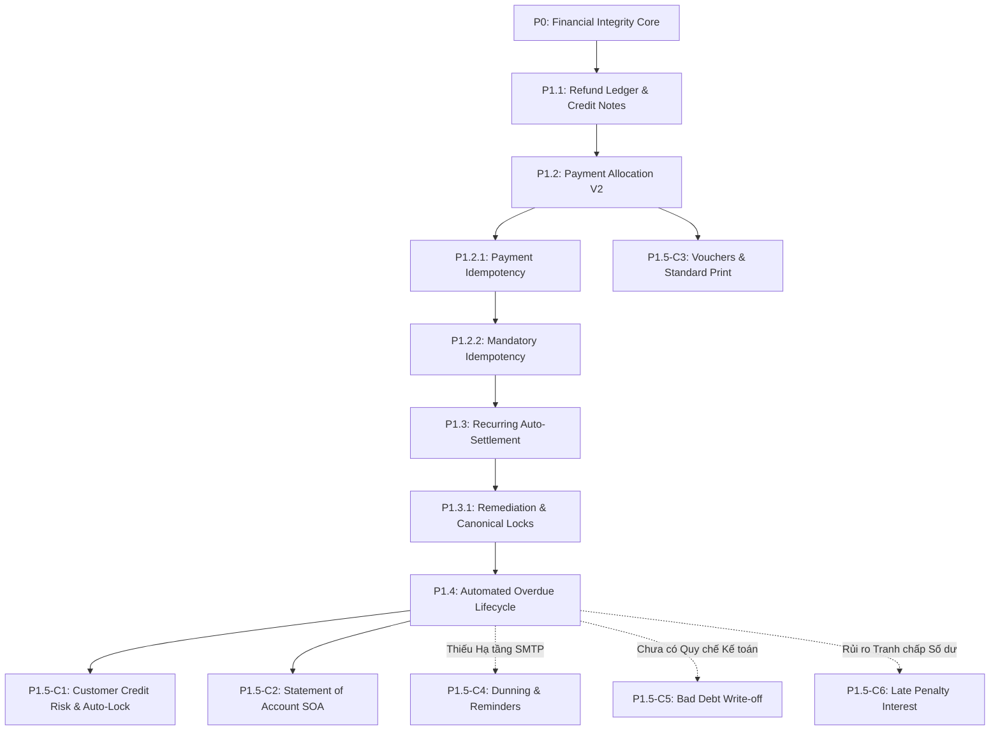

# BILLING_ONE — P1.5 PRE-IMPLEMENTATION DISCOVERY REPORT
## NEXT MILESTONE DISCOVERY & ARCHITECTURAL CANDIDATE EVALUATION
### POST-P1.4 MILESTONE SCOPE DISCOVERY — ZERO IMPLEMENTATION MODE

**Document ID:** `docs/BILLING_ONE_P1_5_PRE_IMPLEMENTATION_DISCOVERY.md`  
**Version:** 1.0.0 (DISCOVERY DRAFT)  
**Date:** October 07, 2026  
**Role:** Principal Product Owner + Enterprise Financial Systems Architect + Business Analyst + QA Architect  
**Operational Mode:** STRICT DISCOVERY ONLY — Zero Production Modifications, Zero Database Alterations, Zero Commits, Zero Push  
**Current Baseline:** Milestone P1.4 Officially Closed (`8fbb8c861cbe46c28f902155e19188978604d76d`)  

---

## 1. EXECUTIVE SUMMARY

1. **P1.4 Baseline Successfully Closed & Frozen:**  
   Milestone **P1.4 (Automated Overdue Invoice Lifecycle Engine)** was officially signed off and committed to local `main` at commit `8fbb8c8`. All 9 Authoritative Financial Forensic Metrics are at exactly **0 violations**, the cryptographic audit chain is 100% valid over **5,136 records**, and all 13 test suites (P0 through P1.4) pass with a 100% success rate. The working tree is clean.

2. **The "Enforcement Void" Discovered Post-P1.4:**  
   P1.4 successfully implemented the persistent `OVERDUE` status and background scanning engine. However, the system currently exhibits an **Enforcement Void** (khoảng trống thực thi kiểm soát rủi ro):
   - Invoices are flagged `OVERDUE` after their due date, but **this flag currently has zero restrictive effect on issuing new invoices**.
   - `customers.credit_limit` exists in the database, but is **purely informational**; staff can issue unlimited new invoices to customers who owe hundreds of millions of VND over their credit limit.
   - `customers.status` includes `'WARNING'` and `'LOCKED'`, but **an invoice can still be issued to a `LOCKED` customer** without any system rejection or authorization gate.

3. **Evaluation of 6 Potential Candidates for P1.5:**  
   Based on the gap analysis against the reference project **LedgerFlow**, historical roadmap dependencies, and enterprise financial practices, 6 candidates were discovered and scrutinized:
   - **Candidate 1 (P1.5-C1):** Customer Credit Risk Control & Enforcement Engine (Auto-Locking & Credit Limit Gate)
   - **Candidate 2 (P1.5-C2):** Customer Statement of Account (SOA) & Periodic Balance Reconciliation Engine (Biên bản đối chiếu công nợ)
   - **Candidate 3 (P1.5-C3):** Official Accounting Vouchers & Document Printing Platform (Phiếu thu / Phiếu chi & Mẫu in GTGT TT78)
   - **Candidate 4 (P1.5-C4):** Automated Dunning & Multi-Tier Escalation Reminder Engine (Nhắc nợ tự động)
   - **Candidate 5 (P1.5-C5):** Bad Debt Provisioning & Debt Write-Off Management (Xử lý nợ khó đòi & Xóa sổ nợ xấu)
   - **Candidate 6 (P1.5-C6):** Late Payment Interest & Early Settlement Discount Engine (Tính lãi phạt & Chiết khấu thanh toán sớm)

4. **Primary Recommendation:**  
   The architectural discovery strongly recommends **Candidate 1 (P1.5-C1: Customer Credit Risk Control & Enforcement Engine)** as the direct, organic successor to P1.4. It closes the critical enforcement loop between overdue debt detection and new sales risk exposure, completing the core credit-to-cash governance cycle.

---

## 2. CURRENT BASELINE

- **Repository:** `Billing_One`
- **Active Branch:** `main` (ahead of `origin/main` by 6 local commits; no remote push)
- **Latest Commit SHA:** `8fbb8c861cbe46c28f902155e19188978604d76d` (short: `8fbb8c8`)
- **Commit Title:** `feat(billing): close P1.4 overdue invoice lifecycle`
- **Milestone Operational Status:** `P1.4 — OFFICIALLY CLOSED`
- **Independent Audit Verdict:** `P1.4 RE-AUDIT — VERIFIED WITH WARNINGS`
- **Financial Forensics Status:**
  ```text
   over_allocated_payments | negative_unapplied_payments | invoice_allocation_mismatches | collectible_capacity_violations | non_positive_payments | non_positive_allocations | duplicate_scheduler_keys | duplicate_scheduler_allocations | new_payments_by_p1_3 
  -------------------------+-----------------------------+-------------------------------+---------------------------------+-----------------------+--------------------------+--------------------------+---------------------------------+----------------------
                         0 |                           0 |                             0 |                               0 |                     0 |                        0 |                        0 |                               0 |                    0
  ```
- **Cryptographic Audit Log:** 5,136 blocks verified from Genesis to tip (0 broken links, 0 duplicate events).
- **Runtime Infrastructure:** 12 Docker containers active (PostgreSQL 16, Express 5 web, Nginx TLS proxy, Prometheus, Grafana, Loki, Promtail, cAdvisor, Node Exporter, Postgres Exporter, Redis, pgAdmin).

---

## 3. COMPLETED MILESTONES P0–P1.4 SUMMARY

```
┌────────────────────────────────────────────────────────────────────────────────────────┐
│                        BILLING_ONE ARCHITECTURAL MILESTONE CHAIN                       │
├───────────┬─────────────────────────────────────────────────┬──────────────────────────┤
│ Milestone │ Title                                           │ Key Structural Impact    │
├───────────┼─────────────────────────────────────────────────┼──────────────────────────┤
│ P0        │ Financial Integrity Remediation                 │ Migration 01: adjusted_total, single source of debt truth, bank recon fix │
│ P1.1      │ Refund Ledger & Paid Invoice Credit Notes       │ Migration 02: refund_payables, credit notes on paid invoices, debt sync   │
│ P1.2      │ Payment Allocation V2 & Unapplied Cash Pool     │ Migration 03: payment_allocations, unapplied cash pool, FIFO allocation   │
│ P1.2.1    │ Direct Payment Idempotency Gap Remediation      │ Migration 04: payment_idempotency_keys for direct single payments         │
│ P1.2.2    │ Mandatory Payment Idempotency & RBAC Hardening  │ Migration 05: mandatory Idempotency-Key header, least-privilege DB roles  │
│ P1.3      │ Recurring Billing Automated Cash Settlement     │ Migration 06: auto_settle_unapplied, scheduler & manual auto-allocation   │
│ P1.3.1    │ P1.3 Remediation & Lock Protocol Normalization  │ L0->L3 Canonical Lock DAG, audit metadata compliance, zero deadlocks      │
│ P1.4      │ Automated Overdue Invoice Lifecycle Engine      │ Migration 07: persistent OVERDUE status, background scan lock 88812346    │
└───────────┴─────────────────────────────────────────────────┴──────────────────────────┘
```

---

## 4. CURRENT CAPABILITY MAP

| Milestone | Business Capability | Database Capability | API Capability | Frontend Capability | Audit Capability | Financial Invariants | Test Coverage | Dependency |
|:---:|---|---|---|---|---|---|:---:|---|
| **P0** | Sửa đổi hóa đơn, chống thanh toán đúp | `invoices.adjusted_total`, check constraints | `/api/invoices`, `/api/payments` | Form hóa đơn & thanh toán cơ bản | Technical logs (Loki) | `paid + adj <= total` | `p0-remediation-test.mjs` (4/4) | Baseline v1.0 |
| **P1.1** | Credit Note cho hóa đơn đã thanh toán, quản lý hoàn tiền | Bảng `refund_payables`, `invoice_adjustments` | `POST /api/adjustments`, `POST /api/adjustments/:id/process` | Modal điều chỉnh & hoàn tiền | Audit log `CREDIT_NOTE_PROCESSED` | `refund_amount <= paid_total` | `p1-refund-ledger-test.mjs` (10/10) | P0 |
| **P1.2** | Phân bổ đa hóa đơn, quản lý số dư ký quỹ chưa phân bổ | Bảng `payment_allocations`, số dư `unapplied_cash` | `POST /api/payments/allocate`, `GET /api/customers/:id/unapplied-balance` | Modal phân bổ đa hóa đơn, lịch sử phân bổ | Audit log `PAYMENT_ALLOCATED` | $\sum alloc \le amount$, $unapplied \ge 0$ | `p1_2-payment-allocation-test.mjs` (18/18) | P1.1 |
| **P1.2.1** | Chống gửi lặp thanh toán trực tiếp | Bảng `payment_idempotency_keys` | `Idempotency-Key` header trên direct payments | Trình duyệt gửi UUID key | Replay log detection | Zero duplicate payments | `p1_2_1-idempotency-test.mjs` (10/10) | P1.2 |
| **P1.2.2** | Bắt buộc Idempotency-Key, phân quyền DB tối thiểu | Ràng buộc khóa duy nhất, thu hồi quyền DROP/UPDATE/DELETE | Toàn bộ payment endpoints yêu cầu key | Bắt buộc client sinh key | Audit log `IDEMPOTENT_REPLAY` | Zero orphan idempotency keys | `p1_2_2-mandatory-idempotency-test.mjs` (16/16) | P1.2.1 |
| **P1.3** | Tự động cấn trừ tiền thừa vào hóa đơn định kỳ | Cột `recurring_plans.auto_settle_unapplied` | `POST /api/invoices/:id/auto-allocate`, `POST /api/recurring/:id/trigger` | Nút "Cấn trừ từ tiền thừa", badge Unapplied | Audit log `PAYMENT_AUTO_ALLOCATED` | Zero ghost payments, FIFO allocations | `p1_3-auto-settlement-test.mjs` (16/16) | P1.2.2 |
| **P1.3.1** | Chuẩn hóa metadata kiểm toán, chuẩn hóa thứ tự khóa | Canonical Lock Protocol (L0 $\to$ L3) | Bổ sung 7 trường metadata bắt buộc | UI hiển thị chi tiết cấn trừ | Chuỗi SHA-256 xác thực 100% | Zero deadlocks (40P01) | `p1_3_1-remediation-test.mjs` (7/7) | P1.3 |
| **P1.4** | Tự động quét và chuyển trạng thái nợ quá hạn | Trạng thái `OVERDUE`, chỉ mục scan partial indexes | `/api/invoices?status=OVERDUE`, background scan | Badge màu tím `OVERDUE`, tab bộ lọc | Audit log `INVOICE_OVERDUE_FLAGGED` | Công nợ không tụt, 9 metrics = 0 | `p1_4-overdue-lifecycle-test.mjs` (21/21) | P1.3.1 |

---

## 5. LEDGERFLOW FEATURE INVENTORY

Khảo sát trực tiếp mã nguồn thư mục `_reference/LedgerFlow/`:

```
_reference/LedgerFlow/src/
├── components/
│   ├── layout/       (Sidebar, Header, MainLayout)
│   ├── modals/       (GlobalSearchModal, PaymentModal, ReceiptVoucherModal, VatInvoicePrintModal)
│   └── views/        (17 màn hình nghiệp vụ)
├── data/             (mockData.ts: 30 KB dữ liệu mẫu)
└── types/            (index.ts: 213 dòng định nghĩa TypeScript)
```

### Chi tiết 17 Views trong LedgerFlow:
1. `DashboardView.tsx` (56 KB): KPI tài chính, tỷ lệ quá hạn, biểu đồ doanh thu, cảnh báo nợ.
2. `InvoicesView.tsx` (47 KB): Danh sách hóa đơn, bộ lọc trạng thái (`OVERDUE`, `ISSUED`, `PAID`...), nút "Gửi nhắc nợ" (client mock).
3. `InvoiceDetailView.tsx` (51 KB): Chi tiết dòng hàng, lịch sử thanh toán, biên bản điều chỉnh, mã CQT, nút in.
4. `CreateInvoiceView.tsx` (27 KB): Form tạo hóa đơn, chọn nhanh từ Master Catalog sản phẩm, tự động tính chiết khấu và thuế.
5. `CustomersView.tsx` (30 KB): Danh sách khách hàng, phân khúc, hạn mức tín dụng (`creditLimit`), nợ hiện tại, hạn mức khả dụng, trạng thái (`ACTIVE`, `WARNING`, `LOCKED`).
6. `PaymentsView.tsx` (18 KB): Danh sách giao dịch nhận tiền, ngân hàng, phương thức, tài khoản.
7. `RecurringPlansView.tsx` (21 KB): Hợp đồng định kỳ, tần suất, MRR/ARR, ngày chạy tiếp theo, nút kích hoạt.
8. `RefundsView.tsx` (26 KB): Quản lý Credit Notes, lý do chiết khấu/giảm giá/trả hàng, trạng thái duyệt.
9. `ReconciliationView.tsx` (25 KB): Sao kê ngân hàng CREDIT/DEBIT, đối soát tự động theo cú pháp, khớp thủ công.
10. `AgingReportView.tsx` (23 KB): Ma trận tuổi nợ 5 nhóm (Current, 1-30d, 31-60d, 61-90d, 90+d), nút "Nhắc nợ hàng loạt (Dunning)" (client mock).
11. `CollectionMetricsView.tsx` (15 KB): Chỉ số DSO, CEI, xu hướng thu hồi 12 tháng.
12. `RevenueView.tsx` (18 KB): Phân tích doanh thu thuần, MRR, ARR, cơ cấu theo dịch vụ & phân khúc khách hàng.
13. `TaxesView.tsx` (22 KB): Báo cáo thuế GTGT theo mức thuế (0%, 5%, 8%, 10%, KCT), xuất XML.
14. `PaymentTermsView.tsx` (18 KB): Quản lý điều khoản tín dụng (NET 15, NET 30, NET 60), ngày ân hạn, tỷ lệ phạt trễ hạn (%/tháng), chiết khấu trả sớm.
15. `ProductsServicesView.tsx` (21 KB): Danh mục sản phẩm/dịch vụ, SKU, đơn vị tính, đơn giá, thuế suất.
16. `AuditLogsView.tsx` (12 KB): Nhật ký kiểm toán, lọc theo module/mã hành động, hash SHA-256.
17. `SettingsView.tsx` (33 KB): Cấu hình pháp nhân doanh nghiệp, chứng thư số HSM, cấu hình giao diện.

### Chi tiết 4 Modals trong LedgerFlow:
1. `ReceiptVoucherModal.tsx`: Mẫu in Phiếu thu tiền (Mẫu 01-TT).
2. `VatInvoicePrintModal.tsx`: Mẫu in Hóa đơn GTGT chuẩn song ngữ.
3. `PaymentModal.tsx`: Popup ghi nhận thanh toán nhanh.
4. `GlobalSearchModal.tsx`: Tìm kiếm toàn cầu đa thực thể.

---

## 6. BILLING_ONE VS LEDGERFLOW GAP MATRIX

| STT | Phân hệ / Nghiệp vụ | Có trong LedgerFlow? | Có trong Billing_One? | Mức hoàn thiện | Phân loại Gap | Rủi ro Tài chính | Phụ thuộc Hiện tại |
|:---:|---|:---:|:---:|:---:|:---:|:---:|:---:|
| 1 | Master Catalog Sản phẩm/SKU | Có (`ProductsServicesView`) | Có (`products` table, CRUD API, UI) | Hoàn chỉnh | A. Already implemented | Thấp | Không |
| 2 | Điều khoản Thanh toán (Payment Terms) | Có (`PaymentTermsView`) | Có (`payment_terms` table, CRUD API) | Hoàn chỉnh | A. Already implemented | Thấp | Không |
| 3 | Hạn mức Tín dụng Khách hàng | Có (Hiển thị `creditLimit`, `currentDebt`) | Có cột DB, có API profile; **Chưa cưỡng chế chặn xuất hóa đơn** | Một phần | **B. Partially implemented** | **CAO** | P1.4 (`OVERDUE`) |
| 4 | Khóa tự động Khách hàng (Auto-Lock) | Có status `LOCKED`, `WARNING` (client state) | Có cột enum DB; **Chưa có logic tự động khóa/mở và chưa chặn issue** | Một phần | **B. Partially implemented** | **CAO** | P1.4 (`OVERDUE`) |
| 5 | Quét nợ Quá hạn (Overdue Scan) | Không (chỉ lọc động) | Có (`runOverdueScan` scheduler, lock `88812346`) | Hoàn chỉnh | A. Already implemented | Không | P1.4 |
| 6 | Phân bổ Đa hóa đơn & Ký quỹ | Có (`PaymentsView`) | Có (`PaymentService.allocatePayment`, Unapplied pool) | Hoàn chỉnh | A. Already implemented | Không | P1.2 / P1.3 |
| 7 | Cấn trừ Tự động Tiền thừa | Không (chỉ manual mock) | Có (`PaymentService.autoAllocateUnappliedCash`) | Hoàn chỉnh | A. Already implemented | Không | P1.3 |
| 8 | Biên bản Điều chỉnh / Credit Notes | Có (`RefundsView`) | Có (`invoice_adjustments`, `refund_payables`) | Hoàn chỉnh | A. Already implemented | Không | P1.1 |
| 9 | Đối soát Ngân hàng (Reconciliation) | Có (`ReconciliationView`) | Có (`bank_transactions`, auto/manual match) | Cơ bản | A. Already implemented | Trung bình | P0 |
| 10 | Báo cáo Tuổi nợ & Chỉ số Thu nợ | Có (`AgingReportView`, `CollectionMetricsView`) | Có (`/api/reports/aging`, `/api/reports/collection-metrics`) | Hoàn chỉnh | A. Already implemented | Thấp | P1.4 |
| 11 | Phân tích Doanh thu MRR/ARR | Có (`RevenueView`) | Có (`/api/reports/revenue`) | Hoàn chỉnh | A. Already implemented | Thấp | Extended |
| 12 | Báo cáo Thuế GTGT Mẫu 01-1 | Có (`TaxesView`) | Có (`/api/reports/vat`) | Hoàn chỉnh | A. Already implemented | Thấp | Extended |
| 13 | Nhắc nợ Hàng loạt (Dunning Engine) | Có nút mock UI ("Dunning Bot") | Chưa có | Thiếu hoàn toàn | **C. Missing** | Thấp | Cần SMTP/SMS |
| 14 | Mẫu in Phiếu thu & Hóa đơn VAT A4 | Có (`ReceiptVoucherModal`, `VatInvoicePrintModal`) | Chưa có phiếu thu, mẫu in hóa đơn còn thô | Thiếu mẫu in chuẩn | **B. Partially implemented** | Rất thấp | Không |
| 15 | Biên bản Đối chiếu Công nợ (SOA) | Có biên bản đối soát mock | Chưa có API tổng hợp số dư đầu/cuối kỳ | Thiếu | **C. Missing** | Thấp | Invoices + Payments |
| 16 | Tính Lãi Phạt Quá Hạn & Chiết Khấu | Có trường tỷ lệ trong PaymentTerm | Có cột DB nhưng chưa tính toán | Chưa dùng | **B. Partially implemented** | **CAO** | P1.4 |
| 17 | Xóa sổ Nợ xấu (Bad Debt Write-off) | Không có | Không có | Thiếu | **G. Future enterprise** | **RẤT CAO** | Kế toán nợ xấu |
| 18 | Cổng Tra cứu Khách hàng (Portal) | Có `ROLE_CUSTOMER_PORTAL` | Chưa có portal tách biệt | Thiếu | **G. Future enterprise** | Thấp | Auth/Token |

---

## 7. DISCOVER NEXT MILESTONE CANDIDATES

Từ ma trận khoảng cách trên, tổng hợp **6 ứng viên tiềm năng** cho Milestone P1.5:

---

### CANDIDATE 1 (P1.5-C1): Customer Credit Risk Control & Automated Enforcement Engine
1. **Candidate ID:** `P1.5-C1`
2. **Tên capability:** Customer Credit Risk Control & Enforcement Engine (Hạn mức Tín dụng & Khóa Khách hàng Tự động).
3. **Business objective:** Ngăn chặn tuyệt đối việc tiếp tục phát hành hóa đơn bán hàng cho các khách hàng có rủi ro công nợ cao (đang có nợ quá hạn nghiêm trọng hoặc đã vượt trần hạn mức tín dụng cho phép).
4. **User problem solved:** Hiện tại, nhân viên kinh doanh vẫn có thể xuất thêm hóa đơn cho khách hàng đang nợ đọng kéo dài, dẫn đến thâm hụt dòng tiền và phình to nợ khó đòi mà ban giám đốc không thể ngăn chặn tự động.
5. **Current gap:** `customers.credit_limit` và `customers.status` (`WARNING`, `LOCKED`) đã có trong DB nhưng **chưa hề được kiểm tra khi phát hành hóa đơn (`/issue`)**; chưa có scheduler đánh giá rủi ro khách hàng tự động sau khi hóa đơn bị chuyển sang `OVERDUE`.
6. **LedgerFlow evidence:** `CustomersView.tsx` (dòng 120–210) hiển thị trạng thái `ACTIVE`, `WARNING`, `LOCKED`, so sánh `currentDebt` với `creditLimit`, hiển thị `availableCredit`.
7. **Billing_One dependency:** Phụ thuộc trực tiếp vào P1.4 (trạng thái `OVERDUE`), `customers.credit_limit`, `customers.status`, hàm tính `current_debt`.
8. **Database impact:** Rất thấp. Các cột `credit_limit` và `status` đã tồn tại trên bảng `customers`. Có thể cần thêm cấu hình `credit_enforcement_mode` (STRICT / WARNING_ONLY) trong `company_settings` hoặc bảng khách hàng.
9. **API impact:** 
   - Nâng cấp `POST /api/invoices/:id/issue`: Thêm kiểm tra chặn phát hành nếu khách hàng bị `LOCKED` (lỗi HTTP 409 `CUSTOMER_IS_LOCKED`) hoặc nợ mới vượt hạn mức (lỗi HTTP 409 `CREDIT_LIMIT_EXCEEDED`).
   - Endpoint ghi đè quyền phát hành có kiểm soát: `POST /api/invoices/:id/issue-override` (chỉ dành cho `ROLE_BILLING_MANAGER` / `admin`).
   - Endpoint kiểm tra rủi ro khách hàng: `POST /api/customers/:id/evaluate-risk`.
10. **Frontend impact:** Hiển thị cảnh báo vượt hạn mức trong form phát hành hóa đơn; badge trạng thái `WARNING`/`LOCKED` trong danh sách khách hàng và hóa đơn; modal duyệt vượt hạn mức.
11. **Audit impact:** Phát sinh sự kiện kiểm toán bất biến `CUSTOMER_RISK_STATUS_CHANGED` và `INVOICE_ISSUE_OVERRIDE_APPROVED`.
12. **Financial impact:** **CAO (HIGH RISK)**. Trực tiếp can thiệp vào quyền phát sinh công nợ mới; bảo vệ an toàn công nợ mở (Receivables Ceiling).
13. **Concurrency risk:** Cần khóa bi quan cấp khách hàng (`SELECT id, status, credit_limit FROM customers WHERE id = $1 FOR UPDATE`) trong transaction phát hành hóa đơn để chống race condition 2 nhân viên cùng xuất hóa đơn vượt hạn mức cùng lúc.
14. **Idempotency requirement:** Áp dụng Idempotency Key cho thao tác duyệt override.
15. **Regression risk:** Trung bình. Cần bảo đảm các test suite cũ phát hành hóa đơn (`cp2-smoke.mjs`, `p0-remediation-test.mjs`, `p1_4-overdue-lifecycle-test.mjs`) không bị gãy do khách hàng test chưa có hạn mức (cần quy ước `credit_limit = 0` nghĩa là vô hạn mức hoặc có cấu hình mặc định).
16. **Estimated implementation complexity:** 3/5.
17. **Test complexity:** 4/5 (Cần test race condition đa giao dịch cùng xuất hóa đơn trên 1 hạn mức).
18. **Priority:** **CAO NHẤT (PRIORITY 1)**.
19. **Reasons to do now:**
    - Là bước tiếp nối tự nhiên và cấp thiết nhất của P1.4: Phân loại hóa đơn `OVERDUE` mà không kiểm soát hành vi mua tiếp theo của khách hàng là vô nghĩa về mặt quản trị rủi ro doanh nghiệp.
    - Dữ liệu schema cơ sở (`credit_limit`, `status`) đã sẵn sàng 100% trong DB từ trước.
20. **Reasons to defer:** Cần Product Owner chốt chính sách xử lý `credit_limit = 0` và điều kiện tự động khóa.

---

### CANDIDATE 2 (P1.5-C2): Customer Statement of Account (SOA) & Balance Confirmation Engine
1. **Candidate ID:** `P1.5-C2`
2. **Tên capability:** Customer Statement of Account (SOA) & Periodic Balance Reconciliation Engine (Biên bản Đối chiếu & Xác nhận Công nợ Kỳ kế toán).
3. **Business objective:** Tự động tạo và xuất Biên bản đối chiếu công nợ chính thức cho khách hàng trong một khoảng thời gian bất kỳ (từ ngày $D_1$ đến ngày $D_2$), thể hiện số dư đầu kỳ, phát sinh tăng (hóa đơn), phát sinh giảm (thanh toán, cấn trừ, credit note) và số dư cuối kỳ khớp 100% với sổ cái.
4. **User problem solved:** Cuối tháng/quý, kế toán công nợ phải mất hàng giờ đối chiếu thủ công từng hóa đơn và thanh toán trên Excel để lập Biên bản đối chiếu gửi khách hàng ký xác nhận theo Luật Kế toán.
5. **Current gap:** Billing_One chỉ có báo cáo tuổi nợ tại thời điểm hiện tại (`/api/reports/aging`), hoàn toàn thiếu endpoint tổng hợp sổ chi tiết công nợ theo kỳ (Time-windowed statement of account).
6. **LedgerFlow evidence:** Các mẫu biên bản đối soát và giao diện `AgingReportView.tsx` có tính năng xuất dữ liệu theo khách hàng.
7. **Billing_One dependency:** Phụ thuộc vào `invoices`, `payments`, `payment_allocations`, `invoice_adjustments`.
8. **Database impact:** Không cần thay đổi schema (chỉ sử dụng các câu lệnh truy vấn SQL tổng hợp nâng cao).
9. **API impact:** Thêm endpoint `GET /api/customers/:id/statement?from=YYYY-MM-DD&to=YYYY-MM-DD`.
10. **Frontend impact:** Thêm tab "Đối chiếu công nợ" trong màn hình chi tiết khách hàng; giao diện xem và in Biên bản đối chiếu khổ A4 có chữ ký 2 bên.
11. **Audit impact:** Ghi nhận sự kiện `STATEMENT_OF_ACCOUNT_GENERATED`.
12. **Financial impact:** **THẤP (READ-ONLY)**. Không làm biến động số dư, không tạo thanh toán mới; mang tính xác thực và minh bạch tài chính.
13. **Concurrency risk:** Không có (Truy vấn đọc).
14. **Idempotency requirement:** Không yêu cầu (Idempotent GET).
15. **Regression risk:** Rất thấp (Zero regression trên các luồng ghi).
16. **Estimated implementation complexity:** 2/5.
17. **Test complexity:** 3/5 (Cần kiểm tra công thức số học: $S_1 = S_0 + \text{Phát sinh tăng} - \text{Phát sinh giảm}$).
18. **Priority:** **TRUNG BÌNH CAO (PRIORITY 2)**.
19. **Reasons to do now:** Triển khai nhanh, an toàn tuyệt đối, mang lại giá trị vận hành kế toán thực tế rất cao.
20. **Reasons to defer:** Không có rủi ro kỹ thuật chặn, nhưng không giải quyết bài toán kiểm soát rủi ro nợ xấu như C1.

---

### CANDIDATE 3 (P1.5-C3): Official Accounting Vouchers & Document Printing Platform
1. **Candidate ID:** `P1.5-C3`
2. **Tên capability:** Official Accounting Vouchers & Standardized Document Printing Platform (Phiếu thu tiền & Mẫu in Hóa đơn GTGT chuẩn Thông tư 78).
3. **Business objective:** Tạo chứng từ Phiếu thu (`PT-YYYY-XXXXXX`) chính thức khi có giao dịch thanh toán và cung cấp mẫu in Hóa đơn GTGT chuẩn quy định Bộ Tài chính (Nghị định 123/2020/NĐ-CP, Thông tư 78/2021/TT-BTC) kèm tiền bằng chữ tiếng Việt.
4. **User problem solved:** Khi thu tiền mặt hoặc ngân hàng, khách hàng yêu cầu Phiếu thu hợp pháp có chữ ký thủ quỹ/kế toán; hóa đơn in hiện tại của Billing_One quá đơn giản, thiếu thông tin pháp lý doanh nghiệp.
5. **Current gap:** Chưa có bảng lưu vết số phiếu thu (`receipt_vouchers`) hoặc sequence phiếu thu; chưa có modal in phiếu thu và hóa đơn song ngữ.
6. **LedgerFlow evidence:** `ReceiptVoucherModal.tsx`, `VatInvoicePrintModal.tsx`.
7. **Billing_One dependency:** Phụ thuộc vào `payments`, `invoices`, `company_settings`.
8. **Database impact:** Thêm sequence `receipt_voucher_no_seq` hoặc bảng `receipt_vouchers`.
9. **API impact:** `GET /api/payments/:id/receipt-voucher`, `GET /api/invoices/:id/print-data`.
10. **Frontend impact:** Thêm 2 Modals in chứng từ chuẩn A4 (Phiếu thu & Hóa đơn VAT).
11. **Audit impact:** Audit log `RECEIPT_VOUCHER_PRINTED`.
12. **Financial impact:** **RẤT THẤP**.
13. **Concurrency risk:** Sinh số phiếu thu tuần tự an toàn qua sequence PostgreSQL.
14. **Idempotency requirement:** Không.
15. **Regression risk:** Rất thấp.
16. **Estimated implementation complexity:** 2/5.
17. **Test complexity:** 2/5.
18. **Priority:** **TRUNG BÌNH (PRIORITY 3)**.
19. **Reasons to do now:** Thân thiện người dùng, hoàn thiện mặt giao diện chứng từ.
20. **Reasons to defer:** Nghiêng về mặt trình bày (Presentation Layer) hơn là Core Billing Engine.

---

### CANDIDATE 4 (P1.5-C4): Automated Dunning & Multi-Tier Escalation Reminder Engine
1. **Candidate ID:** `P1.5-C4`
2. **Tên capability:** Automated Dunning & Multi-Tier Collection Escalation Engine (Cỗ máy Nhắc nợ Tự động & Leo thang Thu hồi nợ).
3. **Business objective:** Tự động tạo các bản ghi nhắc nợ theo từng tầng leo thang (Tier 1: 1–7 ngày quá hạn, Tier 2: 8–30 ngày quá hạn, Tier 3: >30 ngày quá hạn) và lưu vết lịch sử nhắc nợ.
4. **User problem solved:** Đội ngũ thu nợ phải nhớ ngày quá hạn của từng hóa đơn để gửi email nhắc nợ thủ công.
5. **Current gap:** Chưa có bảng `dunning_policies`, `dunning_logs`; chưa có module gửi thông báo (Notification Dispatcher).
6. **LedgerFlow evidence:** Nút "Nhắc nợ hàng loạt (Dunning)" trong `AgingReportView.tsx` và hàm `handleSendReminder` trong `App.tsx` (hoàn toàn là mock Toast).
7. **Billing_One dependency:** Phụ thuộc vào P1.4 (`OVERDUE`).
8. **Database impact:** Cần bảng mới `dunning_policies`, `dunning_logs`.
9. **API impact:** `GET/POST /api/dunning/policies`, `POST /api/dunning/trigger-run`.
10. **Frontend impact:** Giao diện cấu hình chính sách nhắc nợ và danh sách nhật ký nhắc nợ.
11. **Audit impact:** Audit log `DUNNING_REMINDER_DISPATCHED`.
12. **Financial impact:** Thấp (không làm thay đổi số dư nợ).
13. **Concurrency risk:** Trung bình (Quét scheduler chống lặp gửi).
14. **Idempotency requirement:** Cao (Chống gửi trùng thông báo nhắc nợ trong cùng 1 ngày).
15. **Regression risk:** Thấp.
16. **Estimated implementation complexity:** 4/5 (Do thiếu hạ tầng SMTP/SMS).
17. **Test complexity:** 4/5.
18. **Priority:** **TRUNG BÌNH THẤP (PRIORITY 4)**.
19. **Reasons to do now:** Hoàn thành trọn vẹn chu trình "Dunning & Debt Recovery" như từng đề cập trong nhãn định hướng.
20. **Reasons to defer:** **LÝ DO LỚN:** Hệ thống hiện tại **hoàn toàn chưa có hạ tầng gửi Email/SMS/Webhook thật** (Hạ tầng SMTP/Twilio không có trong docker-compose.yml). Nếu làm bây giờ, hoặc phải bổ sung Mail Server bên ngoài, hoặc chỉ dừng lại ở in-app mock/ledger, gây tranh cãi về mặt kiến trúc.

---

### CANDIDATE 5 (P1.5-C5): Bad Debt Provisioning & Debt Write-Off Management
1. **Candidate ID:** `P1.5-C5`
2. **Tên capability:** Bad Debt Provisioning & Debt Write-Off Management (Xử lý Nợ khó đòi & Sổ cái Xóa sổ Nợ xấu).
3. **Business objective:** Cho phép lập biên bản trích lập dự phòng hoặc xóa sổ các khoản nợ không có khả năng thu hồi (khách hàng giải thể, nợ quá hạn trên 3 năm theo Thông tư 48/2019/TT-BTC) theo quy trình phê duyệt chặt chẽ.
4. **User problem solved:** Các hóa đơn nợ quá hạn từ nhiều năm trước vẫn nằm mãi trong mục nợ phải thu, làm sai lệch báo cáo tài chính doanh nghiệp.
5. **Current gap:** Không có trạng thái `WRITTEN_OFF`, không có bảng `debt_write_offs`.
6. **LedgerFlow evidence:** Không có (LedgerFlow không hỗ trợ xóa nợ xấu).
7. **Billing_One dependency:** Phụ thuộc P1.4 (`OVERDUE`), `invoices`, `customers`.
8. **Database impact:** Thêm trạng thái vào check constraint của invoices, bảng `debt_write_offs`.
9. **API impact:** `POST /api/write-offs`, `POST /api/write-offs/:id/approve`.
10. **Frontend impact:** Màn hình quản lý hồ sơ xóa nợ xấu.
11. **Audit impact:** Cực kỳ nghiêm ngặt (`DEBT_WRITTEN_OFF`, `CRITICAL`).
12. **Financial impact:** **CỰC KỲ CAO (CRITICAL FINANCIAL RISK)**. Trực tiếp làm giảm nợ phải thu mà không thu được tiền; ảnh hưởng đến chi phí doanh nghiệp và thuế TNDN.
13. **Concurrency risk:** Cao.
14. **Idempotency requirement:** Rất cao.
15. **Regression risk:** Cao (ảnh hưởng đến công thức nợ khách hàng và báo cáo tài chính).
16. **Estimated implementation complexity:** 5/5.
17. **Test complexity:** 5/5.
18. **Priority:** **THẤP (PRIORITY 5)**.
19. **Reasons to do now:** Hoàn thiện vòng đời kế toán nợ xấu.
20. **Reasons to defer:** Quá phức tạp về mặt quy chế pháp lý kế toán và thẩm quyền phê duyệt; nên để dành cho giai đoạn Enterprise sau.

---

### CANDIDATE 6 (P1.5-C6): Late Payment Interest & Early Settlement Discount Engine
1. **Candidate ID:** `P1.5-C6`
2. **Tên capability:** Late Payment Interest & Early Settlement Discount Engine (Tính Lãi Phạt Quá Hạn & Chiết Khấu Thanh Toán Sớm).
3. **Business objective:** Tự động tính tiền phạt chậm thanh toán dựa trên `late_penalty_rate` khi hóa đơn bị quá hạn, hoặc tự động trừ tiền chiết khấu nếu thanh toán sớm trong `early_discount_days`.
4. **User problem solved:** Doanh nghiệp muốn khuyến khích khách hàng thanh toán sớm bằng chiết khấu hoặc bù đắp chi phí vốn khi khách hàng chây ỳ thanh toán.
5. **Current gap:** `payment_terms` có sẵn các cột `late_penalty_rate`, `early_discount_percent`, `early_discount_days` nhưng chưa có bất kỳ logic tính toán nào kích hoạt chúng.
6. **LedgerFlow evidence:** `PaymentTermsView.tsx` hiển thị cấu hình.
7. **Billing_One dependency:** Phụ thuộc P1.2, P1.4, `payment_terms`.
8. **Database impact:** Cần bảng phát sinh phạt lãi hoặc cơ chế sinh Debit Note tự động.
9. **API impact:** Phức tạp trong luồng thanh toán và hóa đơn.
10. **Frontend impact:** Hiển thị tiền lãi phạt quá hạn tích lũy trên hóa đơn.
11. **Audit impact:** `LATE_INTEREST_APPLIED`.
12. **Financial impact:** **CỰC KỲ CAO (CRITICAL)**. Làm biến động số tiền phải trả thực tế của hóa đơn, sinh chứng từ công nợ bổ sung.
13. **Concurrency risk:** Rất cao.
14. **Idempotency requirement:** Cực kỳ cao.
15. **Regression risk:** Rất cao.
16. **Estimated implementation complexity:** 5/5.
17. **Test complexity:** 5/5.
18. **Priority:** **THẤP (PRIORITY 6)**.
19. **Reasons to do now:** Tận dụng được các trường cấu hình đã có trong `payment_terms`.
20. **Reasons to defer:** Làm thay đổi ngữ nghĩa thanh toán và giá trị hóa đơn gốc; tranh chấp thương mại nếu chưa có hợp đồng quy định rõ ràng.

---

## 8. CANDIDATE PRIORITIZATION MODEL

Đánh giá định lượng trên thang điểm 1–5:

| Tiêu chí Đánh giá (Trọng số) | C1: Credit Risk & Auto-Lock | C2: Statement of Account (SOA) | C3: Accounting Vouchers & Print | C4: Dunning & Reminder | C5: Bad Debt Write-off | C6: Late Interest & Discount |
|---|:---:|:---:|:---:|:---:|:---:|:---:|
| **Business Value (Giá trị Nghiệp vụ)** | 5 | 4 | 3 | 3 | 3 | 4 |
| **Financial Importance (Tầm quan trọng Tài chính)** | 5 | 4 | 2 | 2 | 5 | 4 |
| **Dependency Criticality (Độ chín Phụ thuộc)** | 5 | 5 | 5 | 2 | 3 | 3 |
| **Reference Completeness (Mức độ sẵn sàng mẫu)** | 4 | 3 | 5 | 2 | 1 | 3 |
| **Implementation Feasibility (Tính khả thi)** | 4 | 5 | 5 | 2 | 2 | 2 |
| **Safety / Low Concurrency Risk (Độ an toàn tương tranh)**| 3 | 5 | 5 | 4 | 2 | 2 |
| **Low Regression Risk (Ít rủi ro hồi quy)** | 3 | 5 | 5 | 4 | 2 | 2 |
| **TỔNG ĐIỂM HỘI TỤ (TOTAL SCORE)** | **29** | **31** | **30** | **19** | **18** | **20** |
| **XẾP HẠNG KIẾN TRÚC (ARCHITECTURAL RANK)** | **HẠNG 1 (KHUYÊN DÙNG)** | **HẠNG 2 (DỰ PHÒNG AN TOÀN)** | **HẠNG 3 (GIAO DIỆN)** | **HẠNG 5** | **HẠNG 6** | **HẠNG 4** |

> **Phân tích Quyết định Kiến trúc:**  
> Mặc dù **C2** có tổng điểm thô nhỉnh hơn nhờ rủi ro bằng 0 (chỉ là tính năng đọc/báo cáo), nhưng **C1 (Credit Risk Control & Enforcement)** mới là capability mang tính **bắt buộc mang tính chiến lược** sau P1.4.  
> Nếu hệ thống chỉ dừng lại ở việc gắn mác hóa đơn quá hạn (P1.4) mà vẫn cho phép bán hàng tiếp cho khách hàng quá hạn đó, hệ thống đã thất bại trong vai trò bảo vệ tài chính doanh nghiệp.  
> Do đó, **C1 là ưu tiên số 1 về mặt nghiệp vụ lõi**, và **C2 là ứng viên bổ trợ an toàn nhất**.

---

## 9. DEPENDENCY GRAPH



### Đánh giá Tính sẵn sàng Nền tảng:
- **Prerequisite đã đủ 100%:** P1.4 đã cung cấp trường `OVERDUE` và scanner định kỳ.
- **Schema đã sẵn sàng 95%:** Bảng `customers` đã có `credit_limit numeric(14,2)`, `status IN ('ACTIVE', 'WARNING', 'LOCKED')`.
- **API đã sẵn sàng 90%:** `customers.js` đã có subquery tính `current_debt` và `available_credit`.
- **Audit infrastructure đã đủ:** `recordAudit` với SHA-256 chain sẵn sàng ghi nhận các sự kiện khóa khách hàng.
- **Concurrency infrastructure đã đủ:** Đã có mẫu `inTransaction` và `FOR UPDATE`.

---

## 10. FINANCIAL SYSTEM SAFETY REVIEW

Trả lời 13 câu hỏi an toàn tài chính đối với từng Candidate:

| Câu hỏi Kiểm soát Rủi ro Tài chính | C1: Credit Risk & Auto-Lock | C2: Statement of Account (SOA) | C3: Vouchers & Print | C4: Dunning Engine | C5: Bad Debt Write-off | C6: Late Interest & Discount |
|---|:---:|:---:|:---:|:---:|:---:|:---:|
| 1. Có tạo payment mới không? | **KHÔNG** | **KHÔNG** | **KHÔNG** | **KHÔNG** | **KHÔNG** | Có thể |
| 2. Có sửa invoice totals không? | **KHÔNG** | **KHÔNG** | **KHÔNG** | **KHÔNG** | Có | Có |
| 3. Có tạo allocation không? | **KHÔNG** | **KHÔNG** | **KHÔNG** | **KHÔNG** | Có thể | Có thể |
| 4. Có thay đổi customer debt không? | **KHÔNG** | **KHÔNG** | **KHÔNG** | **KHÔNG** | **CÓ** | **CÓ** |
| 5. Có ảnh hưởng receivables không? | **KHÔNG** (Chặn nợ mới) | **KHÔNG** | **KHÔNG** | **KHÔNG** | **CÓ** | **CÓ** |
| 6. Có ảnh hưởng VAT không? | **KHÔNG** | **KHÔNG** | **KHÔNG** | **KHÔNG** | **CÓ** | **CÓ** |
| 7. Có ảnh hưởng revenue không? | **KHÔNG** | **KHÔNG** | **KHÔNG** | **KHÔNG** | **CÓ** | **CÓ** |
| 8. Có ảnh hưởng credit note không? | **KHÔNG** | **KHÔNG** | **KHÔNG** | **KHÔNG** | Có thể | Có |
| 9. Có cần Idempotency-Key không? | **CÓ** (Luồng override) | **KHÔNG** | **KHÔNG** | **CÓ** | **CÓ** | **CÓ** |
| 10. Có cần advisory lock không? | **CÓ** (Scanner rủi ro) | **KHÔNG** | **KHÔNG** | **CÓ** | **CÓ** | **CÓ** |
| 11. Có cần row lock không? | **CÓ** (`customers FOR UPDATE`)| **KHÔNG** | **KHÔNG** | **KHÔNG** | **CÓ** | **CÓ** |
| 12. Có cần audit hash-chain event? | **CÓ** | **CÓ** | **KHÔNG** | **CÓ** | **CÓ** | **CÓ** |
| 13. Có financial invariants mới? | **CÓ** (Bảo vệ trần nợ) | **CÓ** (Kiểm tra khớp S0/S1)| **KHÔNG** | **KHÔNG** | **CÓ** | **CÓ** |
| **ĐÁNH GIÁ MỨC ĐỘ RỦI RO** | **HIGH RISK (Chặn giao dịch)**| **LOW RISK (Read-Only)** | **MINIMAL** | **LOW** | **CRITICAL** | **CRITICAL** |

---

## 11. DATABASE DISCOVERY

Khảo sát chi tiết hiện trạng cơ sở dữ liệu cho Candidate 1:
- **Bảng `customers`:**
  - `credit_limit numeric(14,2) DEFAULT 0 CHECK (credit_limit >= 0)`.
  - `status varchar(24) DEFAULT 'ACTIVE' CHECK (status IN ('ACTIVE', 'WARNING', 'LOCKED'))`.
  - Không cần sửa cấu trúc cột!
- **Bảng `company_settings`:**
  - Có thể thêm cột cấu hình tùy chọn: `credit_control_enabled boolean DEFAULT true`, `auto_lock_overdue_days integer DEFAULT 30`.
- **Đánh giá Migration:**
  - Không phá vỡ dữ liệu cũ (Zero breaking change).
  - Không cần backfill phức tạp.
  - An toàn 100% với dữ liệu hiện có.

---

## 12. API DISCOVERY

Các điểm chạm API cần nâng cấp và bổ sung cho Candidate 1:
1. **Nâng cấp `POST /api/invoices/:id/issue`:**
   - Trước khi phát hành, khóa dòng khách hàng: `SELECT id, status, credit_limit FROM customers WHERE id = $1 FOR UPDATE`.
   - Nếu `customer.status === 'LOCKED'` $\to$ Ném `409 CUSTOMER_LOCKED: "Khách hàng đang bị khóa công nợ. Không thể phát hành hóa đơn mới."`.
   - Tính tổng nợ hiện tại + giá trị hóa đơn sắp phát hành:
     Nếu `customer.credit_limit > 0` và `current_debt + invoice.total > customer.credit_limit` $\to$ Ném `409 CREDIT_LIMIT_EXCEEDED: "Giá trị hóa đơn vượt quá hạn mức công nợ còn lại của khách hàng."`.
2. **Endpoint mới: `POST /api/invoices/:id/issue-override`:**
   - Dành riêng cho `ROLE_BILLING_MANAGER` hoặc `ROLE_SYS_ADMIN` với lý do bắt buộc (`override_reason`).
   - Ghi nhận vào audit log với mức độ `WARNING`.
3. **Endpoint mới: `POST /api/customers/:id/evaluate-risk`:**
   - Đánh giá lại trạng thái rủi ro của khách hàng dựa trên lịch sử thanh toán và hóa đơn quá hạn.

---

## 13. FRONTEND DISCOVERY

Đối chiếu giao diện `app/public/app.js`:
- Form hóa đơn (`renderInvoices`): Khi chọn khách hàng, hiển thị ngay thanh đo hạn mức tín dụng (Credit Limit Bar): `[Đã dùng: 80tr / Hạn mức: 100tr (Khả dụng: 20tr)]`.
- Nếu khách hàng bị `LOCKED`, nút "Phát hành hóa đơn" bị vô hiệu hóa kèm tooltip cảnh báo màu đỏ.
- Đối với tài khoản Quản lý, hiển thị nút "Phê duyệt phát hành vượt hạn mức (Override)".
- Tab Khách hàng (`renderCustomers`): Thêm bộ lọc khách hàng theo trạng thái rủi ro (`ACTIVE`, `WARNING`, `LOCKED`).

---

## 14. SECURITY & RBAC DISCOVERY

- **Quyền mới cần bổ sung vào bảng `permissions`:**
  - `invoice.issue_override`: Cho phép quản lý phê duyệt phát hành hóa đơn vượt hạn mức hoặc cho khách hàng đang cảnh báo.
  - `customer.unlock`: Cho phép mở khóa khách hàng bị khóa công nợ.
- **Ánh xạ vai trò:**
  - `ROLE_BILLING_STAFF`: Chỉ được phát hành hóa đơn khi khách hàng `ACTIVE` và trong hạn mức.
  - `ROLE_BILLING_MANAGER`: Có quyền `invoice.issue_override` và `customer.unlock`.
  - `ROLE_SYS_ADMIN`: Toàn quyền.

---

## 15. AUDIT & IDEMPOTENCY DISCOVERY

- **Các sự kiện kiểm toán mới:**
  - `CUSTOMER_STATUS_AUTO_LOCKED`: Khi scheduler phát hiện khách hàng có hóa đơn quá hạn vượt ngưỡng quy định.
  - `CUSTOMER_STATUS_AUTO_UNLOCKED`: Khi khách hàng thanh toán hết nợ quá hạn và nợ trở về dưới hạn mức.
  - `INVOICE_ISSUE_OVERRIDDEN`: Khi quản trị viên cố tình xuất hóa đơn vượt hạn mức.
- **Idempotency:**
  - Bắt buộc header `Idempotency-Key` trên endpoint `issue-override`.

---

## 16. CONCURRENCY DISCOVERY

- **Mối nguy Concurrency:**  
  Hai nhân viên cùng bấm phát hành 2 hóa đơn trị giá 30 triệu cho cùng một khách hàng có hạn mức khả dụng 40 triệu cùng một mili-giây. Nếu không khóa, cả 2 hóa đơn đều lọt qua, khiến khách hàng nợ 60 triệu (vượt hạn mức 20 triệu).
- **Giao thức Khóa Giải quyết:**
  ```text
  BEGIN TRANSACTION;
    -- 1. Khóa hóa đơn
    SELECT id, status, total, customer_id FROM invoices WHERE id = $1 FOR UPDATE;
    
    -- 2. Khóa dòng khách hàng để tính nợ chính xác tuyệt đối
    SELECT id, status, credit_limit FROM customers WHERE id = $invoice.customer_id FOR UPDATE;
    
    -- 3. Tính nợ động trong khóa
    SELECT coalesce(sum(total - paid_total - adjusted_total), 0) FROM invoices WHERE customer_id = $cid AND status IN ('ISSUED', 'PARTIALLY_PAID', 'OVERDUE');
    
    -- 4. Kiểm tra điều kiện & Cập nhật
    ...
  COMMIT;
  ```
  Thứ tự khóa: `invoices (id)` $\to$ `customers (id)`. Tuân thủ thứ tự phân tầng ngăn chặn deadlock.

---

## 17. REGRESSION IMPACT

- **Phân tích tác động lên 13 Test Suites hiện hữu:**
  - Đa số các script test cũ tạo customer với `credit_limit = 0` hoặc không truyền trường này.
  - **Quy tắc Backward Compatibility cốt tử:** Cần quy ước nghiệp vụ: `credit_limit = 0` đại diện cho **"Không áp dụng giới hạn công nợ (Unlimited Credit / Không chặn)"**, HOẶC các test script chỉ cần đảm bảo khách hàng có hạn mức đủ lớn.
  - Nhờ quy ước này, toàn bộ 13 bộ test regression (P0 $\to$ P1.4) sẽ tiếp tục chạy thông suốt mà không bị từ chối 409 bất ngờ.

---

## 18. RECOMMENDED P1.5 DIRECTION

```text
================================================================================
                    PRODUCT OWNER RECOMMENDATION:
     RECOMMENDED P1.5 — CANDIDATE 1 (P1.5-C1):
     CUSTOMER CREDIT RISK CONTROL & ENFORCEMENT ENGINE
================================================================================
```

### Tại sao nên chọn Candidate 1 ngay bây giờ (WHY NOW):
1. **Hoàn thiện Vòng lặp Kiểm soát Nợ của P1.4:**  
   P1.4 phát hiện và đánh dấu hóa đơn `OVERDUE`. Nhưng việc đánh dấu chỉ mang tính thống kê nếu hệ thống bán hàng vẫn cho phép nhân viên tiếp tục xuất hàng chịu cho khách nợ đó. Candidate 1 biến thông tin `OVERDUE` thành **lá chắn thực thi tài chính**.
2. **Tối ưu hóa Chi phí Kỹ thuật:**  
   Schema database đã có sẵn 95% hạ tầng (`credit_limit`, `status`), không đòi hỏi các công nghệ bên ngoài như SMTP/SMS.
3. **Tính Chính trực Tài chính:**  
   Giúp Billing_One đạt chuẩn mực của các hệ thống ERP/Billing quốc tế (SAP, NetSuite, Stripe Billing) về quản trị hạn mức tín dụng B2B.

---

## 19. PROPOSED P1.5 SCOPE (PREVIEW ONLY)

### In-Scope (Đề xuất sơ bộ):
1. **Kiểm tra Ràng buộc Khách hàng khi Phát hành Hóa đơn:** Chặn phát hành nếu khách hàng bị `LOCKED`.
2. **Kiểm soát Hạn mức Tín dụng khi Phát hành:** Chặn phát hành nếu nợ mới vượt `credit_limit` (khi `credit_limit > 0`).
3. **Cơ chế Duyệt Vượt Hạn mức (Manager Override):** Cho phép Quản lý duyệt xuất hóa đơn đặc cách kèm lý do và audit trail.
4. **Cỗ máy Đánh giá Rủi ro Khách hàng Tự động (Customer Risk Scanner):** Quét định kỳ chuyển trạng thái khách hàng sang `WARNING` khi có nợ quá hạn và sang `LOCKED` khi quá hạn nghiêm trọng (ví dụ $> 30$ ngày).
5. **Cơ chế Mở khóa Tự động (Auto-Unlock):** Tự động khôi phục `ACTIVE` khi khách hàng tất toán toàn bộ nợ quá hạn và nợ nằm dưới hạn mức.
6. **Cập nhật Giao diện:** Thanh đo hạn mức công nợ và badge cảnh báo rủi ro khách hàng.

---

## 20. EXPLICITLY OUT OF SCOPE

Để bảo vệ ranh giới an toàn của P1.5:
- [x] **KHÔNG gửi Email/SMS/Webhook cảnh báo bên ngoài** (không tích hợp SMTP/Twilio).
- [x] **KHÔNG xóa sổ nợ xấu (No Bad Debt Write-Off)**.
- [x] **KHÔNG tính lãi phạt quá hạn (No Late Payment Interest)**.
- [x] **KHÔNG tích hợp cổng thanh toán trực tuyến (No Payment Gateways)**.
- [x] **KHÔNG thay đổi thuật toán phân bổ thanh toán FIFO của P1.2/P1.3**.

---

## 21. DEFERRED FEATURES

- **P1.6 (Dự kiến):** Customer Statement of Account (SOA) & Biên bản đối chiếu công nợ kỳ kế toán (Candidate 2).
- **P1.7 (Dự kiến):** Hệ thống Mẫu in Chứng từ Kế toán: Phiếu thu, Phiếu chi & Hóa đơn VAT chuẩn Thông tư 78 (Candidate 3).
- **P2.0 (Dài hạn):** Dunning Engine tích hợp Email/SMS gateway thật và Cổng tra cứu khách hàng (Customer Portal).

---

## 22. PRODUCT OWNER DECISIONS REQUIRED

Trước khi bước vào giai đoạn đóng băng đặc tả (Scope Freeze), **bắt buộc cần 5 quyết định từ Product Owner**:

1. **PO Decision 1 (Quy ước Hạn mức bằng 0):**  
   - *Lựa chọn A (Khuyên dùng):* `credit_limit = 0` nghĩa là **Không giới hạn công nợ (Unlimited Credit)** (đảm bảo 100% backward compatibility với dữ liệu cũ).  
   - *Lựa chọn B:* `credit_limit = 0` nghĩa là **Không cho mua chịu (Chỉ bán trả tiền ngay - Cash on Delivery)**.

2. **PO Decision 2 (Ngưỡng tự động Khóa khách hàng - Auto-Lock Threshold):**  
   - *Lựa chọn A (Nghiêm ngặt):* Có bất kỳ hóa đơn nào quá hạn $> 30$ ngày HOẶC nợ vượt $> 100\%$ hạn mức tín dụng $\implies$ Chuyển `LOCKED`.  
   - *Lựa chọn B (Mềm dẻo):* Chỉ chuyển `WARNING`, chỉ khi quản trị viên phê duyệt mới chuyển `LOCKED`.

3. **PO Decision 3 (Quyền Override):**  
   - *Lựa chọn A:* Cho phép Quản lý (`billing_manager` / `admin`) bấm nút Override kèm lý do bắt buộc để phát hành hóa đơn vượt hạn mức.  
   - *Lựa chọn B:* Tuyệt đối cấm phát hành nếu đã vượt hạn mức, bắt buộc phải tăng `credit_limit` trước.

4. **PO Decision 4 (Tự động Mở khóa - Auto-Unlock):**  
   - *Lựa chọn A (Tự động hoàn toàn):* Khi khách hàng nạp tiền/thanh toán hóa đơn đưa nợ quá hạn về 0 $\implies$ Tự động mở khóa về `ACTIVE`.  
   - *Lựa chọn B (Thủ công):* Bắt buộc kế toán/quản lý phải vào mở khóa thủ công.

5. **PO Decision 5 (Chọn Phương án Milestone P1.5):**  
   - Xác nhận chọn **Candidate 1 (Credit Risk Control & Enforcement)** hay muốn chuyển sang phương án an toàn/báo cáo như **Candidate 2 (Statement of Account SOA)**.

---

## 23. PROPOSED P1.5 ACCEPTANCE STRATEGY

Dự thảo chiến lược kiểm thử cho P1.5 (T01–T20+):
- **Nhóm 1: Kiểm soát Hạn mức khi Phát hành (T01–T06):**
  - Phát hành khi nợ còn trong hạn mức $\implies$ Thành công.
  - Phát hành khi nợ mới vượt hạn mức $\implies$ Bị từ chối HTTP 409 `CREDIT_LIMIT_EXCEEDED`.
  - Phát hành khi khách hàng bị `LOCKED` $\implies$ Bị từ chối HTTP 409 `CUSTOMER_LOCKED`.
  - Phát hành vượt hạn mức có quyền Override $\implies$ Thành công kèm audit log.
- **Nhóm 2: Tự động Đánh giá Rủi ro & Chuyển trạng thái (T07–T12):**
  - Khách hàng có hóa đơn quá hạn $\le 30$ ngày $\implies$ Chuyển `WARNING`.
  - Khách hàng có hóa đơn quá hạn $> 30$ ngày $\implies$ Chuyển `LOCKED`.
  - Khách hàng thanh toán hết nợ quá hạn $\implies$ Tự động chuyển về `ACTIVE`.
- **Nhóm 3: An toàn Tương tranh & Idempotency (T13–T16):**
  - Race condition 2 request cùng xuất hóa đơn trên 1 hạn mức $\implies$ Duy nhất 1 request thành công, request sau bị chặn chuẩn xác.
  - Replay request override $\implies$ Nhận kết quả lưu trữ, không sinh log trùng.
- **Nhóm 4: Bất biến Tài chính & Hồi quy (T17–T20):**
  - Toàn bộ 9 Financial Invariants tiếp tục bằng 0.
  - Toàn bộ 13 test suites P0 $\to$ P1.4 đạt PASS 100%.

---

## 24. RISKS & MITIGATION STRATEGY

| Rủi ro Kỹ thuật / Nghiệp vụ | Mức độ | Biện pháp Giảm thiểu |
|---|:---:|---|
| **Rủi ro 1: Gãy các test suite hồi quy cũ** | CAO | Áp dụng quy ước `credit_limit = 0` là không giới hạn, hoặc seed dữ liệu test có `credit_limit` đủ lớn. |
| **Rủi ro 2: Deadlock giữa khóa hóa đơn và khóa khách hàng** | TRUNG BÌNH | Thiết lập quy chuẩn thứ tự khóa đồng nhất: Luôn khóa `invoices` trước rồi khóa `customers` sau. |
| **Rủi ro 3: Tranh cãi chính sách nghiệp vụ khóa khách** | TRUNG BÌNH | Tách biệt cấu hình ngưỡng (ví dụ 30 ngày) ra `company_settings` thay vì hardcode trong mã nguồn. |
| **Rủi ro 4: Bỏ sót hóa đơn nháp (Draft) khi tính nợ khả dụng** | THẤP | Xác định rõ quy tắc: Hóa đơn DRAFT chưa cấp số thì chưa tính vào nợ phát sinh, chỉ tính nợ tại thời điểm bấm Phát hành (`/issue`). |

---

## 25. FINAL RECOMMENDATION & VERDICT

```text
================================================================================
                    FINAL DISCOVERY VERDICT:
     P1.5 DISCOVERY — READY FOR PRODUCT OWNER REVIEW
================================================================================
```

Tài liệu Discovery này đã hoàn thành việc rà soát hiện trạng, phân tích khoảng cách với hệ thống tham chiếu LedgerFlow, đánh giá toàn diện 6 ứng viên tiềm năng và đề xuất ứng viên tối ưu nhất (**P1.5-C1: Customer Credit Risk Control & Enforcement Engine**).

Toàn bộ thông tin kỹ thuật, phụ thuộc kiến trúc và 5 quyết định nghiệp vụ đã được chuẩn bị đầy đủ để Product Owner xem xét và phê duyệt trước khi lập Đặc tả Chính thức (Official Specification).

**TUYỆT ĐỐI KHÔNG BẮT ĐẦU VIẾT MÃ NGUỒN CHO ĐẾN KHI PRODUCT OWNER PHÊ DUYỆT SCOPE VÀ RA QUYẾT ĐỊNH CHÍNH THỨC.**
