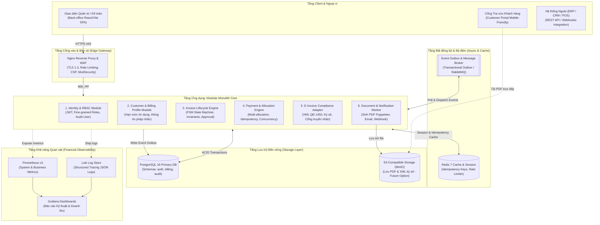
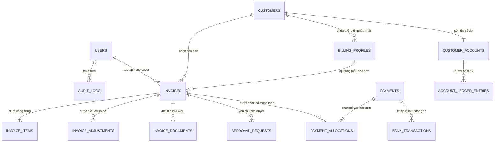
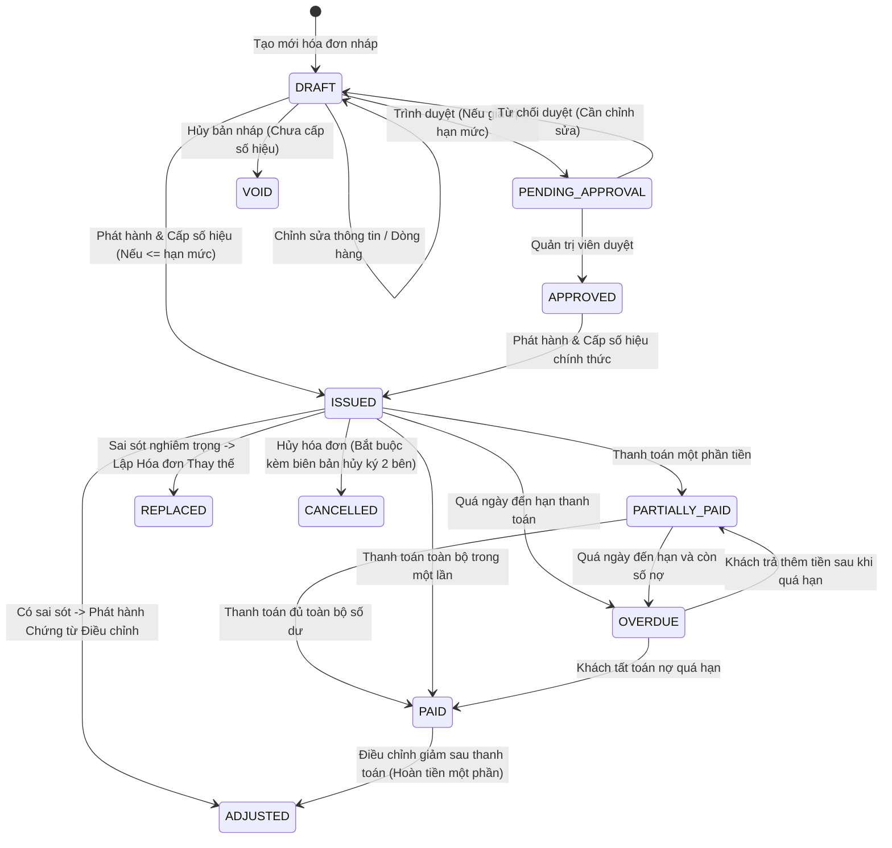

# ĐỀ ÁN PHÁT TRIỂN HỆ THỐNG BILLING MANAGEMENT THẾ HỆ TIẾP THEO
## Lộ trình Tiến hóa Chiến lược: Từ Ứng dụng Quản lý Hóa đơn đến Nền tảng Billing Core Engine Doanh nghiệp (Enterprise Billing Platform Blueprint)

> **Tài liệu Chiến lược Phát triển Hệ thống & Kiến trúc Mục tiêu**  
> **Hệ thống gốc đối chiếu:** Hệ thống Quản lý Hóa đơn / Billing Management System (Đề 18)  
> **Tác giả nghiên cứu:** Phạm Tiến Hà — MSSV: DTC245200086 — Lớp: CNTT K23G  
> **Giảng viên hướng dẫn:** Vũ Việt Dũng  
> **Mã định danh đề án:** `STRATEGIC-BLUEPRINT-BILLING-EVOLUTION-202610`  
> **Bản phát hành cơ sở (Baseline Release):** `v1.0` (Milestone Commit: `fded947d98441446e8c424e657a51f88ea5edfbb`)  
> **Ngày cập nhật đề án:** 06/10/2026  
> **Quy chế thực thi:** TÀI LIỆU ĐỀ XUẤT NGHIÊN CỨU & THIẾT KẾ KIẾN TRÚC — TUYỆT ĐỐI KHÔNG THAY ĐỔI RUNTIME, SCHEMA HOẶC MÃ NGUỒN CỦA BẢN RELEASE HIỆN HÀNH.

---

## BẢNG QUY ƯỚC PHÂN LOẠI THÔNG TIN (INFORMATION TAXONOMY)

Nhằm đảm bảo tính chính xác khoa học và phân định rạch ròi giữa thực tế đã kiểm chứng và phương án tương lai, toàn bộ tài liệu này áp dụng quy ước gán nhãn nghiêm ngặt:
- `[FACT]`: Sự thật kỹ thuật khách quan đã được kiểm chứng trực tiếp trên mã nguồn và runtime của bản phát hành `v1.0`.
- `[RESEARCH FINDING]`: Tri thức thu được từ văn bản pháp luật, tiêu chuẩn kỹ thuật quốc tế hoặc tài liệu chính thức có trích dẫn nguồn.
- `[INFERENCE]`: Suy luận logic rút ra từ hiện trạng hệ thống và bài toán nghiệp vụ kế toán doanh nghiệp.
- `[PROPOSAL]`: Đề xuất kiến trúc, mô hình dữ liệu hoặc tính năng cho các phiên bản tiếp theo.
- `[TARGET]`: Chỉ tiêu định hướng phấn đấu khi triển khai các giai đoạn tương lai.
- `[KPI TARGET]`: Mục tiêu hiệu năng hoặc nghiệp vụ đo lường được, cần kiểm chứng bằng benchmark thực nghiệm.
- `[ESTIMATE]`: Ước lượng tương đối về công sức, thời gian hoặc chi phí hạ tầng mang tính tham khảo.
- `[ASSUMPTION]`: Giả định thiết kế ban đầu, có thể điều chỉnh tùy theo bối cảnh triển khai cụ thể.
- `[TO-BE-VALIDATED]`: Hạng mục cần chuyên gia pháp lý hoặc đối tác công nghệ xác nhận thêm trước khi áp dụng vào thực tế.

---

## 1. Tóm tắt Điều hành (Executive Summary)

`[FACT]` Hệ thống **Billing Management System (Phiên bản v1.0)** hiện tại là một giải pháp container hóa hoàn chỉnh đạt 100% các tiêu chí kỹ thuật của đồ án đại học: triển khai 12 containers qua Docker Compose, cơ sở dữ liệu quan hệ PostgreSQL 16, cổng Nginx HTTPS, hệ thống giám sát Prometheus/Grafana, ghi log tập trung Loki/Promtail và kiểm soát 6 chuẩn an toàn hệ thống H1–H6.

`[INFERENCE]` Tuy nhiên, xét trên góc độ một hệ thống quản lý hóa đơn thương mại trong thực tế doanh nghiệp, phiên bản `v1.0` vẫn mang bản chất của một ứng dụng web nội bộ (Back-office CRUD Web App) với các hạn chế cấu trúc:
1. Vòng đời hóa đơn còn thô sơ: Hóa đơn đã phát hành khi có sai sót chỉ có thể hủy bỏ (`CANCELLED`), thiếu cơ chế chứng từ bù trừ (Credit/Debit Adjustments) hoặc thay thế hợp lệ theo nguyên tắc kế toán và pháp luật.
2. Mô hình thanh toán ghép cứng 1-1: Mỗi giao dịch thanh toán bắt buộc phải trỏ vào duy nhất một hóa đơn, chưa hỗ trợ thanh toán gộp đa hóa đơn (Payment Allocation) hay quản lý số dư ký quỹ khách hàng (`CustomerAccount`).
3. Thiếu cổng tương tác khách hàng (Customer Self-Service Portal) và khả năng đối soát ngân hàng tự động (Automated Bank Reconciliation).
4. Kiến trúc khối nguyên khối (Monolith) lưu trữ session trong PostgreSQL nghiệp vụ, thiếu cơ chế xử lý bất đồng bộ (Event-driven) và Idempotency cho các giao dịch tài chính.

`[PROPOSAL]` Đề án này vạch ra **Bản thiết kế Tiến hóa Chiến lược (Strategic Evolution Blueprint)** nhằm chuyển dịch hệ thống qua 3 chặng đường trưởng thành:
$$\text{Billing Web Application (v1.0)} \xrightarrow{\quad\text{Tiến hóa}\quad} \text{Billing Platform (v2.0)} \xrightarrow{\quad\text{Trưởng thành}\quad} \text{Billing Core Engine (v3.0)}$$

Chiến lược này đặt nguyên tắc **"Tính Đúng đắn Tài chính là Trên hết" (Financial Correctness First)** làm tôn chỉ, triển khai qua lộ trình 9 giai đoạn (Phase 0 đến Phase 8) có thể đo lường, đảm bảo tính tương thích ngược tuyệt đối (Backward Compatibility) và không làm gián đoạn hệ thống hiện hành.

---

## 2. Phạm vi Nghiên cứu (Research Scope)

- `[FACT]` **Phạm vi hệ thống cơ sở:** Toàn bộ mã nguồn Express/Node.js 24 (`app/`), lược đồ cơ sở dữ liệu PostgreSQL 16 (`db/init/`), cấu hình cổng vào Nginx (`nginx/`), hạ tầng giám sát và log (`monitoring/`, `logging/`), kịch bản kiểm thử bảo mật (`scripts/`), tài liệu vận hành và báo cáo nghiệm thu (`docs/`, `FILEmd/`).
- `[RESEARCH FINDING]` **Phạm vi nghiệp vụ và pháp lý:**
  - Quy trình quản lý thực thể khách hàng và tài khoản thanh toán (`Customer`, `CustomerAccount`, `BillingProfile`).
  - Vòng đời hóa đơn đầy đủ từ dự thảo, phê duyệt, phát hành, điều chỉnh, thay thế, tất toán và lưu trữ chứng từ.
  - Khung pháp lý hóa đơn điện tử Việt Nam hiện hành (Nghị định 123/2020/NĐ-CP được sửa đổi bổ sung bởi Nghị định 70/2025/NĐ-CP, Thông tư 32/2025/TT-BTC, Quyết định 1450/QĐ-TCT) và chuẩn quốc tế (UBL 2.1, Peppol BIS 3.0).
  - Cơ chế tự động đối soát thanh toán ngân hàng qua mã VietQR động (chuẩn Napas 247).
- `[PROPOSAL]` **Phạm vi tiến hóa kiến trúc:** Lộ trình chuyển đổi từ *Layered Monolith* sang *Event-Driven Modular Monolith* với Outbox Pattern, sẵn sàng trích xuất thành các microservices độc lập chỉ khi có yêu cầu thực tế về quy mô tải.

---

## 3. Hiện trạng Hệ thống Cơ sở v1.0 (Current Baseline State)

`[FACT]` Qua kiểm tra mã nguồn và runtime thực tế của bản phát hành `v1.0`, các đặc tính kỹ thuật cốt lõi bao gồm:

| Hạng mục thành phần | Công nghệ / Hiện trạng thực tế | Cơ chế hoạt động đã kiểm chứng |
|---|---|---|
| **Mô hình triển khai** | Docker Compose v2 (12 containers, 5 networks, 6 named volumes) | Khởi chạy đóng gói trên 1 máy chủ VM, cô lập cổng mạng nội bộ. |
| **Backend Core** | Node.js 24.21.0, Express 5.1.0, JavaScript ES Modules | Kiến trúc Monolith, chia tuyến thủ công (`customers.js`, `invoices.js`, `payments.js`). |
| **Giao diện Client** | HTML/CSS/Vanilla JS thuần trong `app/public/` | Giao diện Single Page Application tối giản cho nội bộ nhân viên. |
| **Cơ sở dữ liệu** | PostgreSQL 16.15-trixie | 5 bảng nghiệp vụ (`users`, `customers`, `invoices`, `invoice_items`, `payments`), 1 bảng `user_sessions`. |
| **Quản trị DB** | pgAdmin 4 v9.18.0 | Kết nối qua loopback `127.0.0.1:5050` với role `billing_readonly`. |
| **Xác thực & Phiên** | Cookie session `billing.sid`, bcryptjs cost 12, `connect-pg-simple` | Session lưu trong PostgreSQL; 2 roles phân quyền cứng trong DB: `admin` và `staff`. |
| **Cổng vào (Proxy)** | Nginx unprivileged 1.30.5-alpine | Cổng công khai duy nhất (80, 443), TLS 1.2/1.3, 6 security headers, Rate limit login 5r/m. |
| **Giám sát** | Prometheus 3.15.0 & Grafana 13.2.3 | 6 scrape jobs UP; 1 dashboard 3 rows (Container, Web, DB); metric `billing_invoices_created_total`. |
| **Ghi log** | Loki 3.7.8 & Promtail 3.6.11 | Thu thập log container qua Docker socket, 3 labels (`service`, `container`, `stream`), retention 72h. |
| **Bảo mật** | Hardening 6 tiêu chuẩn H1–H6 | Non-root containers, 5 networks (`internal: true`), least privilege 3 roles DB, ports unexposed. |

---

## 4. Điểm mạnh Nền tảng của Hệ thống Hiện tại (Baseline Strengths)

`[FACT]` Phiên bản `v1.0` sở hữu những phẩm chất kỹ thuật vững chắc, tạo nền móng vững vàng cho tiến trình phát triển:
1. **Tính đúng đắn số học tài chính (Financial Arithmetic Integrity):** Sử dụng kiểu dữ liệu số thực chính xác `NUMERIC(14,2)` trong PostgreSQL cho mọi trường giá trị (`subtotal`, `tax_amount`, `total`, `paid_total`, `amount`), tính toán làm tròn hoàn toàn trên server, loại trừ triệt để lỗi sai số dấu phẩy động (Floating-point error) của JavaScript.
2. **Kiểm soát xung đột đồng thời (Concurrency Control):** Thao tác ghi nhận thanh toán trong `payments.js` sử dụng transaction có khóa bi quan `SELECT ... FOR UPDATE`, ngăn chặn triệt để hiện tượng thanh toán đúp (Double-payment) khi có nhiều request đồng thời.
3. **Tính bất biến của hóa đơn phát hành (Invoice Immutability):** Hóa đơn khi đã chuyển sang trạng thái `ISSUED` sẽ bị khóa cứng trên cả tầng DB và API, không thể chỉnh sửa hay xóa dòng hàng (`invoice_items`).
4. **Cô lập ranh giới mạng xuất sắc:** Cơ sở dữ liệu, ứng dụng backend, log store và metric exporter đều nằm trong các mạng nội bộ không mở cổng host công khai; Nginx là cổng tiếp nhận duy nhất.
5. **Nền tảng quan sát sẵn sàng:** Đã định hình đầy đủ Metrics (Prometheus), Logs (Loki) và Correlation Tracing qua `X-Request-Id` từ Nginx vào ứng dụng.

---

## 5. Khoảng cách với Hệ thống Billing Chuyên nghiệp (Gap Analysis)

`[INFERENCE]` So sánh đối chiếu với các nền tảng Billing thương mại (Stripe Billing, Chargebee, Zuora, Viettel S-Invoice, VNPT Invoice):

```
[HỆ THỐNG HIỆN TẠI v1.0]                [NỀN TẢNG BILLING DOANH NGHIỆP THỰC TẾ]
┌───────────────────────────────┐        ┌────────────────────────────────────────────────────────┐
│ • 5 bảng dữ liệu cơ bản       │        │ • Đa thực thể: CustomerAccount, BillingProfile, Ledger │
│ • 2 roles cứng: admin / staff │  GAP   │ • RBAC phân quyền hạt mịn + Phê duyệt đa cấp (Approval)│
│ • Hủy hóa đơn trực tiếp       │ ─────> │ • Hóa đơn điều chỉnh/thay thế (Credit/Debit Notes)     │
│ • Thanh toán thủ công 1:1     │        │ • Phân bổ đa hóa đơn, VietQR, tự động đối soát Webhook │
│ • Chưa có cổng khách hàng     │        │ • Customer Portal tra cứu, tải PDF hóa đơn             │
│ • Session nằm trong DB        │        │ • Tách Cache/Session (Redis) & Hàng đợi Sự kiện (Queue)│
└───────────────────────────────┘        └────────────────────────────────────────────────────────┘
```

1. **Vòng đời hóa đơn còn thiếu cơ chế điều chỉnh:**
   - Hệ thống hiện tại chỉ có cơ chế `CANCEL` (nếu chưa thanh toán). Trong thực tế kế toán và luật thuế, hóa đơn đã phát hành và gửi cho người mua **tuyệt đối không được xóa/hủy thô bạo** mà phải lập biên bản và phát hành *Hóa đơn điều chỉnh* hoặc *Hóa đơn thay thế*.
   - Thiếu các trạng thái nghiệp vụ chuẩn: `PENDING_APPROVAL` (Chờ duyệt), `OVERDUE` (Quá hạn thanh toán), `DISPUTED` (Đang khiếu nại), `REFUNDED` (Hoàn tiền).
2. **Cơ chế thanh toán ghép cứng 1-1 (Tight Coupling):**
   - Khoản thanh toán hiện tại bắt buộc phải gắn cứng vào 1 hóa đơn duy nhất. Chưa hỗ trợ khách hàng thanh toán gộp 1 lần cho nhiều hóa đơn (Batch Allocation) hoặc đặt cọc tiền trước vào tài khoản (Pre-paid Balance).
   - Chưa hỗ trợ đối soát ngân hàng tự động qua mã VietQR hoặc cổng thanh toán trực tuyến.
3. **Trải nghiệm khách hàng chưa được thiết lập:**
   - Khách hàng chưa có cổng tự phục vụ để tra cứu hóa đơn, xem số dư công nợ, nhận thông báo hay tải bản in PDF có mã tra cứu.
4. **Điểm nghẽn tài nguyên kiến trúc:**
   - Bảng `user_sessions` nằm chung trong PostgreSQL gây lãng phí kết nối và I/O của database nghiệp vụ.
   - Các tác vụ xuất tài liệu, gửi thông báo chạy đồng bộ trên tiến trình chính của Node.js, tiềm ẩn nguy cơ nghẽn Event Loop khi có lưu lượng lớn.

---

## 6. Nghiên cứu Mô hình Chuẩn và Phân tầng Pháp lý (Standards & Legal Stratification)

`[RESEARCH FINDING]` Nghiên cứu phân định rõ ràng 5 tầng pháp lý và tiêu chuẩn kỹ thuật:

```
┌─────────────────────────────────────────────────────────────────────────┐
│ LEVEL 1: LEGAL MANDATES (Quy định Pháp luật Bắt buộc Hiện hành tại VN)  │
│ • Luật Quản lý thuế số 38/2019/QH14                                     │
│ • Nghị định 123/2020/NĐ-CP (sửa đổi, bổ sung bởi Nghị định 70/2025/NĐ-CP)│
│ • Thông tư 32/2025/TT-BTC (thay thế Thông tư 78/2021/TT-BTC)            │
│ • Quyết định 1450/QĐ-TCT (Định dạng XML chuẩn dữ liệu hóa đơn điện tử) │
├─────────────────────────────────────────────────────────────────────────┤
│ LEVEL 2: HISTORICAL / PREDECESSOR REGULATIONS (Văn bản Tiền nhiệm)     │
│ • Thông tư 78/2021/TT-BTC (Đã hết hiệu lực, được thay thế bởi TT 32/2025)│
├─────────────────────────────────────────────────────────────────────────┤
│ LEVEL 3: TECHNICAL STANDARDS (Tiêu chuẩn Kỹ thuật Quốc tế Chính thức)    │
│ • ISO/IEC 19845:2015 (Universal Business Language - UBL 2.1)            │
│ • RFC 9457 (Problem Details for HTTP APIs - Thay thế RFC 7807)          │
│ • XML Digital Signature (W3C XML-DSig Recommendation)                   │
├─────────────────────────────────────────────────────────────────────────┤
│ LEVEL 4: INTEROPERABILITY FRAMEWORKS & BEST PRACTICES (Khung Trao đổi)  │
│ • Peppol BIS Billing 3.0 & Peppol PINT (Khung tương tác mạng xuyên biên)│
│ • IETF Internet-Draft: draft-ietf-httpapi-idempotency-key-header        │
│ • Chuẩn mã thanh toán VietQR động (Napas 247)                           │
├─────────────────────────────────────────────────────────────────────────┤
│ LEVEL 5: FUTURE ARCHITECTURAL PROPOSALS (Đề xuất Chiến lược Hệ thống)   │
│ • Financial Integrity Layer, Event-Driven Modular Monolith, Outbox Ptr  │
└─────────────────────────────────────────────────────────────────────────┘
```

### 6.1. Cập nhật Pháp lý Hóa đơn Điện tử Việt Nam Hiện hành
- **Luật Quản lý thuế 38/2019/QH14:** Nền tảng pháp lý yêu cầu áp dụng hóa đơn điện tử toàn diện trong hoạt động kinh doanh.
- **Nghị định 123/2020/NĐ-CP & Nghị định 70/2025/NĐ-CP:**
  - *Nghị định 70/2025/NĐ-CP* (ban hành ngày 20/03/2025, có hiệu lực từ 01/06/2025) sửa đổi, bổ sung một số điều của Nghị định 123/2020/NĐ-CP: mở rộng phạm vi áp dụng, đẩy mạnh hóa đơn điện tử khởi tạo từ máy tính tiền (POS), và cập nhật chặt chẽ quy trình xử lý sai sót hóa đơn.
- **Thông tư 32/2025/TT-BTC:**
  - Ban hành ngày 31/05/2025, có hiệu lực từ 01/06/2025. **Thông tư này thay thế hoàn toàn Thông tư 78/2021/TT-BTC**, hướng dẫn chi tiết thi hành NĐ 123/2020/NĐ-CP và NĐ 70/2025/NĐ-CP về định dạng, quy trình quản lý và dữ liệu hóa đơn điện tử.
- **Quyết định 1450/QĐ-TCT:** Quy định chuẩn thành phần chứa dữ liệu nghiệp vụ hóa đơn điện tử và phương thức truyền nhận bằng tệp XML Schema (`DLHDon`, `DSCKS/NBan`, mã xác thực của cơ quan thuế `MCCQT`).
- **Quy tắc Xử lý Sai sót Hóa đơn Điện tử (Điều 19 NĐ 123/2020 và sửa đổi tại NĐ 70/2025):**
  - Hóa đơn đã phát hành và gửi người mua **không được tự ý sửa hay xóa trực tiếp trong cơ sở dữ liệu**.
  - Xử lý bắt buộc qua một trong hai phương thức có lưu vết:
    1. Lập *Hóa đơn điều chỉnh* (ghi rõ điều chỉnh tăng/giảm giá trị, thuế suất, số tiền).
    2. Lập *Hóa đơn thay thế* (ghi rõ thay thế cho hóa đơn số..., ngày..., ký hiệu...).
    3. Hủy hóa đơn chỉ áp dụng khi người bán phát hiện sai sót trước khi gửi cho người mua hoặc có biên bản hủy ký điện tử cả hai bên.

### 6.2. Tiêu chuẩn Kỹ thuật Quốc tế
- **RFC 9457 (Problem Details for HTTP APIs):** Tiêu chuẩn IETF chính thức công bố năm 2023, **thay thế hoàn toàn (obsoletes) RFC 7807**. Chuẩn hóa cấu trúc JSON trả về lỗi API tài chính (`type`, `title`, `status`, `detail`, `instance`).
- **IETF Internet-Draft Idempotency-Key (`draft-ietf-httpapi-idempotency-key-header`):** Bản thảo kỹ thuật của IETF quy định truyền header `Idempotency-Key` trong các request ghi nhận thanh toán để ngăn chặn giao dịch trùng lặp khi mạng chập chờn.
- **UBL 2.1 (ISO/IEC 19845) & Peppol BIS 3.0:** UBL là chuẩn tài liệu XML có cấu trúc; Peppol là hệ sinh thái và khung tương tác (Interoperability Network) xuyên biên giới ứng dụng UBL. Đề án tiếp thu cấu trúc thực thể hóa đơn của UBL làm mô hình tham chiếu cho domain nội bộ.

---

## 7. Nguyên tắc Thiết kế Chiến lược: "Financial Correctness First"

`[PROPOSAL]` Khác với các ứng dụng CRUD thông thường, một hệ thống tài chính/billing phải lấy tính đúng đắn làm tôn chỉ sống còn. Đề án đề xuất kiến trúc **Lớp Toàn vẹn Tài chính (Financial Integrity Layer)** với 6 bất biến bắt buộc:

```
┌────────────────────────────────────────────────────────────────────────┐
│                   FINANCIAL INTEGRITY LAYER (INVARIANTS)               │
├────────────────────────────────────────────────────────────────────────┤
│ 1. Deterministic Money Model: NUMERIC cố định, không dùng Float        │
│ 2. Immutable Financial Facts: Hóa đơn đã phát hành bị khóa vĩnh viễn   │
│ 3. Compensating Transactions: Mọi sửa đổi phải qua chứng từ điều chỉnh │
│ 4. Concurrency Guard: Khóa hàng bi quan (SELECT ... FOR UPDATE)        │
│ 5. Idempotent Ingestion: Khóa chống trùng lặp request giao dịch        │
│ 6. Complete Traceability: Nhật ký kiểm toán bất biến (Audit Trail)     │
└────────────────────────────────────────────────────────────────────────┘
```

1. **Mô hình tiền tệ xác định (Deterministic Money Model):** Toàn bộ phép toán số học cộng, trừ, nhân thuế suất, chiết khấu bắt buộc thực hiện với độ chính xác số học cố định, xác định rõ quy tắc làm tròn (Round Half Up).
2. **Sự thật tài chính bất biến (Immutable Financial Facts):** Hóa đơn sau khi `ISSUED` trở thành một sự thật lịch sử kế toán. Không có API hoặc lệnh SQL nào được phép cập nhật (`UPDATE`) trực tiếp các trường số tiền, thuế, dòng hàng.
3. **Giao dịch bù trừ (Compensating Transactions):** Bất kỳ sai sót nào cũng phải giải quyết bằng giao dịch bù trừ: phát hành Hóa đơn điều chỉnh (Credit/Debit Note) hoặc Hóa đơn thay thế.
4. **Bảo vệ đồng thời (Concurrency Invariants):** Mọi thao tác làm thay đổi số dư hóa đơn hoặc tài khoản khách hàng đều phải được bảo vệ bằng transaction cô lập có khóa hàng để loại trừ race conditions.
5. **Tiếp nhận giao dịch bất biến (Idempotent Ingestion):** Client gọi lại cùng một request tài chính do đứt kết nối mạng sẽ nhận lại kết quả cũ mà không làm phát sinh thêm giao dịch mới.
6. **Kiểm toán truy vết toàn diện (Full Traceability):** Mọi hành động tài chính phải lưu lại thông tin: Ai thực hiện (WHO), Hành động gì (WHAT), Thời điểm nào (WHEN), Lý do gì (WHY), Mã tham chiếu giao dịch (CORRELATION ID).

---

## 8. Phân định Khái niệm Domain Credit/Debit Note vs Hiện thực Pháp lý tại Việt Nam

`[RESEARCH FINDING]` Nhằm tránh ngộ nhận giữa thuật ngữ kế toán quốc tế và quy định pháp luật Việt Nam, đề án làm rõ ranh giới:

| Tiêu chí phân định | Domain / Accounting Design Concept (Mô hình Nội bộ) | Legal Realization in Vietnam (Hiện thực Pháp lý VN) |
|---|---|---|
| **Bản chất** | Khái niệm kế toán chuẩn mực theo UBL 2.1, GAAP/IFRS. | Chứng từ điện tử theo Luật Quản lý thuế, NĐ 123 & NĐ 70, TT 32. |
| **Thuật ngữ** | `Credit Note` (Giảm trừ công nợ / Trả hàng) & `Debit Note` (Tăng công nợ). | *Hóa đơn điều chỉnh* (tăng/giảm giá trị, thuế suất) & *Hóa đơn thay thế*. |
| **Quy trình áp dụng** | Bù trừ công nợ giữa bên bán và bên mua trên sổ cái (Ledger). | Phải lập biên bản thỏa thuận sai sót, truyền dữ liệu XML có chữ ký số lên Tổng cục Thuế. |
| **Vai trò trong hệ thống** | **Domain Abstraction Layer:** Quản lý logic tính toán, số dư và công nợ trên giao diện và database nội bộ. | **Compliance Layer:** Ánh xạ từ Credit/Debit Note thành gói hóa đơn điều chỉnh chuẩn XML theo QĐ 1450/QĐ-TCT. |

`[PROPOSAL]` **Kết luận thiết kế:** Tên gọi `Credit Note` / `Debit Note` trong mã nguồn tương lai đóng vai trò là lớp trừu tượng nghiệp vụ (Domain Concept). Khi xuất ra dữ liệu pháp lý tại Việt Nam, Adapter sẽ chuyển đổi thành **Hóa đơn điện tử điều chỉnh** hoặc **Hóa đơn điện tử thay thế** đáp ứng 100% quy định của cơ quan thuế.

---

## 9. Kiến trúc Mục tiêu: Event-Driven Modular Monolith

### 9.1. Lựa chọn Kiến trúc và Phân tích Trade-off
`[INFERENCE]` So sánh 3 hướng tiếp cận kiến trúc:

| Tiêu chuẩn đánh giá | A. Traditional Monolith (v1.0) | B. Event-Driven Modular Monolith (ĐỀ XUẤT) | C. Pure Microservices |
|---|---|---|---|
| **Độ phức tạp vận hành** | Rất thấp (1 container web) | Vừa phải (Thêm Redis & Message Broker) | Rất cao (Kubernetes, Service Mesh, Tracing phức tạp) |
| **Tính toàn vẹn ACID** | Cao (1 database instance) | Rất cao (Dùng Schema riêng + Outbox Pattern) | Kém (Phải dùng 2PC hoặc Saga Pattern phức tạp) |
| **Khả năng mở rộng nghiệp vụ** | Thấp (Mã nguồn dễ dính chặt) | Rất cao (Tách Domain Modules độc lập) | Rất cao (Deploy từng service riêng) |
| **Chi phí hạ tầng** | Rất thấp | Vừa phải (Thêm 1-2GB RAM) | Tốn kém (Nhiều container, API Gateway, giám sát phân tán) |
| **Đánh giá phù hợp** | Đã hoàn thành vai trò đồ án | **LỰA CHỌN TỐI ƯU CHO GIAI ĐOẠN 2–3 NĂM** | **OVER-ENGINEERING (Chưa cần thiết ở giai đoạn này)** |

`[PROPOSAL]` **Quyết định kiến trúc:** Lựa chọn **Mô hình B: Event-Driven Modular Monolith**. Hệ thống tiếp tục chạy trong một tiến trình ứng dụng nhưng mã nguồn được chia tách thành các Domain Modules có ranh giới rõ ràng. Giao tiếp giữa các module nội bộ thực hiện qua In-process Event Dispatcher, đồng thời áp dụng **Transactional Outbox Pattern** với Redis/RabbitMQ để xử lý các tác vụ bất đồng bộ nặng (xuất PDF, gửi email, gọi webhook).

### 9.2. Sơ đồ Kiến trúc Mục tiêu (Target Architecture Blueprint)



---

## 10. Lược đồ Thực thể và Domain Model Tương lai

`[PROPOSAL]` Mô hình dữ liệu mở rộng từ 5 bảng của `v1.0` thành kiến trúc thực thể chuẩn doanh nghiệp:



### Chi tiết các Thực thể Mở rộng:
1. **`customer_accounts`:** Quản lý số dư đặt cọc (`prepaid_balance`), hạn mức tín dụng (`credit_limit`), trạng thái khóa công nợ.
2. **`billing_profiles`:** Tách thông tin xuất hóa đơn (Mã số thuế, tên pháp nhân, địa chỉ kinh doanh, email kế toán) ra khỏi thực thể khách hàng cơ bản, hỗ trợ 1 khách hàng có nhiều chi nhánh nhận hóa đơn.
3. **`invoice_adjustments` (Credit/Debit Notes):** Liên kết với `invoices` gốc (`original_invoice_id`), ghi nhận số tiền điều chỉnh, lý do, loại điều chỉnh (tăng/giảm) và tham chiếu biên bản thỏa thuận.
4. **`invoice_documents`:** Lưu trữ phiên bản PDF, tệp XML gốc đã ký số, chữ ký số bên bán và mã cơ quan thuế (`MCCQT`).
5. **`payments` & `payment_allocations`:** Tách riêng sự kiện nhận tiền (`payments`) và hành động phân bổ tiền (`payment_allocations`). Một thanh toán 10 triệu có thể phân bổ cho 3 hóa đơn khác nhau và phần dư chuyển vào `customer_accounts`.
6. **`bank_transactions`:** Bảng tạm lưu trữ dữ liệu biến động số dư nhận từ Webhook ngân hàng để đưa vào cỗ máy khớp lệnh tự động.
7. **`audit_logs`:** Bảng nhật ký kiểm toán ghi nhận mọi thay đổi tài chính (WHO, WHAT, WHEN, WHY, IP, Correlation ID, Before JSON, After JSON).

---

## 11. Cỗ máy Vòng đời Hóa đơn (Invoice State Machine)

`[PROPOSAL]` Chuẩn hóa vòng đời hóa đơn bằng máy trạng thái hữu hạn (FSM) chặt chẽ:



---

## 12. Cỗ máy Phân bổ Thanh toán và Đối soát Ngân hàng (Payment & Reconciliation Engine)

### 12.1. Động cơ Phân bổ Thanh toán Đa Hóa đơn (Multi-Invoice Payment Allocation)
`[PROPOSAL]` Thay thế mô hình ghép cứng 1-1 hiện tại bằng mô hình phân bổ linh hoạt:

$$\text{Khoản Thanh toán: } 10.000.000 \text{ VND} \implies \begin{cases} \text{Hóa đơn A (Đến hạn trước):} & 3.000.000 \text{ VND} \implies \text{PAID} \\ \text{Hóa đơn B:} & 4.000.000 \text{ VND} \implies \text{PAID} \\ \text{Hóa đơn C:} & 2.000.000 \text{ VND} \implies \text{PARTIALLY\_PAID} \\ \text{Số dư ví khách (Customer Credit):} & 1.000.000 \text{ VND} \implies \text{Ký quỹ} \end{cases}$$

### 12.2. Luồng Khớp lệnh Tự động qua VietQR Động
`[PROPOSAL]` Quy trình đối soát thanh toán thời gian thực:
1. **Sinh VietQR động:** Khi hóa đơn phát hành, hệ thống sinh mã VietQR Napas 247 chứa số tài khoản, số tiền và mã tham chiếu duy nhất: `BILLING_INV2026NNNNNN`.
2. **Tiếp nhận Webhook ngân hàng:** Khi khách chuyển khoản, Webhook ngân hàng gửi biến động số dư tới endpoint `POST /api/v2/webhooks/bank`.
3. **Bảo vệ Idempotency:** Endpoint xác thực chữ ký HMAC-SHA256 và kiểm tra mã giao dịch ngân hàng trong Redis để loại bỏ request gửi lặp.
4. **Khớp lệnh tự động:** Trích xuất mã hóa đơn từ nội dung chuyển khoản ➔ Mở transaction khóa hàng (`FOR UPDATE`) ➔ Ghi nhận payment và cập nhật trạng thái hóa đơn sang `PAID` trong vòng vài giây.
5. **Hàng đợi Chưa khớp (Unmatched Transaction Queue):** Nếu nội dung chuyển khoản sai cú pháp hoặc số tiền không khớp, giao dịch được đưa vào hàng đợi `unmatched_bank_transactions` để kế toán xử lý thủ công qua giao diện đối soát riêng.

---

## 13. Nền tảng Tài liệu Hóa đơn (Invoice Document Platform)

`[PROPOSAL]` Phân tách rõ ràng 4 hình thái của một hóa đơn:
1. **Dữ liệu Nghiệp vụ (Business Record):** Các dòng dữ liệu lưu trữ trong bảng `invoices`, `invoice_items` của PostgreSQL (Source of Truth).
2. **Bản thể hiện Trực quan (Rendered Document - PDF):** File PDF vector chất lượng cao sinh bởi background worker (Puppeteer), gắn mã QR tra cứu và Watermark.
3. **Dữ liệu Pháp lý Máy đọc được (Machine-readable XML):** Gói dữ liệu XML chuẩn Quyết định 1450/QĐ-TCT có chữ ký số (XML-DSig) dùng cho mục đích thuế.
4. **Đối tượng Lưu trữ Bền vững (Archival Object):** File PDF và XML được lưu trong kho lưu trữ đối tượng tương thích S3 (như MinIO triển khai nội bộ). Database chỉ lưu URL và mã băm SHA-256 để chống giả mạo file.

---

## 14. Cổng Tra cứu Khách hàng Tự phục vụ (Customer Self-Service Portal)

`[PROPOSAL]` Xây dựng giao diện tra cứu độc lập tại `/portal/lookup` hoàn toàn tách biệt khỏi giao diện quản trị nội bộ:
- Khách hàng không cần đăng nhập tài khoản nhân viên. Chỉ cần nhập `Mã số hóa đơn` + `Mã tra cứu bảo mật (Access Token)` gửi qua email.
- Khách hàng có thể: Xem chi tiết hóa đơn, xem mã VietQR động để quét chuyển khoản, tải file PDF hóa đơn chính thức, xem lịch sử các lần thanh toán.
- Bảo vệ cổng bằng Rate Limiting nghiêm ngặt và Cloudflare Turnstile / reCAPTCHA để chống quét mã tự động.

---

## 15. Nền tảng API-First và Chiến lược Tích hợp (API-First Platform Strategy)

`[PROPOSAL]` Nâng cấp toàn diện giao diện lập trình ứng dụng:
1. **Chuẩn hóa OpenAPI 3.1:** Phát hành tài liệu API chính thức tại `/api-docs` qua Swagger UI.
2. **Phiên bản hóa API:** Các API cũ của v1.0 giữ nguyên tại `/api/v1/`. Các API mới chuẩn hóa tại `/api/v2/`.
3. **Định dạng lỗi chuẩn RFC 9457:** Áp dụng RFC 9457 (thay thế RFC 7807) với cấu trúc `type`, `title`, `status`, `detail`, `instance`.
4. **Idempotent API Design:** Áp dụng header `Idempotency-Key` (dựa trên IETF Internet-Draft) cho toàn bộ API thanh toán và phát hành hóa đơn.
5. **Outbound Webhooks:** Cho phép các hệ thống CRM, ERP ngoài đăng ký nhận webhook có chữ ký số HMAC-SHA256 khi có sự kiện `invoice.issued`, `invoice.paid`.

---

## 16. Tiến trình Tiến hóa: Từ Ứng dụng đến Nền tảng Core Engine (From App to Core Engine)

`[PROPOSAL]` Tầm nhìn kiến trúc vạch rõ 3 nấc thang tiến hóa:

```
V1.0 (HIỆN TẠI): BILLING WEB APP
  Giao diện Web nội bộ ──[Gắn chặt]──> Mã nguồn Express ──[Gắn chặt]──> PostgreSQL

V2.0 (MỤC TIÊU TIẾP THEO): BILLING PLATFORM
  [Staff Web App]   [Customer Portal]   [External Systems]
         └─────────────────┬───────────────────┘
               [RESTful API & Webhooks Gateway]
                           │
             [Event-Driven Modular Monolith Core]
               (Invoice, Payment, Audit, Redis)

V3.0 (TẦM NHÌN DÀI HẠN): BILLING CORE ENGINE
  [E-Commerce]   [POS Quầy]   [Mobile App]   [ERP Doanh nghiệp]   [CRM]
        └──────────────┴──────────────┼──────────────┴──────────────┘
                       [API & Event Contracts Gateway]
                                      │
                       [BILLING CORE ENGINE PLATFORM]
      ┌───────────────────────────────┴───────────────────────────────┐
      │ • State Machine Core          • Payment Allocation Engine    │
      │ • Financial Invariants        • Bank Reconciliation Hub      │
      │ • Audit Ledger                • E-Invoice Compliance Adapter │
      └───────────────────────────────────────────────────────────────┘
```

`[INFERENCE]` **Ý nghĩa chiến lược:** Billing không còn là một website đơn lẻ, mà trở thành một **Năng lực Nghiệp vụ Tái sử dụng (Reusable Business Capability)**. Bất kỳ phân hệ bán hàng nào (POS, Web, App) cũng có thể gọi vào Core Engine để lập hóa đơn và đối soát tiền.

---

## 17. Khả năng Quan sát Tài chính (Financial Observability)

`[PROPOSAL]` Nâng cấp tầng quan sát từ giám sát kỹ thuật lên giám sát sức khỏe tài chính:

| Tên Metric PromQL | Loại | Đơn vị & Ngữ nghĩa tổng hợp | Mục đích quản trị |
|---|---|---|---|
| `billing_invoices_issued_total` | Counter | Số lượng hóa đơn phát hành chính thức | Đo lường sản lượng kinh doanh |
| `billing_invoices_paid_total` | Counter | Số lượng hóa đơn đã thu đủ tiền | Theo dõi hiệu quả thu nợ |
| `billing_invoices_overdue_current` | Gauge | Số hóa đơn đang bị nợ quá hạn | Giám sát rủi ro công nợ xấu |
| `billing_revenue_collected_vnd_total` | Counter | Tổng tiền thu thực tế (VND) tích lũy | Quan sát dòng tiền thực tế |
| `billing_outstanding_balance_vnd` | Gauge | Tổng dư nợ chưa thu được (VND) | Theo dõi quy mô công nợ mở |
| `billing_payment_reconciliation_duration_seconds` | Histogram | Phân bố thời gian khớp lệnh thanh toán | Giám sát độ trễ đối soát ngân hàng |
| `billing_unmatched_bank_transactions_current` | Gauge | Số giao dịch ngân hàng chưa khớp lệnh | Cảnh báo kế toán xử lý thủ công |

> `[FACT]` **Nguyên tắc Nguồn Sự thật:** Toàn bộ metrics PromQL trên chỉ phục vụ **Quan sát (Observability)** và cảnh báo sớm. **Cơ sở dữ liệu giao dịch PostgreSQL luôn luôn là Nguồn Sự Thật Duy Nhất (Source of Truth)** cho mọi báo cáo kế toán và tài chính pháp lý.

---

## 18. Chiến lược Tự động hóa Trước, Trí tuệ Nhân tạo Sau (Automation Before AI)

`[PROPOSAL]` Đề án phân định ranh giới nghiêm ngặt về việc ứng dụng công nghệ:

```
CẤP ĐỘ 1: LUẬT NGHIỆP VỤ XÁC ĐỊNH (Deterministic Business Rules) ──> Ưu tiên số 1
CẤP ĐỘ 2: TỰ ĐỘNG HÓA QUY TRÌNH (Workflow Automation)          ──> Ưu tiên số 2
CẤP ĐỘ 3: PHÂN TÍCH & BÁO CÁO THỐNG KÊ (Analytics & Dashboards)  ──> Ưu tiên số 3
CẤP ĐỘ 4: PHÁT HIỆN BẤT THƯỜNG (Anomaly Detection ML)           ──> Giai đoạn sau
CẤP ĐỘ 5: MÔ HÌNH HỌC MÁY DỰ BÁO (Predictive Risk Scoring)      ──> Giai đoạn sau
```

### Các Nguyên tắc Tuyệt đối về Ứng dụng AI:
- **AI KHÔNG ĐƯỢC PHÉP:** Tính toán số tiền hóa đơn, tính thuế suất, quyết định trừ tiền khách hàng, hoặc can thiệp vào tính toàn vẹn transaction cơ sở dữ liệu.
- **AI ĐƯỢC PHÉP ỨNG DỤNG HỢP LÝ VÀO:**
  1. *Phát hiện Bất thường Hóa đơn (Anomaly Detection):* Phát hiện hóa đơn có giá trị lệch đột biến so với lịch sử khách hàng để cảnh báo nhân viên kiểm tra lại.
  2. *Chấm điểm Rủi ro Chậm thanh toán (Payment Default Risk Scoring):* Phân tích lịch sử trả nợ để gợi ý thời điểm gửi email nhắc nợ phù hợp.
  3. `[FACT]` Mọi kết quả từ mô hình AI/ML chỉ mang tính chất **Hỗ trợ Ra Quyết định (Decision Support)**, không bao giờ là căn cứ ghi nhận kế toán chính thức.

---

## 19. Bảng Đối chiếu Chi tiết Hiện trạng và Mục tiêu Tương lai (Current vs. Future Mapping)

| Thành phần hệ thống | Hiện trạng (v1.0) `[FACT]` | Khoảng cách tồn tại `[INFERENCE]` | Mục tiêu tương lai (v2.0+) `[PROPOSAL]` | Mức ưu tiên | Phương án chuyển dịch kỹ thuật |
|---|---|---|---|:---:|---|
| **Invoice CRUD** | 4 trạng thái đơn giản, hủy trực tiếp | Không có chứng từ điều chỉnh kế toán | FSM Engine, Credit/Debit Notes, Immutability | **P0** | Thêm bảng `invoice_adjustments`, khóa cập nhật hóa đơn phát hành. |
| **Thanh toán** | Gắn cứng 1:1 với 1 invoice | Không hỗ trợ trả gộp, không có ví cọc | Multi-invoice Allocation, Customer Account | **P0** | Tách bảng `payment_allocations`, thêm bảng `customer_accounts`. |
| **Bảo vệ Giao dịch** | Concurrency lock bằng SQL | Thiếu Idempotency API chống request lặp | Idempotency Key Middleware backed by Redis | **P0** | Thêm Redis, triển khai middleware kiểm tra header `Idempotency-Key`. |
| **Nhật ký Kiểm toán** | Chỉ có log JSON Nginx/Web | Thiếu audit trail nghiệp vụ bất biến | Financial Audit Trail Table (Who, What, When) | **P0** | Bổ sung bảng `audit_logs`, trigger lưu vết thay đổi nhạy cảm. |
| **Đối soát Ngân hàng**| Nhập tay số tiền thanh toán | Tốn công, dễ nhầm lẫn, chậm trễ | VietQR động Napas 247, Webhook auto-reconcile | **P1** | Tích hợp thư viện VietQR, endpoint Webhook ngân hàng + Unmatched Queue. |
| **Trải nghiệm Khách** | Không có giao diện cho khách | Khách phải liên hệ nhân viên tra cứu | Customer Self-Service Portal (`/portal/lookup`)| **P1** | Xây dựng giao diện tra cứu độc lập, bảo vệ bằng Token và Rate Limit. |
| **Tài liệu Hóa đơn** | Chỉ hiển thị trên web | Không có bản in PDF, không có XML chuẩn | Vector PDF Generator + MinIO Object Storage | **P1** | Worker xuất PDF nền (Puppeteer), tích hợp kho MinIO nội bộ. |
| **Giám sát** | Giám sát tài nguyên kỹ thuật | Người quản lý không thấy số liệu tiền | Financial Observability (Revenue, Overdue metrics)| **P2** | Thêm Custom PromQL Gauges/Counters doanh thu, dashboard Grafana tài chính. |
| **Kiến trúc Nền tảng**| Web app độc lập | Không phục vụ được POS, App, ERP khác | API-First Billing Platform & Core Engine | **P2** | Chuẩn hóa OpenAPI 3.1, RFC 9457 errors, Webhooks outbound. |
| **Tuân thủ Thuế VN**  | Thuế suất % đơn giản | Chưa có định dạng XML chuẩn Tổng cục Thuế | E-Invoice Compliance Adapter (NĐ 123/70, TT 32)| **P3** | Module xuất XML QĐ 1450, ký số XML-DSig, tích hợp cổng truyền nhận CQT. |
| **Trí tuệ Nhân tạo**  | Hoàn toàn chưa có | Chưa có dự báo rủi ro trễ hạn nợ | AI Anomaly Detection & Payment Risk Scoring | **P3** | Thuật toán học máy thống kê hỗ trợ cảnh báo nợ xấu (Decision Support). |

---

## 20. Lộ trình Triển khai theo Từng Giai đoạn (Phased Implementation Roadmap)

```
2026 Q4        2027 Q1        2027 Q2        2027 Q3        2027 Q4        2028 Q1        2028 Q2        2028 Q3+
[Phase 0] ───> [Phase 1] ───> [Phase 2] ───> [Phase 3] ───> [Phase 4] ───> [Phase 5] ───> [Phase 6] ───> [Phase 7] ───> [Phase 8]
Baseline       Financial      Invoice        Payment &      Customer       Financial      API-First      E-Invoice      Intelligent
v1.0           Core Hardening Lifecycle      Reconciliation Experience     Observability  Platform       Compliance     Billing (AI)
```

### Phase 0: Bản Phát hành Cơ sở v1.0 (Baseline Release)
- `[FACT]` Duy trì và vận hành ổn định phiên bản `v1.0` hiện tại, bảo toàn kết quả nghiệm thu đồ án.

### Phase 1: Gia cố Lớp Toàn vẹn Tài chính & Tách lớp Hạ tầng (Financial Core Hardening)
- `[PROPOSAL]` Bổ sung container `redis` vào Docker Compose làm cache, session store và idempotency store. Refactor mã nguồn thành Domain Modules. Triển khai bảng `audit_logs`.
- `[TARGET]` Thời gian dự kiến: 4–6 tuần `[ESTIMATE]`.

### Phase 2: Máy Trạng thái Hóa đơn & Động cơ Điều chỉnh (Invoice Lifecycle & Adjustments)
- `[PROPOSAL]` Bổ sung máy trạng thái FSM. Thêm bảng `invoice_adjustments` (Credit/Debit Notes) và quy trình phê duyệt (`approval_requests`). Khóa bất biến toàn bộ hóa đơn `ISSUED`.
- `[TARGET]` Thời gian dự kiến: 6–8 tuần `[ESTIMATE]`.

### Phase 3: Động cơ Phân bổ Thanh toán & Đối soát Tự động (Payment & Reconciliation Engine)
- `[PROPOSAL]` Tách bảng `payment_allocations`. Tích hợp thư viện VietQR Napas 247 động. Xây dựng Webhook tiếp nhận biến động số dư ngân hàng và hàng đợi `unmatched_transactions`.
- `[TARGET]` Thời gian dự kiến: 6–8 tuần `[ESTIMATE]`.

### Phase 4: Trải nghiệm Khách hàng & Nền tảng Tài liệu (Customer Experience & Document Platform)
- `[PROPOSAL]` Xây dựng Cổng tra cứu khách hàng `/portal/lookup`. Tích hợp background worker sinh file PDF hóa đơn vector và dịch vụ lưu trữ file MinIO (S3-compatible).
- `[TARGET]` Thời gian dự kiến: 4–6 tuần `[ESTIMATE]`.

### Phase 5: Khả năng Quan sát Tài chính (Financial Observability)
- `[PROPOSAL]` Mở rộng các metrics doanh thu, nợ đọng, SLA đối soát lên Prometheus và Grafana. Thiết lập cảnh báo Alertmanager qua Telegram/Slack.
- `[TARGET]` Thời gian dự kiến: 3–4 tuần `[ESTIMATE]`.

### Phase 6: Nền tảng API-First & Tiến hóa Core Engine (API-First Billing Platform)
- `[PROPOSAL]` Chuẩn hóa OpenAPI 3.1, chuẩn lỗi RFC 9457, hệ thống Outbound Webhooks ký HMAC-SHA256, sẵn sàng cho POS, E-Commerce, ERP tích hợp.
- `[TARGET]` Thời gian dự kiến: 6–8 tuần `[ESTIMATE]`.

### Phase 7: Module Tuân thủ Hóa đơn Điện tử (E-Invoice Compliance Adapter)
- `[PROPOSAL]` Xuất gói dữ liệu XML theo Quyết định 1450/QĐ-TCT, tích hợp ký số XML-DSig, kết nối cổng truyền nhận Tổng cục Thuế theo Nghị định 123/2020/NĐ-CP (sửa đổi bởi NĐ 70/2025/NĐ-CP) và Thông tư 32/2025/TT-BTC.
- `[TARGET]` Thời gian dự kiến: 8–12 tuần `[ESTIMATE]`.

### Phase 8: Nghiệp vụ Thông minh & Hỗ trợ Ra Quyết định (Intelligent Billing)
- `[PROPOSAL]` Áp dụng mô hình học máy thống kê phát hiện bất thường hóa đơn và chấm điểm rủi ro chậm thanh toán của khách hàng.
- `[TARGET]` Thời gian dự kiến: 8–10 tuần `[ESTIMATE]`.

---

## 21. Bảng Xếp hạng Top 10 Ưu tiên Chiến lược (Strategic Priority Ranking)

| Hạng | Hạng mục cải tiến | Giá trị Nghiệp vụ | Giá trị Kỹ thuật | Mức ưu tiên | Lý do ưu tiên (Why Now?) |
|:---:|---|---|---|:---:|---|
| **1** | **Financial Invariants & Audit Trail** | Bảo vệ tiền bạc, chống gian lận | Toàn vẹn dữ liệu, kiểm toán lịch sử | **P0 (Critical)** | Nền tảng sống còn của mọi hệ thống tài chính. |
| **2** | **Invoice State Machine & Adjustments**| Hợp thức hóa kế toán khi có sai sót | Khóa bất biến hóa đơn đã phát hành | **P0 (Critical)** | Giải quyết lỗ hổng nghiệp vụ lớn nhất của v1.0. |
| **3** | **Idempotency Key API Protection**   | Chống thanh toán trùng, chống mất tiền| Bảo vệ giao dịch qua mạng chập chờn | **P0 (Critical)** | Tiêu chuẩn bắt buộc cho mọi API giao dịch tiền. |
| **4** | **Payment Allocation Engine**         | Khách trả gộp nhiều hóa đơn, trả cọc  | Chuẩn hóa cấu trúc thanh toán 1-n    | **P0 (Critical)** | Cần thiết trước khi tích hợp tự động hóa ngân hàng.|
| **5** | **Tách Session & Cache sang Redis**   | Trải nghiệm đăng nhập mượt mà | Giải phóng I/O và kết nối PostgreSQL | **P0 (Critical)** | Chuẩn bị hạ tầng chịu tải cho các module mới. |
| **6** | **VietQR Động & Auto Reconciliation** | Thu tiền tự động 24/7, xóa bỏ gõ tay  | Khớp lệnh ngân hàng tự động qua Webhook| **P1 (High)**    | Đem lại giá trị tiết kiệm thời gian lớn nhất. |
| **7** | **Customer Self-Service Portal**      | Khách hàng tự tra cứu và trả tiền     | Tách biệt luồng khách hàng và nội bộ | **P1 (High)**    | Nhu cầu thiết yếu nâng cao trải nghiệm đối tác. |
| **8** | **Document Platform & Vector PDF**    | Có bản in hóa đơn chuyên nghiệp       | Worker chạy nền không làm nghẽn app  | **P1 (High)**    | Hóa đơn bắt buộc phải có tài liệu trực quan. |
| **9** | **Financial Observability**           | Ban giám đốc thấy doanh thu thời gian thực| Quan sát sức khỏe tài chính trực quan| **P2 (Medium)**  | Tận dụng cụm Prometheus/Grafana có sẵn. |
| **10**| **API-First & Core Engine Contracts** | Biến Billing thành dịch vụ dùng chung | Độc lập giao diện, sẵn sàng đa nền tảng| **P2 (Medium)** | Mở ra khả năng tích hợp POS, ERP, Mobile. |

---

## 22. Những Hướng Phát triển KHÔNG NÊN Làm Quá Sớm (What NOT to Do Too Early)

`[PROPOSAL]` Để đảm bảo tính khả thi thực tế và không sa đà vào bẫy công nghệ (Over-engineering), đề án xác định rõ **những công nghệ bị loại trừ ở giai đoạn đầu**:

1. **KHÔNG vội vã đập bỏ Monolith để sang Pure Microservices:**
   - *Lý do:* Hệ thống hiện tại có quy mô nghiệp vụ vừa phải. Chuyển sang microservices quá sớm sẽ gặp thảm họa về Transaction phân tán (Distributed Transactions), dữ liệu không nhất quán và chi phí vận hành mạng quá lớn. Mô hình Event-Driven Modular Monolith là hoàn toàn tối ưu.
2. **KHÔNG triển khai Kubernetes (K8s) khi tải chưa vượt ngưỡng:**
   - *Lý do:* Docker Compose hiện tại vận hành hoàn hảo, gọn nhẹ, dễ kiểm soát. Đưa K8s vào sẽ tiêu tốn tài nguyên máy chủ gấp 3 lần và đòi hỏi kỹ năng DevOps chuyên sâu mà không mang lại giá trị nghiệp vụ trực tiếp cho bài toán billing ở quy mô hiện nay.
3. **KHÔNG sử dụng Blockchain cho hóa đơn:**
   - *Lý do:* Blockchain thường được quảng bá rầm rộ nhưng có chi phí lưu trữ khổng lồ, thông lượng giao dịch (TPS) thấp và không phù hợp với yêu cầu bảo mật thông tin tài chính nội bộ doanh nghiệp. Tính toàn vẹn và bất biến được giải quyết triệt để bằng cơ chế Khóa hàng PostgreSQL, Append-only Ledger và Chữ ký số tiêu chuẩn (XML-DSig).
4. **KHÔNG theo đuổi kiến trúc "AI-First":**
   - *Lý do:* Cốt lõi của billing là **Tính toán Xác định (Deterministic Calculation)**, trong khi AI mang tính **Xác suất (Probabilistic)**. Đưa AI vào tính tiền hoặc tính thuế là sai lầm chết người về kiểm toán. AI chỉ được triển khai ở bước cuối cùng cho bài toán phụ trợ: cảnh báo bất thường và chấm điểm rủi ro.
5. **KHÔNG phân tán cơ sở dữ liệu (No premature Distributed Database / Multi-Region):**
   - *Lý do:* Một instance PostgreSQL duy nhất được tối ưu hóa chỉ mục và phân vùng (Partitioning) có thể dễ dàng xử lý hàng triệu hóa đơn mỗi năm với chi phí gần như bằng không.

---

## 23. Chiến lược Di chuyển Dữ liệu Tăng dần Tương thích Ngược (Backward-Compatible Incremental Migration)

`[PROPOSAL]` Thay vì tuyên bố "Zero-downtime" thiếu căn cứ (vốn đòi hỏi hạ tầng điều phối cụm phức tạp), đề án đề xuất **Chiến lược Di chuyển Dữ liệu Tăng dần (Expand and Contract Pattern)**:

```
BƯỚC 1: MỞ RỘNG LƯỢC ĐỒ (EXPAND PHASE)
• Tạo các bảng mới (billing_profiles, invoice_adjustments, payment_allocations).
• Bổ sung các cột mới với điều kiện cho phép rỗng (NULLABLE) trên bảng cũ.
• Ứng dụng v1.0 vẫn đọc ghi bình thường vào cấu trúc cũ, không bị ảnh hưởng.

BƯỚC 2: SAO CHÉP DỮ LIỆU CŨ (BACKFILL PHASE)
• Chạy script chạy nền di chuyển dữ liệu lịch sử (ví dụ: tạo 1 billing_profile mặc định cho mỗi customer cũ).
• Kích hoạt Database Trigger để đồng bộ tự động dữ liệu cũ sang mới.

BƯỚC 3: KÍCH HOẠT MÃ NGUỒN MỚI (SWITCH PHASE)
• Triển khai mã nguồn v2.0 đọc ghi trực tiếp vào các thực thể mới.
• Chạy bộ test hồi quy (Regression Test) kiểm tra toàn vẹn công nợ.

BƯỚC 4: THU HỒNG VÀ DỌN DẸP (CONTRACT PHASE)
• Gỡ bỏ Trigger tạm thời.
• Đánh dấu deprecated các trường cũ và dọn dẹp sau 30 ngày vận hành ổn định.
```

---

## 24. Tiêu chí Nghiệm thu Thành công theo Từng Giai đoạn (Success Criteria per Phase)

`[PROPOSAL]` Mỗi giai đoạn chuyển đổi phải đạt các tiêu chí nghiệm thu khách quan:

| Giai đoạn | Tiêu chí Nghiệm thu Kỹ thuật & Nghiệp vụ Bắt buộc (Acceptance Criteria) |
|---|---|
| **Phase 1 (Core Hardening)** | 100% test suite cũ `cp2-smoke` PASS khi chạy với Redis session; Bảng `audit_logs` ghi nhận đầy đủ mọi thao tác nhạy cảm; Request lặp cùng `Idempotency-Key` trả lại kết quả cũ trong 100% ca thử nghiệm. |
| **Phase 2 (Lifecycle & FSM)**| Hóa đơn chuyển trạng thái tuân thủ nghiêm ngặt FSM; Mọi lệnh SQL sửa trực tiếp hóa đơn `ISSUED` bị DB Rule/Trigger từ chối; Tạo thử nghiệm thành công Hóa đơn điều chỉnh bù trừ khớp số học 100%. |
| **Phase 3 (Reconciliation)** | Webhook ngân hàng giả lập tự động khớp hóa đơn sang `PAID` dưới 3 giây `[TARGET BENCHMARK]`; Giao dịch chuyển tiền sai cú pháp được đẩy chính xác vào hàng đợi `unmatched_transactions`. |
| **Phase 4 (Portal & PDF)**   | Khách hàng tra cứu hóa đơn qua token thành công; Worker xuất PDF vector 100 dòng hàng dưới 2 giây `[TARGET BENCHMARK]`; MinIO lưu trữ và trả về file có mã băm SHA-256 khớp tuyệt đối. |
| **Phase 5 (Observability)**  | Metrics doanh thu và nợ đọng trên Prometheus khớp 100% với dữ liệu trong PostgreSQL; Cảnh báo Alertmanager gửi tin nhắn thành công vào kênh Telegram thử nghiệm. |
| **Phase 6 (API Platform)**   | Tài liệu OpenAPI 3.1 sinh tự động đạt chuẩn; Phản hồi lỗi tuân thủ 100% cấu trúc RFC 9457; Outbound Webhook gửi thành công tới mock server ngoài có chữ ký HMAC hợp lệ. |
| **Phase 7 (E-Invoice)**      | Gói dữ liệu XML sinh ra vượt qua bộ kiểm tra XML Schema của Quyết định 1450/QĐ-TCT; Chữ ký số XML-DSig hợp lệ; Kịch bản xử lý sai sót tuân thủ Nghị định 123/NĐ 70 và Thông tư 32. |
| **Phase 8 (Intelligence)**   | Mô hình phát hiện bất thường đạt độ chính xác (Precision) > 90% trên tập dữ liệu kiểm thử giả lập; Kết quả dự báo chỉ mang tính hỗ trợ, không làm sai lệch số liệu kế toán. |

---

## 25. Phân tầng Nguồn Sự thật Duy nhất (Source of Truth Hierarchy)

`[PROPOSAL]` Để loại trừ hoàn toàn tình trạng xung đột dữ liệu giữa các thành phần phân tán:

```
┌────────────────────────────────────────────────────────────────────────┐
│ 1. POSTGRESQL TRANSACTIONAL DATABASE                                  │
│    ==> NGUỒN SỰ THẬT TÀI CHÍNH DUY NHẤT (Financial Source of Truth)   │
│    Toàn bộ số dư, hóa đơn, thanh toán hợp pháp đều nằm tại đây.       │
├────────────────────────────────────────────────────────────────────────┤
│ 2. POSTGRESQL AUDIT STORE                                              │
│    ==> NGUỒN TRUY VẾT KIỂM TOÁN NGHIỆP VỤ (Business Traceability)      │
├────────────────────────────────────────────────────────────────────────┤
│ 3. S3-COMPATIBLE OBJECT STORAGE (MinIO)                                │
│    ==> NGUỒN LƯU TRỮ TÀI LIỆU (Document Artifact Storage: PDF & XML)  │
├────────────────────────────────────────────────────────────────────────┤
│ 4. PROMETHEUS METRIC STORE                                             │
│    ==> DỮ LIỆU QUAN SÁT TỔNG HỢP (Aggregated Telemetry / Dashboards)   │
│    Không dùng số liệu metric để làm căn cứ quyết toán tài chính.      │
├────────────────────────────────────────────────────────────────────────┤
│ 5. LOKI LOG STORE                                                      │
│    ==> NHẬT KÝ VẬN HÀNH HẠ TẦNG (Operational & Technical Logs)         │
├────────────────────────────────────────────────────────────────────────┤
│ 6. AI / MACHINE LEARNING INFERENCE                                     │
│    ==> HỖ TRỢ RA QUYẾT ĐỊNH (Decision Support Only)                   │
│    Không bao giờ được coi là nguồn dữ liệu tài chính.                 │
└────────────────────────────────────────────────────────────────────────┘
```

---

## 26. Tầm nhìn 2–3 Năm: Billing Core Engine Doanh nghiệp (Strategic Vision)

`[PROPOSAL]` **Tuyên ngôn Tầm nhìn (Vision Statement):**  
*"Chuyển đổi Hệ thống Quản lý Hóa đơn từ một đồ án công nghệ độc lập thành một **Nền tảng Quản trị Doanh thu và Hóa đơn Đa kênh Chuẩn hóa, Vững chắc về Số học, Tuân thủ Pháp lý và Vận hành Tự động (An Event-Driven, Legally Compliant, Multi-Channel Billing & Revenue Core Engine)**."*

`[INFERENCE]` Sau 2–3 năm phát triển theo đề án này:
- Hệ thống trở thành một **Core Engine dùng chung**: Website thương mại điện tử, ứng dụng di động, máy bán hàng POS tại quầy hay phần mềm ERP đều tích hợp vào Billing Core Engine qua một giao diện API thống nhất.
- Kế toán không còn phải nhập liệu hay đối soát thủ công; dòng tiền ngân hàng tự động khớp vào hóa đơn trong vài giây; hóa đơn điện tử tự động ký số theo chuẩn pháp luật Việt Nam; khách hàng tự tra cứu và thanh toán online 24/7.

---

## 27. Kết luận (Conclusion)

`[INFERENCE]` Đề án này khẳng định: Phiên bản Billing Management hiện tại (`v1.0`) không phải là điểm dừng, mà là một **bàn đạp kiến trúc lý tưởng**. Với nền tảng tính toán số học chuẩn xác, kiểm soát concurrency chặt chẽ và mô hình bảo mật hardening đã được kiểm chứng, hệ thống có đầy đủ phẩm chất để tiến hóa thành một sản phẩm thương mại cấp doanh nghiệp.

`[PROPOSAL]` Bằng việc áp dụng thứ tự ưu tiên hợp lý:
$$\text{Tính Đúng đắn Tài chính} \implies \text{Vòng đời Hóa đơn} \implies \text{Phân bổ Thanh toán} \implies \text{Đối soát Ngân hàng} \implies \text{Cổng Khách hàng} \implies \text{Khả năng Quan sát} \implies \text{Tuân thủ Thuế} \implies \text{Trí tuệ Nhân tạo}$$

Đề án mang lại một lộ trình thực thi khả thi cao nhất: hiện đại hóa từng bước, dựa trên chuẩn mực kế toán và pháp lý cập nhật, không phá vỡ những gì đang chạy tốt và kiểm soát chặt chẽ mọi rủi ro tài chính. Đây là tài liệu định hướng chiến lược xuất sắc cho các giai đoạn nâng cấp tiếp theo của đồ án, đề cương khóa luận tốt nghiệp chuyên sâu hoặc kế hoạch xây dựng sản phẩm SaaS khởi nghiệp Fintech.

---

## 28. Tài liệu Tham khảo và Nguồn Nghiên cứu (References)

1. `[RESEARCH FINDING]` **Chính phủ Việt Nam (19/10/2020):** *Nghị định số 123/2020/NĐ-CP* quy định về hóa đơn, chứng từ. Cổng thông tin điện tử Chính phủ: `https://vanban.chinhphu.vn/` *(Xác minh ngày 06/10/2026)*.
2. `[RESEARCH FINDING]` **Chính phủ Việt Nam (20/03/2025):** *Nghị định số 70/2025/NĐ-CP* sửa đổi, bổ sung một số điều của Nghị định số 123/2020/NĐ-CP về hóa đơn, chứng từ (Hiệu lực từ 01/06/2025). Cổng thông tin điện tử Chính phủ: `https://chinhphu.vn/` *(Xác minh ngày 06/10/2026)*.
3. `[RESEARCH FINDING]` **Bộ Tài chính Việt Nam (31/05/2025):** *Thông tư số 32/2025/TT-BTC* hướng dẫn thi hành một số điều của Luật Quản lý thuế, Nghị định số 123/2020/NĐ-CP và Nghị định số 70/2025/NĐ-CP (Thay thế Thông tư 78/2021/TT-BTC, hiệu lực từ 01/06/2025). Cổng thông tin Bộ Tài chính: `https://mof.gov.vn/` *(Xác minh ngày 06/10/2026)*.
4. `[RESEARCH FINDING]` **Tổng cục Thuế Việt Nam (07/10/2021):** *Quyết định số 1450/QĐ-TCT* quy định về thành phần chứa dữ liệu nghiệp vụ hóa đơn điện tử và phương thức truyền nhận bằng định dạng XML. Cổng thông tin Tổng cục Thuế: `https://gdt.gov.vn/` *(Xác minh ngày 06/10/2026)*.
5. `[RESEARCH FINDING]` **IETF Network Working Group (Tháng 06/2023):** *RFC 9457 — Problem Details for HTTP APIs (Obsoletes RFC 7807)*. `https://www.rfc-editor.org/rfc/rfc9457.html` *(Xác minh ngày 06/10/2026)*.
6. `[RESEARCH FINDING]` **IETF HTTP Working Group (Active Internet-Draft):** *The Idempotency-Key HTTP Header Field (draft-ietf-httpapi-idempotency-key-header)*. `https://datatracker.ietf.org/doc/draft-ietf-httpapi-idempotency-key-header/` *(Xác minh ngày 06/10/2026)*.
7. `[RESEARCH FINDING]` **OASIS Standard (ISO/IEC 19845:2015):** *Universal Business Language (UBL) Version 2.1*. `https://docs.oasis-open.org/ubl/os-UBL-2.1/` *(Xác minh ngày 06/10/2026)*.
8. `[RESEARCH FINDING]` **OpenPeppol AISBL (2020):** *Peppol BIS Billing 3.0 & Peppol International Invoicing (PINT)*. `https://docs.peppol.eu/poacc/billing/3.0/` *(Xác minh ngày 06/10/2026)*.
9. `[RESEARCH FINDING]` **Martin Fowler (2017):** *What do you mean by “Event-Driven”?*. `https://martinfowler.com/articles/201701-event-driven.html` *(Xác minh ngày 06/10/2026)*.
10. `[RESEARCH FINDING]` **Chris Richardson (2020):** *Transactional Outbox Pattern for Reliable Event Publishing*. `https://microservices.io/patterns/data/transactional-outbox.html` *(Xác minh ngày 06/10/2026)*.
11. `[FACT]` **Tài liệu Kỹ thuật Dự án Billing Management (Đề 18 - v1.0 Baseline):**
    - `README.md` & `FILEmd/billing_deployment_roadmap_2.md`
    - `docs/report/Final_Report.md` (Báo cáo tổng kết nghiệm thu hệ thống v1.0)
    - `docs/STARTUP_AND_OPERATIONS_GUIDE.md` (Hướng dẫn vận hành v1.0)
    - `docs/ASSESSMENT_CRITERIA_ANALYSIS.md` (Phân tích tiêu chí đánh giá đồ án)
