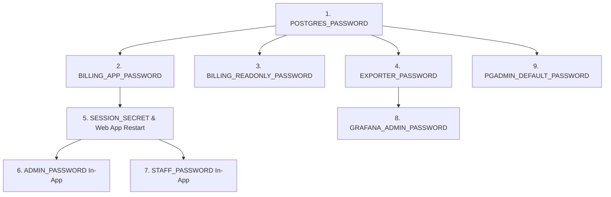

# QUY TRÌNH XOAY VÒNG BÍ MẬT & MẬT KHẨU SẢN XUẤT
# PRODUCTION CREDENTIAL ROTATION SPECIFICATION & RUNBOOK

> **Document Version:** 1.0.0 — Production Readiness  
> **System:** `Billing_One Extended`  
> **Classification:** Security Operations Runbook  
> **Target Environment:** Production Deployment  
> **Prerequisite:** Bắt buộc hoàn tất trước khi mở hệ thống cho người dùng thật (Zero Trust Policy).

---

## 1. NGUYÊN TẮC BẢO MẬT CHUNG
1. **Tuyệt đối không sử dụng mật khẩu ngắn hoặc mật khẩu mặc định:** Mọi mật khẩu sản xuất phải được sinh ngẫu nhiên bằng bộ tạo số giả ngẫu nhiên mật mã (CSPRNG), độ dài tối thiểu 32 ký tự alphanumeric.
2. **Thứ tự xoay vòng nghiêm ngặt:** Cập nhật tài khoản cơ sở dữ liệu trước khi nạp vào ứng dụng web để tránh ngắt kết nối kéo dài.
3. **Không ghi giá trị mật khẩu vào tài liệu, ticket, hoặc nhật ký hệ thống:** Lưu trữ và quản lý thông qua biến môi trường an toàn (hoặc Docker Secret / Vault theo hạ tầng triển khai).

---

## 2. MA TRẬN & THỨ TỰ XOAY VÒNG 9 BIẾN BÍ MẬT (ROTATION MATRIX)

### Thứ tự Thực hiện Đề xuất:
$$\text{Bước 1: DB Roles} \to \text{Bước 2: App & Session} \to \text{Bước 3: App Users} \to \text{Bước 4: Monitoring \& Admin}$$



---

## 3. CHECKLIST CHI TIẾT TỪNG BIẾN BÍ MẬT

### 1. `POSTGRES_PASSWORD`
- **Current source:** Biến môi trường `.env` hoặc Docker compose environment của service `postgres`.
- **New value source:** Vault / AWS Secrets Manager / `openssl rand -hex 32`.
- **Rotation order:** Bước 1 (Khởi đầu - Superuser).
- **Dependencies:** Service `postgres`, `migration`, và các script bảo trì hệ thống.
- **Restart requirements:**
  - Kết nối psql với quyền superuser hiện tại và chạy:
    ```sql
    ALTER USER postgres WITH PASSWORD '<NEW_POSTGRES_PASSWORD>';
    ```
  - Cập nhật biến môi trường trên host/container và recreate container `postgres`.
- **Verification:**
  ```bash
  docker compose exec -e PGPASSWORD="<NEW_VALUE>" postgres psql -U postgres -d billing -c "SELECT 1;"
  ```
- **Rollback consideration:** Giữ mật khẩu cũ trong secret store cho đến khi xác nhận kết nối thành công; nếu lỗi, `ALTER USER postgres WITH PASSWORD '<OLD_VALUE>';`.

---

### 2. `BILLING_APP_PASSWORD`
- **Current source:** Biến môi trường `.env` truyền vào service `postgres` (init) và service `web` (`DB_PASSWORD`).
- **New value source:** Vault / `openssl rand -hex 32`.
- **Rotation order:** Bước 2 (Ngay sau superuser).
- **Dependencies:** Service `web`, pool kết nối `app/src/db.js`, service `migration`.
- **Restart requirements:**
  1. Cập nhật role trong PostgreSQL:
     ```sql
     ALTER ROLE billing_app WITH PASSWORD '<NEW_BILLING_APP_PASSWORD>';
     ```
  2. Cập nhật `.env` cho `BILLING_APP_PASSWORD`.
  3. Khởi động lại service `web`:
     ```bash
     docker compose restart web
     ```
- **Verification:**
  - Kiểm tra log của `web`: `docker compose logs --tail=50 web` (không có lỗi kết nối DB).
  - Kiểm tra endpoint sức khỏe: `curl -k https://localhost/health` (thông qua internal port hoặc nginx).
- **Rollback consideration:** Nếu `web` không kết nối được, đổi ngược lại mật khẩu của role `billing_app` về giá trị cũ.

---

### 3. `BILLING_READONLY_PASSWORD`
- **Current source:** Biến môi trường `.env` truyền vào PostgreSQL init script.
- **New value source:** Vault / `openssl rand -hex 32`.
- **Rotation order:** Bước 2 (Song song với billing_app).
- **Dependencies:** Các công cụ trích xuất báo cáo BI ngoài, pgAdmin read-only connection.
- **Restart requirements:**
  ```sql
  ALTER ROLE billing_readonly WITH PASSWORD '<NEW_BILLING_READONLY_PASSWORD>';
  ```
  Cập nhật file cấu hình và nạp lại vào các công cụ báo cáo. Không yêu cầu khởi động lại service `web`.
- **Verification:**
  ```bash
  docker compose exec -e PGPASSWORD="<NEW_VALUE>" postgres psql -U billing_readonly -d billing -c "SELECT count(*) FROM invoices;"
  ```
- **Rollback consideration:** `ALTER ROLE billing_readonly WITH PASSWORD '<OLD_VALUE>';`.

---

### 4. `EXPORTER_PASSWORD`
- **Current source:** `.env` truyền vào PostgreSQL và Prometheus `postgres-exporter`.
- **New value source:** Vault / `openssl rand -hex 32`.
- **Rotation order:** Bước 2 (Monitoring).
- **Dependencies:** Service `postgres-exporter`, metric scraping endpoint.
- **Restart requirements:**
  1. `ALTER ROLE exporter WITH PASSWORD '<NEW_EXPORTER_PASSWORD>';`
  2. Cập nhật `.env` và restart `postgres-exporter`.
- **Verification:** Kiểm tra metrics tại `http://localhost:9187/metrics` hoặc Grafana datasource.
- **Rollback consideration:** Revert mật khẩu role `exporter`.

---

### 5. `SESSION_SECRET`
- **Current source:** Biến môi trường `SESSION_SECRET` của service `web`.
- **New value source:** `openssl rand -base64 48` (độ dài $\ge 32$ ký tự).
- **Rotation order:** Bước 3 (Tầng ứng dụng).
- **Dependencies:** `express-session`, bảo mật cookie phiên đăng nhập của người dùng.
- **Restart requirements:** Cập nhật `.env` và restart container `web`:
  ```bash
  docker compose restart web
  ```
- **Verification:** Đăng nhập vào hệ thống web, kiểm tra session cookie được thiết lập hợp lệ và bảo mật.
- **Rollback consideration:** Xoay vòng session secret sẽ làm mất hiệu lực toàn bộ session hiện hành của người dùng (người dùng cần đăng nhập lại). Đây là hành vi bảo mật mong muốn sau khi lộ bí mật.

---

### 6. `ADMIN_PASSWORD`
- **Current source:** Bảng `public.users` (băm bcrypt) và biến môi trường test/seed.
- **New value source:** Quản lý mật khẩu quản trị viên doanh nghiệp (1Password / Bitwarden).
- **Rotation order:** Bước 4 (Tài khoản người dùng ứng dụng).
- **Dependencies:** Đăng nhập Web UI quyền `admin`, các kịch bản tự động hóa E2E.
- **Restart requirements:** Không cần restart server; cập nhật trực tiếp qua API đổi mật khẩu hoặc cập nhật mã băm bcrypt trong cơ sở dữ liệu:
  ```bash
  docker compose exec web node -e "
    const bcrypt = require('bcryptjs');
    const { pool } = require('./src/db');
    const hash = bcrypt.hashSync(process.env.NEW_ADMIN_PASS, 10);
    pool.query('UPDATE public.users SET password_hash = \$1 WHERE username = \'admin\'', [hash])
      .then(() => { console.log('Admin password updated successfully'); process.exit(0); });
  "
  ```
- **Verification:** Đăng nhập vào `https://localhost/api/auth/login` với username `admin` và mật khẩu mới.
- **Rollback consideration:** Khôi phục lại mã băm `password_hash` cũ trong bảng `users`.

---

### 7. `STAFF_PASSWORD`
- **Current source:** Bảng `public.users` (băm bcrypt).
- **New value source:** Quản lý mật khẩu nhân viên kế toán.
- **Rotation order:** Bước 4 (Song song với Admin).
- **Dependencies:** Đăng nhập Web UI quyền `staff` (Kế toán viên).
- **Restart requirements:** Cập nhật `password_hash` của user `staff` trong cơ sở dữ liệu tương tự như Admin. Không cần restart server.
- **Verification:** Đăng nhập vào `https://localhost/api/auth/login` với username `staff`.
- **Rollback consideration:** Khôi phục hash cũ.

---

### 8. `PGADMIN_DEFAULT_PASSWORD`
- **Current source:** Biến môi trường `.env` truyền vào service `pgadmin`.
- **New value source:** Mật khẩu ngẫu nhiên quản trị pgAdmin.
- **Rotation order:** Bước 5 (Công cụ quản trị phụ trợ).
- **Dependencies:** Service `pgadmin` (port 5050 - nên tắt hoặc khóa mạng ngoài trong production).
- **Restart requirements:** Cập nhật `.env` và recreate service `pgadmin`:
  ```bash
  docker compose up -d --force-recreate pgadmin
  ```
- **Verification:** Đăng nhập vào pgAdmin web console.
- **Rollback consideration:** Revert giá trị `.env` và restart container.

---

### 9. `GRAFANA_ADMIN_PASSWORD`
- **Current source:** Biến môi trường `.env` (`GF_SECURITY_ADMIN_PASSWORD`).
- **New value source:** Mật khẩu ngẫu nhiên quản trị Grafana.
- **Rotation order:** Bước 5 (Dashboard giám sát).
- **Dependencies:** Service `grafana`.
- **Restart requirements:**
  - Nếu đã có volume dữ liệu `grafana_data`, đổi mật khẩu bằng CLI nội bộ:
    ```bash
    docker compose exec grafana grafana-cli admin reset-admin-password "<NEW_GRAFANA_PASSWORD>"
    ```
  - Cập nhật `.env` cho các lần khởi tạo mới.
- **Verification:** Đăng nhập vào Grafana UI qua `admin` và mật khẩu mới.
- **Rollback consideration:** Reset lại mật khẩu cũ qua `grafana-cli`.

---

## 4. CREDENTIAL ROTATION REMEDIATION & IDENTITY AUDIT (2026-10-08)

### 4.1. Khắc phục Lỗi Cập nhật Hàng loạt & Cơ chế Ánh xạ Tường minh
- **Vấn đề phát hiện:** Script xoay vòng ban đầu sử dụng mệnh đề `WHERE username != 'admin'` và thao tác đồng bộ hash đã khiến các tài khoản test fixture dùng chung password hash với tài khoản `staff`.
- **Hành động khắc phục:**
  1. Tái cấu trúc [`scripts/rotate-credentials.mjs`](file:///c:/Users/phamt/OneDrive/Desktop/Billing_One/scripts/rotate-credentials.mjs):
     - Loại bỏ hoàn toàn mệnh đề `WHERE username != 'admin'` và mọi logic bulk update.
     - Áp dụng cơ chế ánh xạ tường minh 1-1:
       ```sql
       UPDATE public.users SET password_hash = crypt('<ADMIN_PASSWORD>', gen_salt('bf', 12)) WHERE username = 'admin';
       UPDATE public.users SET password_hash = crypt('<STAFF_PASSWORD>', gen_salt('bf', 12)) WHERE username = 'staff';
       ```
     - Tuyệt đối không thay đổi thông tin xác thực của các user ngoài phạm vi xoay vòng.
  2. Bảo mật thực thi SQL: Truyền lệnh SQL cấu hình role và user thông qua **STDIN** của `docker compose exec -T postgres psql`, triệt tiêu rủi ro lộ secret trong tham số dòng lệnh (`ps aux` / shell process arguments).
  3. Khởi động lại `postgres-exporter`: Bổ sung bước recreate service `postgres-exporter` sau khi đổi `EXPORTER_PASSWORD` để bảo đảm kết nối giám sát metrics hoạt động liên tục.

### 4.2. Khôi phục Định danh Người dùng & Triệt tiêu Trùng lặp Hash
- **Kiểm kê Người dùng (Inventory):**
  - **Tài khoản Sản xuất (Production-Relevant):** `admin` (id: 1) và `staff` (id: 2).
  - **Tài khoản Test Fixture (Test-Only):** 20 tài khoản (`gate4_*`, `gate5_*`, `gate6_*`, `gate8_*`, `gate9_*`, `gate10_*`, `p0_*`).
- **Phân tách Credential:** Toàn bộ 20 tài khoản test fixture được gán credential riêng biệt, băm với salt độc lập (`gen_salt('bf', 10)`). Tuyệt đối không dùng chung `STAFF_PASSWORD` của môi trường sản xuất làm shared test password.
- **Kết quả Kiểm tra Va chạm Hash (Hash Collision Verification):**
  ```sql
  SELECT password_hash, count(*) FROM public.users GROUP BY password_hash HAVING count(*) > 1;
  -- Kết quả: 0 rows (ZERO COLLISIONS)
  ```
- **Xác thực Thu hồi Credential cũ (Revocation):**
  - Cả 2 credential thật trước khi xoay vòng (`oldAdminPass`, `oldStaffPass`) bị từ chối 100% với mã phản hồi HTTP `401 Unauthorized`.
  - Cả 2 credential mới sau khi xoay vòng xác thực thành công HTTP `200 OK`.
- **Xác thực Vô hiệu hóa Phiên làm việc (Session Invalidation):**
  - Session cookie được ký bởi `SESSION_SECRET` cũ bị từ chối HTTP `401`.
  - Phiên làm việc mới sau xoay vòng thiết lập thành công.
- **Xác thực Bộ kiểm thử:** Toàn bộ 31/31 Active Suites trong [`scripts/run-all-tests.mjs`](file:///c:/Users/phamt/OneDrive/Desktop/Billing_One/scripts/run-all-tests.mjs) đạt **100% PASS GREEN**.

